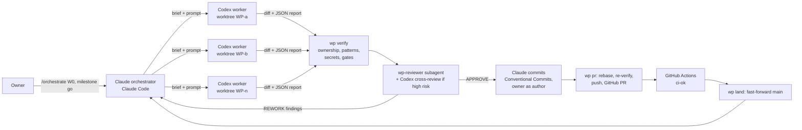
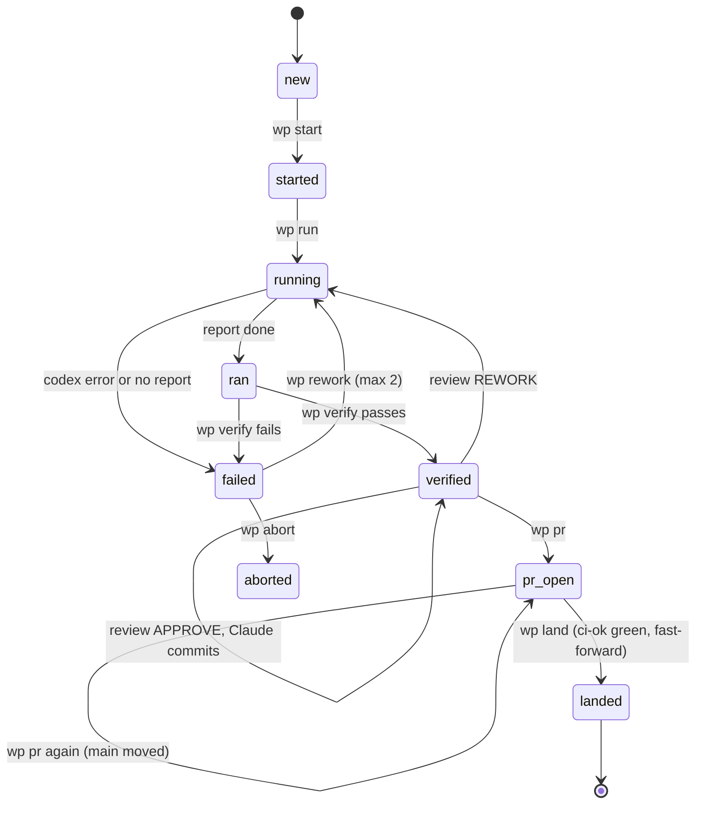
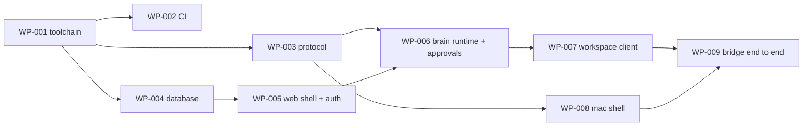

# SV KI-Lotse: build orchestration playbook

This playbook describes how SV KI-Lotse is built:

- **Claude (Opus 5.5) in Claude Code** is the orchestrator, reviewer and integrator.
- **Codex CLI agents (GPT 6.1 Sol)** are parallel workers.
- **GitHub** keeps the record.
- **You**, the owner, are the only commit author and approve each milestone.

The requirements live in `docs/prd/SV-KI-Lotse-PRD.md`. This document covers process, not product.

**Contents**

1. How it works
2. Roles
3. Principles
4. One-time setup
5. Commit, branch and PR standard
6. Work-package lifecycle
7. Waves and work packages
8. Prompts
9. Failure handling
10. Milestone gates
11. Further proposals
12. First steps

---

## 1. How it works



- Each work package (WP) is a small, self-contained unit with a brief: goal, owned paths, acceptance
  criteria and gates.
- A Codex worker implements it in its own git worktree and branch, inside a sandbox, and cannot commit.
- `orchestration/bin/wp` checks the result mechanically: ownership, forbidden patterns, secret scan
  and the brief's gates against real services.
- A fresh Claude reviewer reads the diff against the brief and the PRD.
- Claude writes clean, atomic commits under your identity, opens the PR, waits for CI and
  fast-forwards `main`.
- Up to `MAX_PARALLEL` (8 by default) workers run at once.

## 2. Roles

| Role | Who | Responsibilities | Never |
| --- | --- | --- | --- |
| Owner | You | Accounts and keys, milestone go or no-go, product decisions, macOS permissions on your Mac | Hand-editing worker branches mid-flight |
| Orchestrator | Claude Opus 5.5 in Claude Code (`CLAUDE.md`) | Briefs, scheduling, verification, review coordination, commits, PRs, landing, milestone reports | Writing product code in owned paths, adding AI attribution, pushing `main` outside `wp land` |
| Worker | Codex CLI with GPT 6.1 Sol (`AGENTS.md`, worker prompt) | Implementing one brief inside its paths, running gates, writing the JSON report | Committing, touching paths it does not own, mocks in product code |
| Reviewer | `wp-reviewer` Claude subagent (fresh context); Codex read-only cross-review for `risk: high` | Independent verdict against the brief, PRD and house rules | Editing code |
| CI | GitHub Actions (`ci-ok`) | Server-side proof: verify, commit policy, secrets, integration, container, Swift protocol | Being bypassed |

## 3. Principles

1. **Contracts first.** Protocol, database schema and tool contracts land in W0 and are then frozen.
   Changes go through contract-change WPs (`CCR-n`).
2. **Ownership by path.** Every brief owns explicit path patterns. Two WPs with overlapping paths never
   run at the same time; `wp` refuses that. This is what makes 8 to 10 parallel workers merge cleanly.
3. **Gates are the judge.** A worker's claims are evidence, not proof. `wp verify` runs every gate
   outside the sandbox against real Postgres, MinIO and live providers, and CI runs them again.
4. **Cross-model review.** Codex writes, Claude reviews. High-risk WPs also get an independent Codex
   read-only review.
5. **No mocks in the product.** Either it works or it does not. Test doubles exist only inside test
   files, for isolated units. Build-time stubs sit behind `BRAIN_ALLOW_STUBS`, are unreachable in
   releases, and are gone by M1.
6. **You are the only author.** Every commit on `main` has your name as author and committer, with no
   AI attribution. This is enforced in five places (section 5).
7. **Linear, reviewable history.** One WP is one branch, one PR and a few atomic Conventional Commits.
   It is fast-forwarded onto `main`, so SHAs and signatures stay intact.
8. **Small WPs.** At most about 800 changed lines and one lane each. More, smaller WPs parallelise
   better and review better.
9. **Resumable.** All pipeline state is in `.orchestration/` (state, run logs, journal), so any Claude
   session can pick up where the last one stopped.

## 4. One-time setup

### 4.1 Tools on your Mac

```bash
# Package managers and CLIs
brew install git gh jq node@22 xcodegen swiftlint gitleaks actionlint
corepack enable && corepack prepare pnpm@latest --activate
npm install -g @openai/codex              # Codex CLI; then: codex login
# Claude Code: install per https://docs.claude.com (Claude Code), then: claude login
# Docker Desktop or OrbStack for Postgres and MinIO
# Xcode (current) with command line tools: xcode-select --install
```

### 4.2 Accounts and keys

Keys go into `.env.local`, which is never committed. The ones needed for live CI jobs also go into
GitHub Actions secrets.

| Needed from | Key(s) | Used for |
| --- | --- | --- |
| W0 | `AI_GATEWAY_API_KEY`, `OPENAI_API_KEY` | Model gateway, live tests |
| W0 | `APPROVAL_HMAC_SECRET`, `AUTH_SECRET` (`openssl rand -base64 48`) | Approvals, sessions |
| W0 | `RESEND_API_KEY`, `AUTH_EMAIL_FROM` | Magic-link e-mail (passkeys work without it) |
| W1 | `ELEVENLABS_API_KEY` | Scribe v2 Realtime and TTS |
| W1 | `LANGFUSE_*`, `NEXT_PUBLIC_POSTHOG_*` | Traces and product analytics |
| W1b | `SVBOX_DIR` | Path to the SV-Box data you downloaded (EKO, sample documents, SozDok, fee schedules, forms) |
| W4 | `LIVEKIT_*` | Relatives mode |

### 4.3 Create the repository

```bash
unzip sv-ki-lotse-kit.zip && cd sv-ki-lotse
git config --global user.name  "Julian Schmidt"        # your real identity; it is the only author
git config --global user.email "you@example.com"
# optional but recommended: SSH-signed commits (Verified badges survive fast-forward landing)
git config --global gpg.format ssh
git config --global user.signingkey ~/.ssh/id_ed25519.pub
git config --global commit.gpgsign true                 # add the key on GitHub as a signing key
gh auth login
bash orchestration/bin/bootstrap.sh --github sv-ki-lotse   # private repo, first commit, push
```

Bootstrap does the following:

- initialises git and installs the hooks (`core.hooksPath=.githooks`);
- records your e-mail as the only allowed author (`lotse.authorEmail`);
- sets fast-forward-only pulls;
- creates `.env.local`;
- makes the first commit;
- creates the private GitHub repo;
- sets the `ALLOWED_AUTHOR_EMAIL` repository variable;
- enables only rebase merges with branch deletion on merge.

### 4.4 Configure the pipeline

Edit `orchestration/config.env`, or put personal overrides in `.orchestration/config.local.env`:

- `CODEX_MODEL`: the model id under which your Codex CLI offers GPT 6.1 Sol. Check the model picker
  in the Codex TUI or `codex --help`.
- `CODEX_EFFORT`: `high` by default. A brief can set `codex_effort: xhigh` (contracts, approvals,
  bridge) or `medium` (data entry).
- `MAX_PARALLEL`: `8` (your plan handles 8 to 10). Lower it if you hit rate limits.

Then run:

```bash
orchestration/bin/wp doctor
```

### 4.5 Claude Code settings

`.claude/settings.json` in the repository:

- turns off Claude's commit and PR attribution (`"attribution": {"commit": "", "pr": ""}`);
- allows the pipeline commands;
- denies force pushes, `--no-verify`, `git config` and reading `.env.local`.

If a Claude Code version still adds a trailer, the commit-msg hook strips it.

### 4.6 GitHub protection (after WP-002 lands)

```bash
orchestration/bin/wp protect      # ruleset on main: required check ci-ok, linear history, no force push, no deletion
gh secret set AI_GATEWAY_API_KEY  # and the other live keys for the nightly workflow
```

Rulesets on private repositories need GitHub Pro or Team. Without them, the local hooks, `wp` and the
CI `commits` job still enforce the policy, but GitHub itself does not block direct pushes.

### 4.7 While waves run

- Keep the Mac awake: `caffeinate -dimsu &`.
- Keep `docker compose up -d --wait` running once WP-004 has landed. Every WP gets its own database
  (`lotse_wp_xxx`), created by `wp start` and dropped by `wp land`.
- Grant Screen Recording, Accessibility and Microphone permissions when the Mac app or its test host
  asks. This is a one-time click per binary; the orchestrator will tell you when.

## 5. Commit, branch and PR standard

### 5.1 Conventional Commits

```
type(scope): imperative lower-case subject, at most 72 characters, no period

Body: what changed and why, wrapped at 72 characters. Not how; the diff
shows how. Mention user-visible behaviour, risks and follow-ups.

Refs: WP-006, FR-A2
```

| Type | Use for |
| --- | --- |
| `feat` | New behaviour for users or other packages |
| `fix` | A bug fix (with a regression test) |
| `perf` | A performance improvement without behaviour change |
| `refactor` | A code change without behaviour change |
| `test` | Tests only |
| `docs` | Documentation and ADRs |
| `build` | Toolchain, dependencies, packaging, project generation |
| `ci` | GitHub Actions and CI scripts |
| `chore` | Repository maintenance (imports, orchestration files) |
| `style` | Formatting only |
| `revert` | Reverting a commit |

**Scopes:** `repo deps infra ci orchestration protocol brain engine guards pipeline retrieval documents
approvals db web workspace ui guide knowledge catalog evals mac voice overlay bridge relatives security
adr release`. The canonical list is `LOTSE_SCOPES` in `.githooks/lib.sh`.

**Breaking changes:** `feat(protocol)!: rename action kinds` plus a footer
`BREAKING CHANGE: <what clients must change>`.

**Good and bad headers:**

- Good: `feat(approvals): add server-side approval records with hmac`
- Good: `fix(bridge): reject envelopes from non-workspace origins`
- Bad: `Added approvals.` (no type, capitalised, past tense, period)
- Bad: `feat: stuff` (no scope, vague)
- Bad: `feat(brain): add approvals, fix bridge, update docs` (three changes in one commit)

### 5.2 Atomic commits and linear history

- One logical change per commit, and every commit builds. Tests go with the code they prove, or in a
  directly following `test(...)` commit.
- Typical WP: 2 to 6 commits, for example contracts, implementation, tests, docs or ADR.
- No merge commits and no fixup commits on `main`. `main` only moves by fast-forward through
  `wp land`.

Why fast-forward instead of GitHub's "Rebase and merge" button: GitHub's rebase merge always rewrites
the committer and creates new SHAs. A fast-forward push of the already-rebased, already-verified branch
keeps you as author and committer, keeps the SHAs that CI tested, and keeps SSH signatures valid.
GitHub marks the PR as merged automatically when its head commit reaches `main`.

### 5.3 Branches, PRs and tags

| Item | Convention |
| --- | --- |
| WP branch | `wp/wp-006` (from the brief's `branch` or derived from the id) |
| Orchestrator change | `chore/orch-<slug>` (briefs, templates, config) |
| PR title | The brief's `pr_title`, a Conventional Commit header (the single commit's header when there is one commit) |
| PR body | `orchestration/templates/pr-body.md`: WP, requirements, summary, commits, gates, review verdict |
| Milestone tag | `m0` … `m5`, annotated, on `main`, after your go (`wp tag m0 "M0 Contracts"`) |

### 5.4 How "you are the only author" is enforced

| Layer | Mechanism |
| --- | --- |
| Claude Code | `attribution` set to empty in `.claude/settings.json`; `CLAUDE.md` rule; `git config` denied |
| Codex workers | Cannot commit: no write git commands by rule. In practice the sandbox cannot write the repository's `.git` directory from a worktree. `Co-authored-by` in content fails verification |
| `commit-msg` hook | Strips `Co-authored-by`, "Generated with …", session trailers and the robot emoji, then enforces Conventional Commits and the scope list |
| `pre-commit` hook | Author and committer must equal `lotse.authorEmail`; no env files, local state or files over 5 MB |
| `pre-push` hook | Every pushed commit is re-validated; `main` only moves through `wp land` |
| `wp pr` | Re-validates the branch range before pushing |
| CI `commits` job | Validates the range against the `ALLOWED_AUTHOR_EMAIL` repository variable |
| GitHub ruleset | Required `ci-ok`, linear history, no force push, no deletion |

## 6. Work-package lifecycle

### 6.1 States



### 6.2 Commands

| Step | Command | What happens |
| --- | --- | --- |
| Plan | `wp ready` | WPs whose dependencies have landed |
| Run several | `wp batch WP-101 WP-103 …` | Refuses overlapping claims, then runs `cycle` for each, up to `MAX_PARALLEL` at once |
| Run one | `wp cycle WP-101` | `start` (if needed), `run`, `verify` |
| Start | `wp start WP-101` | Checks dependencies and path overlap; creates the worktree and branch from `origin/main`; copies `.env.local`; creates the per-WP database; `pnpm install` |
| Work | `wp run WP-101` | Renders the worker prompt; `codex exec --json --output-schema … -s workspace-write`; records the report, tokens and thread id |
| Check | `wp verify WP-101` | Worker report, ownership, global forbidden paths, env files, added-line patterns (`.only`, `.skip`, `@ts-ignore`, keys, co-author lines; warnings for `any`, TODO, lint suppressions, Swift force operations), gitleaks, brief gates plus global gates with `.env.local` loaded, gate hygiene |
| Inspect | `wp paths WP-101` | The files the reviewer reads |
| Review | `wp-reviewer` subagent; `wp xreview WP-101` for `risk: high` | `review.md` with APPROVE, REWORK or BLOCK |
| Fix | `wp rework WP-101 findings.md` | New attempt with findings, previous report and gate output |
| Commit | `git -C <worktree> add …` and `commit -F …` | Claude writes the commits; hooks enforce the standard |
| PR | `wp pr WP-101` | Policy check, rebase on `main`, re-verify if `main` moved, push, create or update the PR |
| Land | `wp land WP-101` | Waits for `ci-ok`, fast-forwards `main`, deletes the branch, worktree and database, syncs the root checkout |
| Status | `wp status` | State, attempts, tokens and PR per WP |

### 6.3 Verification depth by risk

| Risk | Automated | Review |
| --- | --- | --- |
| `normal` | `wp verify` + CI | `wp-reviewer` |
| `high` (contracts, approvals, guards, safety net, bridge, auth, deletion, relatives) | `wp verify` + CI; `codex_effort: xhigh` | `wp-reviewer` + `wp xreview`; Claude reconciles both before committing |
| Data (catalog, gold sets) | Schema validation, live link and quote checks, E2 scan | `wp-reviewer` with a sampled source check (5 quotes opened against the live page) |

### 6.4 Rework policy

- Blockers and majors from the review, and any failing gate, go back to the worker in one findings
  file (numbered, file:line, required change).
- Minor findings and nits are either fixed by Claude in a follow-up WP or dropped. They are never
  mixed into a worker's rework.
- After two reworks (`MAX_ATTEMPTS=3`), Claude splits the WP or escalates to you with the evidence.

## 7. Waves and work packages

Briefs for W0 are in `orchestration/wp/W0/`. Claude writes the briefs for later waves from the tables
below. Owned paths are indicative; the brief is authoritative.

### 7.1 Scheduling rules

- **Critical path first.** It runs WP-001 → WP-003 and WP-004 → WP-005 → WP-006 → WP-007 → WP-009 →
  the W1 runtime lanes (102, 104 to 107, 109, 110, 115 to 118) → W2 scenario 3.
- **Pull forward.** A WP of the next wave may start as soon as its dependencies have landed. This keeps
  the 8 to 10 slots busy during the mostly serial W0. Claude lists pulled-forward WPs in the milestone
  report.
- **Exclusive shared files.** Claims on `pnpm-lock.yaml`, `packages/brain/drizzle/**`,
  `apps/mac/project.yml` and `packages/protocol/**` make WPs mutually exclusive automatically.
- **Mac lane** runs on your Mac; at most two Mac WPs run at once, in different LotseKit modules.

### 7.2 W0: foundation and contracts (gate M0)



| WP | Title | Owns (main) | Depends | Risk |
| --- | --- | --- | --- | --- |
| WP-001 | Monorepo toolchain and package skeletons | root config, `packages/**` skeletons | none | normal |
| WP-002 | CI pipeline, commit policy, `ci-ok` | `.github/**`, `scripts/ci/**` | 001 | normal |
| WP-003 | Protocol v1, JSON Schema, Swift types | `packages/protocol/**` | 001 | high |
| WP-004 | Database schema, migrations, Postgres and MinIO | `docker-compose.yml`, `packages/brain/src/{db,storage}/**`, `drizzle/**` | 001 | high |
| WP-005 | Web shell, passkey and magic-link auth, container | `apps/web/**` (not `api/turn`) | 004 | high |
| WP-006 | Brain runtime, tool contracts, server-side approvals, `/api/turn` | `packages/brain/src/{agent,tools,approvals,conversation,gateway,config}/**`, `api/turn` | 003, 005 | high |
| WP-007 | Workspace conversation client, approval card, web bridge | `apps/web/src/{conversation,bridge}/**`, `(workspace)`, `packages/ui/**` | 006 | normal |
| WP-008 | Mac shell from Clicky, XcodeGen, LotseKit, native bridge | `apps/mac/**` | 003 | high |
| WP-009 | Bridge end to end with a live turn | LotseBridge, LotseOverlay, LotseCapture, `apps/mac/{App,E2E}`, web bridge and adapters | 007, 008 | high |

Pull-forward candidates during W0: WP-101 (after 004), WP-103 (after 004), WP-108 (after 003) and
WP-111 (after 001).

### 7.3 W1: brain core, tools and capabilities (gate M1: "all tools real")

| WP | Title | Owns (main) | Depends | Requirements |
| --- | --- | --- | --- | --- |
| WP-101 | Knowledge schemas, YAML loader, E2 generalization scan | `packages/knowledge/src/{schemas,loader}/**`, `scripts/e2-scan` | 004 | FR-G5, E2 |
| WP-102 | Process engine (pure TS) and process tools | `packages/brain/src/engine/**`, `tools/impl/process/**` | 101, 006 | FR-G3, FR-G7, FR-K5, E1 |
| WP-103 | Ingestion: crawl, normalize, chunk, embed, index | `packages/knowledge/src/ingest/**`, `allowlist.yaml`, `sources.yaml` | 004 | §10 ingestion |
| WP-104 | Hybrid retrieval, reranker, query-time synonyms, `kb.search` | `packages/brain/src/retrieval/**`, `tools/impl/kb/**` | 103, 006 | FR-G2, FR-G4, E3 |
| WP-105 | Safety net SR-1, rule guard, boundary classifier, citation verifier | `packages/brain/src/guards/**`, `packages/knowledge/guards/**` | 006 | §4, E5, E6 |
| WP-106 | Turn pipeline, context assembly, segmenter, goal confirmation | `packages/brain/src/{pipeline,context}/**` | 102, 104, 105 | §8, FR-G7, NFR-1 |
| WP-107 | Documents: upload, server OCR, `docs.extractStatements`, fact confirmation API | `packages/brain/src/documents/**`, `tools/impl/docs/**`, `api/{documents,facts}` | 006 | FR-D1–D3, FR-P1, FR-P3, FR-P8, E12 |
| WP-108 | Guide runtime: snapshot, pointing, highlight, fill preview, deny list | `packages/guide/**` | 003 | FR-D4, FR-D7, E8 |
| WP-109 | Mac voice: Scribe realtime (OT-7), TTS WebSocket per turn (OT-11), barge-in, token route | LotseVoice, `api/voice/**`, `packages/brain/src/voice/**` | 009 | FR-C1, FR-C4, E9 |
| WP-110 | Mac overlay actions and resolver (AX, OCR, `/api/resolve` vision fallback) | LotseOverlay, LotseResolver, `api/resolve`, `packages/brain/src/resolve/**` | 009 | FR-C2, FR-C3, FR-C5, E8 |
| WP-111 | Evaluation harness: runner, Wilson intervals, judge, persona simulator, CI subsets | `packages/evals/src/**` | 001 | §14 |
| WP-112 | Workspace core UI: journey map, fact confirmation cards, Why panel, document viewer | `apps/web/src/features/{journey,facts,why,viewer}/**` | 007 | FR-K1, FR-G4, FR-D4, FR-P3 |
| WP-113 | Browser voice (STT and TTS with single-use tokens) | `apps/web/src/voice/**` | 109 | FR-C4, FR-L1 |
| WP-114 | Observability: Langfuse export, PostHog event taxonomy | `packages/brain/src/telemetry/**`, `apps/web/src/analytics/**` | 006 | §15 |
| WP-115 | Forms: `form.getSchema`, `form.prefill` with provenance, `package.build` (pdf-lib) | `packages/brain/src/forms/**`, `tools/impl/form/**` | 101, 006 | FR-D5, FR-D6, E7 |
| WP-116 | Offices and facilities: `office.resolve`, `facility.search` | `tools/impl/{office,facility}/**`, `packages/brain/src/geo/**` | 101, 006 | FR-O1, FR-O2 |
| WP-117 | Appointments: `appointment.search`, `appointment.prepare` (call sheet, e-mail, .ics) | `tools/impl/appointment/**` | 116 | FR-O3, FR-O5 |
| WP-118 | Case tools: `documents.checklist`, `handoff.compose`, step completion wiring | `tools/impl/{documents,handoff,case}/**` | 102 | FR-D9, FR-K3, FR-K5 |

**W1b: data fan-out.** Starts when WP-101 lands. These WPs are data-only, highly parallel, run with
`codex_effort: medium`, and are validated by schemas, live link and quote checks, and E2.

| WP | Title | Owns |
| --- | --- | --- |
| WP-151 | Medical rehabilitation incl. Anschlussheilverfahren (catalog, process, form) | `packages/knowledge/{catalog,processes,forms}/medical-rehabilitation*` |
| WP-152 | Heilbehelfe und Hilfsmittel | `…/heilbehelfe*` |
| WP-153 | Wahlarzt reimbursement and fee-schedule loader (SV-Box) | `…/wahlarzt*`, `packages/knowledge/src/loaders/fees/**`, `tools/impl/fees/**` |
| WP-154 | EKO loader and `eko.lookupCoverage` (SV-Box) | `packages/knowledge/src/loaders/eko/**`, `tools/impl/eko/**` |
| WP-155 | Office directory: carrier Landesstellen and service centres | `packages/knowledge/offices/carriers/**` |
| WP-156 | Office directory: FSW, district authorities, Finanzamt | `packages/knowledge/offices/regional/**` |
| WP-157 | Care bundle (S1): Pflegegeld, Pflegeberatung, mobile services, Pflegekarenz, 24-hour care | `…/pflege*` |
| WP-158 | Prevention (S2): VU, breast and colorectal screening, vaccination programme, Bewegt im Park | `…/praevention*` |
| WP-159 | Family (S4): Eltern-Kind-Pass, Familienbeihilfe, Kinderbetreuungsgeld | `…/familie*` |
| WP-160 | Rezeptgebührenbefreiung, Sozialhilfe per federal state | `…/rezeptgebuehr*`, `…/sozialhilfe*` |
| WP-161 | E5 red-team and benign set (500 labelled) | `packages/evals/sets/e5/**` |
| WP-162 | E3 retrieval gold questions (200, from sources) | `packages/evals/sets/e3/**` |
| WP-163 | E12 extraction gold annotations (SV-Box documents) | `packages/evals/sets/e12/**` |
| WP-164 | E11 slot gold sets (300 utterances) | `packages/evals/sets/e11/**` |
| WP-165 | E7 form prefill gold set (SV-Box forms) | `packages/evals/sets/e7/**` |

### 7.4 W2: first-value slice, scenario 3 end to end (gate M2)

| WP | Title | Depends | Requirements |
| --- | --- | --- | --- |
| WP-201 | Workspace scenario 3 surfaces: form copilot with provenance, document checklist, facility map, appointment options | 112, 115–118 | FR-D5, FR-D9, FR-O2, FR-O3 |
| WP-202 | Mac document import: multi-page screen capture, Continuity Camera, upload queue | 107, 110 | FR-D1, FR-D2 |
| WP-203 | Highlight in source and speech–action sync | 109, 110 | FR-D4, NFR-2 |
| WP-204 | Scenario 3 demo as automated E2E (web and Mac) and E4 S3 variants incl. simple language and voice-and-captions only | 106, 201–203, 111 | E4, FR-L2 |
| WP-205 | E12, E7 and E9 runs to target; fix WPs spawned from findings | 204, 163, 165 | E7, E9, E12 |

### 7.5 W3: breadth (gate M3)

| WP | Title | Requirements |
| --- | --- | --- |
| WP-301 | Subject and actor model; a helper starts a case | FR-P7 |
| WP-302 | Life-situation bundles S1, S2, S4 | FR-G5 |
| WP-303 | Prevention guidance from official programmes | FR-G6 |
| WP-304 | Multilingual, simple language, register and detail preferences | FR-L1–L3, NFR-7 |
| WP-305 | Letter explanation and deadline guard with calendar export | FR-D8, FR-K2 |
| WP-306 | EKO and Wahlarzt flows end to end with boundary cases | FR-M1, FR-M2 |
| WP-307 | Appointment search with preferences end to end | FR-O5 |
| WP-308 | E4 S1–S4 suites, non-brief life situations, E11 to target | E4, E11 |

### 7.6 W4: advanced features (gate M4)

| WP | Title | Requirements |
| --- | --- | --- |
| WP-401 | Relatives backend: invites, join approval, LiveKit tokens, sessions, rate limits | FR-R1, FR-R4, FR-R5 |
| WP-402 | Relatives on the Mac: screen-share publisher, helper cursor, pause word | FR-R2, FR-R3 |
| WP-403 | Helper web client | FR-R2, FR-R3 |
| WP-404 | Circle-to-ask | FR-C6 |
| WP-405 | Guided portal window and L3 booking fill on allowlisted pages | FR-D7, FR-O6, FR-A1 |
| WP-406 | Background jobs runtime and worker route | FR-C10 |
| WP-407 | Autonomy levels UI and voice switching | FR-A1 |
| WP-408 | Call rehearsal and dictation into any app | FR-O4, FR-C8 |
| WP-409 | Human handoff and case history replay | FR-K3, FR-K4 |
| WP-410 | Onboarding, helper-assisted setup, accessibility completion | FR-C7, FR-L4, NFR-6 |

### 7.7 W5: pilot readiness (gate M5)

| WP | Title | Requirements |
| --- | --- | --- |
| WP-501 | Judge calibration (kappa ≥ 0.8) and evaluation dashboard | §14 |
| WP-502 | Portability proof: `ToolLoopAgent` on a non-Vercel host; `WorkflowAgent` on Vercel | NFR-15, M5 |
| WP-503 | Resume-after-crash test | NFR-4 |
| WP-504 | Security pass: threat review, injection suite extension, dependency review | §13, E5 |
| WP-505 | Operations dashboards and alerts | §15 |
| WP-506 | Demo hardening and recorded walkthrough | §2 jury table |

## 8. Prompts

The canonical files are listed below. Claude and `wp` use them directly; the text here is for reading.

| Prompt | File | Used by |
| --- | --- | --- |
| Orchestrator standing instructions | `CLAUDE.md` | Claude Code, every session |
| Worker constitution | `AGENTS.md` (+ per-package `AGENTS.md`) | Codex, every run |
| Worker prompt | `orchestration/templates/worker-prompt.md` | `wp run` |
| Rework section | generated by `wp rework` from the findings file | `wp run --rework` |
| Reviewer | `.claude/agents/wp-reviewer.md` | Claude subagent |
| Codex cross-review | `orchestration/templates/xreview-prompt.md` | `wp xreview` |
| Wave command | `.claude/commands/orchestrate.md` | `/orchestrate <wave>` |
| Milestone command | `.claude/commands/milestone.md` | `/milestone <M>` |
| Brief template | `orchestration/templates/brief.md` | Claude, W1 and later |

### 8.1 Kickoff (type this into Claude Code in the repository)

```text
/orchestrate W0
```

If the slash command is not available, paste:

```text
You are the orchestrator for SV KI-Lotse. Read CLAUDE.md now and follow it exactly; ORCHESTRATION.md
and docs/prd/SV-KI-Lotse-PRD.md are your references. Run orchestration/bin/wp doctor; if it fails,
tell me what to fix and stop. Otherwise run wave W0: start every ready work package with
'orchestration/bin/wp batch' in the background (non-overlapping, up to MAX_PARALLEL), verify each
result, have the wp-reviewer subagent review it (plus 'wp xreview' for risk: high), rework or commit
with Conventional Commits under my git identity with no attribution, open the PR with 'wp pr', land it
with 'wp land', and keep the pipeline full, pulling forward next-wave work packages whose dependencies
have landed. Give me a one-line update per landed work package. When all W0 work packages have landed,
run the M0 gate and stop for my go.
```

### 8.2 Resume (new Claude session or after a break)

```text
/orchestrate resume
```

### 8.3 Worker prompt (rendered per run by `wp run`)

<details>
<summary>orchestration/templates/worker-prompt.md (summary)</summary>

- **Role:** senior engineer on exactly one WP; production quality, reviewed line by line.
- **Before coding:** read the root and package `AGENTS.md`, the referenced PRD sections and the
  existing code; check current library docs (AI SDK 7, Next.js, Drizzle, WebKit, ScreenCaptureKit,
  ElevenLabs).
- **Rules:**
  - only owned paths; no writing git commands; dependencies only per `allow_deps`;
  - no mocks in product code; acceptance tests against real services;
  - never weaken tests; no `.only`, `.skip`, `@ts-ignore` or `any`; no Swift force operations;
  - no secrets; never hand-edit generated files; no domain ids in code; medical boundary;
  - report contract change requests instead of working around them.
- **How:** plan; tests first; minimal idiomatic diff; run all gates (list non-runnable ones under
  `not_run`); update `AGENTS.md`; ADR only if asked; propose atomic Conventional Commits.
- **Final message:** only the JSON report (`orchestration/schemas/worker-report.schema.json`), with
  acceptance evidence and real gate exit codes.
- **Appended:** the rework section (if any) and the full brief.

</details>

### 8.4 Reviewer (subagent)

The reviewer reads the brief, the PRD sections, `AGENTS.md`, `diff.patch`, `report.json`,
`verify.json` and `verify.log`, and checks:

- acceptance (with tests that would fail without the change);
- requirement fidelity;
- scope;
- the no-mock rule;
- security;
- the medical boundary;
- correctness;
- test quality;
- code quality;
- operability;
- the commit plan.

It writes `review.md` with `VERDICT: APPROVE | REWORK | BLOCK` and numbered, severity-tagged findings
that each name a required change. Minor findings and nits never block.

### 8.5 Writing briefs for the next wave (Claude's own prompt)

```text
Write the briefs for wave <Wn> from ORCHESTRATION.md section 7 and the PRD, one file per work package in
orchestration/wp/<Wn>/, using orchestration/templates/brief.md. Each brief: one lane, at most about 800
changed lines, exact non-overlapping owns, PRD sections and FR/NFR IDs, acceptance criteria provable by
tests against real services, gates under five minutes, live_services where real providers are needed,
risk: high for approvals, guards, safety net, bridge, auth, deletion and relatives, codex_effort
(xhigh for high risk, medium for data), and a Conventional pr_title. Split anything larger. Then commit
them through 'wp orch <wn>-briefs' and land that PR before starting the wave.
```

### 8.6 Milestone report

`/milestone M0` makes Claude run the gate on a clean checkout of `main` and report in under 40 lines:

- landed WPs with PR links;
- gate results;
- evaluation numbers;
- deviations and ADRs;
- open contract change requests and follow-ups;
- risks;
- tokens;
- the proposed next batch.

Then it waits for your go and tags the milestone.

## 9. Failure handling

| Symptom | Action |
| --- | --- |
| `wp run` fails (exit code, no report) | `tail .orchestration/runs/<WP>/attempt-n/stderr.log`. Rate limit: lower `MAX_PARALLEL` and re-run. Wrong model id: fix `CODEX_MODEL`. Otherwise `wp run` again; it counts as an attempt. |
| Report `blocked` with a contract change request | Claude writes a `CCR-n` brief on the contract's lane (exclusive). It lands that first, then re-runs the blocked WP. User-visible behaviour changes go to you first. |
| Ownership failure | The worker strayed: rework. If the brief was too narrow, fix the brief through `wp orch` and re-run. |
| Gate fails only outside the sandbox (Docker, xcodebuild, TCC) | Expected: `wp verify` runs those gates. If they fail, rework with the gate output. |
| Rebase conflict in `wp pr` on `pnpm-lock.yaml` | In the worktree: `git checkout --ours pnpm-lock.yaml` (main's version during a rebase), `pnpm install`, `git add`, `git rebase --continue`, then `wp pr` again. |
| Rebase conflict in source files | `git rebase --abort`; rework the WP with the finding "rebase on main; conflict in X with WP-Y". |
| CI red after push | `gh run view --log-failed`. Rework with that output. Never re-run CI in the hope that it passes. |
| Flaky test | Never skip or quarantine. A `fix(...)` WP makes it deterministic. |
| Third attempt fails | Claude splits the WP (smaller scope, clearer contract) or escalates to you with the evidence. |
| Claude's context fills up or the session ends | New session: `/orchestrate resume`; the journal and `wp status` restore the state. |
| A worker produces something good outside its brief | It is not committed. Claude may open a new WP for it. |
| `main` moved during landing | `wp land` refuses; run `wp pr <WP>` (rebase, re-verify, push), wait for CI, then `wp land` again. |

## 10. Milestone gates

The gates follow PRD §18. Claude runs them on a clean checkout of `main` (`/milestone`), and you give
the go.

| Milestone | Gate |
| --- | --- |
| **M0 Contracts** | `wp doctor` green; CI `ci-ok` green on `main`; ruleset active (`wp protect`); protocol Zod, JSON Schema and Swift round-trip pass; container smoke test; approval rejection tests (WP-006 AC4); live turn through `/api/turn`; bridge end-to-end test (WP-009) on your Mac, including a hidden workspace window; the Mac app launches and shows the overlay (your visual check) |
| **M1 Brain core** | E1 and E2 at 100 %; E5 subset zero violations; no stub reachable (`BRAIN_ALLOW_STUBS` unset, E2 scan); scenario 3 benefits in the catalog; every tool real |
| **M2 Scenario 3** | E12 precision gate; E4 scenario 3 variants at target; the demo E2E runs without intervention; voice latency p50 within budget on your Mac |
| **M3 Breadth** | E2 generalization scan; E4 S1–S4 at target; E11 at target |
| **M4 Advanced** | Full E5 zero violations; E8 at target; WCAG 2.2 AA audit; deny-list fixtures pass |
| **M5 Pilot readiness** | All blocking gates; `ToolLoopAgent` on a non-Vercel host and separately `WorkflowAgent` on Vercel; NFR-4 resume test |

## 11. Further proposals

Already built into the kit:

- **Per-WP databases and S3 prefixes.** Parallel integration tests never share state.
- **XcodeGen plus the LotseKit Swift package.** Parallel Mac WPs never conflict on a `.pbxproj`; every
  capability is its own module.
- **Fast-forward landing.** It keeps CI-tested SHAs, your committer identity and signatures; GitHub's
  rebase button would rewrite them.
- **Per-brief reasoning effort** (`codex_effort`): extra-high for contracts and security, medium for
  data entry.
- **Token accounting** per WP in `wp status`, from Codex's `turn.completed` usage.

Worth adding as you go:

1. **Demo as a test.** From W2, the scenario 3 demo runs nightly as an E2E test, so it cannot break
   silently before the pitch.
2. **Changelog from Conventional Commits.** Generate release notes per milestone tag with git-cliff
   (`chore(release)` WP at M2), so the jury can see a professional history.
3. **Pre-mortem per wave.** Before each wave, Claude adds the five most likely failure modes to the
   milestone report and turns the top two into early WPs. OT-7, OT-11 and OT-12 are already
   acceptance items of WP-109 and WP-006 for this reason.
4. **Second macOS user for demos.** A clean account with only the demo's TCC permissions granted, so
   the recorded demo has no surprise permission prompts.
5. **Two-key rule for risky data.** For guard patterns, the safety-net list and the allowlist, Claude
   asks you to skim the diff before landing, as the PRD's "reviewed by a second person" demands.
6. **Live-cost guard.** The nightly live workflow posts token and cost totals to the run summary. If a
   night is more than twice the previous one, the next milestone report flags it.

## 12. First steps

1. Download the SV-Box data yourself (link and password are in the brief PDF) to a folder outside
   the repository, and note its path for `SVBOX_DIR`.
2. Install the tools (4.1) and get the W0 keys (4.2): AI Gateway, OpenAI, Resend; generate
   `APPROVAL_HMAC_SECRET` and `AUTH_SECRET`.
3. Unzip the kit, set your git identity, then run
   `bash orchestration/bin/bootstrap.sh --github sv-ki-lotse` (4.3).
4. Fill in `.env.local`; set `CODEX_MODEL` (4.4); run `orchestration/bin/wp doctor` until it is green.
5. `caffeinate -dimsu &`, then `claude` in the repository folder, then `/orchestrate W0`.
6. When WP-002 has landed: `orchestration/bin/wp protect`, and add the live keys as GitHub secrets
   (4.6).
7. When WP-004 has landed: `docker compose up -d --wait` in the repository folder and leave it running.
8. At M0: review Claude's report, open the Mac app once to check the overlay and grant permissions,
   then say "go".
