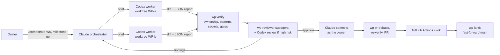
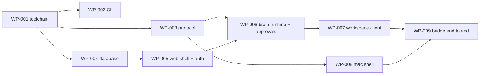

# Orchestration

How SV KI-Lotse is built:

- **Claude** (Claude Code) is the orchestrator, reviewer and integrator. Its rules are in `CLAUDE.md`.
- **Codex CLI workers** (GPT 6.1 Sol) implement work packages in parallel. Their rules are in
  `AGENTS.md`.
- **You** are the only commit author and approve each milestone.

Requirements: `docs/prd/SV-KI-Lotse-PRD.md`. Challenge data: `data/svbox/`, described in
`docs/svbox-inventory.md`.

## How it works



- **One brief per work package (WP).** Each brief (`orchestration/wp/<wave>/`) gives the goal, owned
  paths, acceptance criteria and gates.
- **One worker per WP.** A Codex worker implements it in its own git worktree and branch, inside a
  sandbox, and cannot commit.
- **Checks.** `wp verify` checks ownership, forbidden patterns and secrets, and runs the gates against
  real services. A fresh Claude reviewer then checks the diff against the brief and the PRD.
- **Landing.** Claude commits under your identity, `wp pr` opens the pull request, and `wp land`
  fast-forwards `main` once CI is green.
- **Parallelism.** Up to `MAX_PARALLEL` workers (16) run at once. WPs that claim overlapping paths
  never run together.

## Setup

1. Install Homebrew and Xcode.
2. Run `orchestration/bin/setup`. It is safe to re-run and:
   - installs what is missing: Node 22+, Bun 1.4+, Docker (OrbStack), `gh`, `jq`, Codex CLI,
     `xcodegen`, `swiftlint`, `gitleaks`, `actionlint`;
   - runs `gh auth login` and `codex login` if needed;
   - runs `bun install`, which installs the husky hooks;
   - creates or completes `.env.local` without overwriting existing values: it asks for
     `OPENAI_API_KEY` and generates `SESSION_SECRET`, `APPROVAL_HMAC_SECRET` and `CRON_SECRET`;
   - runs `orchestration/bin/wp doctor`.
3. Before W1, add the ElevenLabs key and voice ids to `.env.local`.
4. Optional: `orchestration/config.env` runs 16 workers on GPT 6.1 Sol (`gpt-6.1-sol`) at `xhigh`
   effort. Override any of these in `.orchestration/config.local.env`; lower `MAX_PARALLEL` only if
   workers hit rate limits.
5. Run `caffeinate -dimsu &`, start `claude` in the repository, then run `/orchestrate W0`.

Local development, workers and CI use Postgres and MinIO from docker compose. The deployed app
(Vercel `fra1`) uses Neon for `DATABASE_URL` (EU region, `?sslmode=require`) and Cloudflare R2 for
the `S3_*` variables (`S3_REGION=auto`, endpoint `https://<account>.r2.cloudflarestorage.com`), set
as Vercel environment variables.

After WP-002 lands:

```bash
gh variable set ALLOWED_AUTHOR_EMAIL --body "$(git config user.email)"
orchestration/bin/wp protect
```

`wp protect` sets a ruleset on `main`: the `ci-ok` check is required, history stays linear, and force
pushes are blocked. After WP-004 lands, keep `docker compose up -d --wait` running; each WP gets its
own database.

## Commit standard

Conventional Commits, enforced by husky (`commit-msg`, `pre-commit`, `pre-push`), commitlint,
`wp pr` and CI:

```
type(scope): imperative lower-case subject, at most 72 characters

Body: what and why, wrapped at 72.

Refs: WP-006, FR-A2
```

- **Types:** feat, fix, perf, refactor, test, docs, build, ci, chore, style, revert.
- **Scopes:** the `scope-enum` list in `commitlint.config.mjs`.
- **Atomic commits.** Each commit is one logical change and builds on its own.
- **Linear history.** No merge or fixup commits on `main`.
- **Author.** The author and committer are always your configured git identity. AI attribution lines
  are stripped by `commit-msg` and rejected by commitlint and CI.
- **How `main` moves.** Only by fast-forward through `wp land`; the `pre-push` hook blocks everything
  else. This keeps the SHAs that CI tested, keeps you as committer, and keeps signatures intact.

## Pipeline commands

| Step | Command |
| --- | --- |
| Ready WPs | `wp ready` |
| Run a batch | `wp batch WP-101 WP-103 …` (start, Codex run and verify; refuses overlapping claims) |
| Run one | `wp cycle WP-101` |
| Verify again | `wp verify WP-101` |
| Reviewer inputs | `wp paths WP-101` |
| Codex cross-review | `wp xreview WP-101` |
| Rework | `wp rework WP-101 findings.md` (at most two reworks) |
| Commit | `git -C <worktree> add <files>` and `git -C <worktree> commit -F <message>` |
| PR | `wp pr WP-101` (policy check, rebase on main, re-verify if main moved, push, PR) |
| Land | `wp land WP-101` (waits for `ci-ok`, fast-forwards main, cleans up) |
| Orchestrator-only change | `wp orch <slug>`, edit, commit, then `wp pr` and `wp land` |
| Status | `wp status`; the journal is in `.orchestration/journal.md` |

**Verification depth:**

| Risk | Checks |
| --- | --- |
| `normal` | `wp verify`, the `wp-reviewer` subagent, CI |
| `high` (contracts, approvals, guards, safety net, bridge, sessions, deletion, relatives) | Same, plus `codex_effort: xhigh` and `wp xreview`; Claude reconciles both reviews |
| Data (catalog, gold sets) | Schema validation, live link and quote checks, E2 |

## Waves

Briefs for W0 are written. Claude writes the briefs for later waves from these tables, using
`orchestration/templates/brief.md`, and lands them through `wp orch`. A WP of the next wave may start
as soon as its dependencies have landed.

### W0: foundation and contracts (gate M0)



| WP | Title | Owns (main) | Depends | Risk |
| --- | --- | --- | --- | --- |
| WP-001 | Monorepo toolchain and package skeletons | root config, `packages/**` skeletons | none | normal |
| WP-002 | CI pipeline, commit policy, `ci-ok` | `.github/**`, `scripts/ci/**` | 001 | normal |
| WP-003 | Protocol v1, JSON Schema, Swift types | `packages/protocol/**` | 001 | high |
| WP-004 | Database schema, migrations, Postgres and MinIO | `docker-compose.yml`, `packages/brain/src/{db,storage}/**`, `drizzle/**` | 001 | high |
| WP-005 | Web shell, anonymous sessions, container | `apps/web/**` (not `api/turn`) | 004 | high |
| WP-006 | Brain runtime, tool contracts, server-side approvals, `/api/turn` | `packages/brain/src/{agent,tools,approvals,conversation,models,config}/**`, `api/turn` | 003, 005 | high |
| WP-007 | Workspace conversation client, approval card, web bridge | `apps/web/src/{conversation,bridge}/**`, `(workspace)`, `packages/ui/**` | 006 | normal |
| WP-008 | Mac shell from Clicky, XcodeGen, LotseKit, native bridge | `apps/mac/**` | 003 | high |
| WP-009 | Bridge end to end with a live turn | LotseBridge, LotseOverlay, LotseCapture, `apps/mac/{App,E2E}`, web bridge and adapters | 007, 008 | high |

Pull-forward candidates during W0: WP-101 (after 004), WP-103 (after 004), WP-108 (after 003),
WP-111 (after 001), WP-166 (after 004) and WP-120 (after 004).

### W1: brain core, tools and capabilities (gate M1: "all tools real")

| WP | Title | Owns (main) | Depends | Requirements |
| --- | --- | --- | --- | --- |
| WP-101 | Knowledge schemas, YAML loader, E2 generalization scan | `packages/knowledge/src/{schemas,loader}/**`, `scripts/e2-scan` | 004 | FR-G5, E2 |
| WP-102 | Process engine (pure TS) and process tools | `packages/brain/src/engine/**`, `tools/impl/process/**` | 101, 006 | FR-G3, FR-G7, FR-K5, E1 |
| WP-103 | Ingestion: crawl, normalize, chunk, embed, index | `packages/knowledge/src/ingest/**`, `allowlist.yaml`, `sources.yaml` | 004 | §10 ingestion |
| WP-104 | Hybrid retrieval, reranker, query-time synonyms, `kb.search` | `packages/brain/src/retrieval/**`, `tools/impl/kb/**` | 103, 006 | FR-G2, FR-G4, E3 |
| WP-105 | Safety net SR-1, rule guard, boundary classifier, citation verifier | `packages/brain/src/guards/**`, `packages/knowledge/guards/**` | 006 | §4, E5, E6 |
| WP-106 | Turn pipeline, context assembly, segmenter, goal confirmation | `packages/brain/src/{pipeline,context}/**` | 102, 104, 105 | §8, FR-G7, NFR-1 |
| WP-107 | Documents: upload, server OCR, `docs.extractStatements`, fact confirmation API | `packages/brain/src/documents/**`, `tools/impl/docs/**`, `api/{documents,facts}` | 006 | FR-D1–D3, FR-P1, FR-P3, FR-P8, E12 |
| WP-108 | Guide runtime: snapshot, pointing, highlight, fill preview, deny list | `packages/guide/**` | 003 | FR-D4, FR-D7, E8 |
| WP-109 | Mac voice: Scribe realtime (OT-7), TTS WebSocket per turn (OT-11), barge-in, token route | LotseVoice, `api/voice/**`, `packages/brain/src/voice/**` | 009 | FR-C1, FR-C4, E9 |
| WP-110 | Mac overlay actions and resolver (AX, OCR, `/api/resolve` vision fallback) | LotseOverlay, LotseResolver, `api/resolve`, `packages/brain/src/resolve/**` | 009 | FR-C2, FR-C3, FR-C5, E8 |
| WP-111 | Evaluation harness: runner, Wilson intervals, judge, persona simulator, CI subsets | `packages/evals/src/**` | 001 | §14 |
| WP-112 | Workspace core UI: journey map, fact confirmation cards, Why panel, document viewer | `apps/web/src/features/{journey,facts,why,viewer}/**` | 007 | FR-K1, FR-G4, FR-D4, FR-P3 |
| WP-113 | Browser voice (STT and TTS with single-use tokens) | `apps/web/src/voice/**` | 109 | FR-C4, FR-L1 |
| WP-114 | Observability: Langfuse export, PostHog event taxonomy | `packages/brain/src/telemetry/**`, `apps/web/src/analytics/**` | 006 | §15 |
| WP-115 | Form engine core: template registry, `form.getSchema`, `form.prefill` with provenance, draft instances, `form.commitGroup`, `package.build` (pdf-lib, AcroForm and added fields) | `packages/brain/src/forms/{registry,instances,output}/**`, `tools/impl/form/**`, `api/forms/**` | 101, 006 | FR-D5, FR-D6, E7 |
| WP-119 | Form acquisition: `form.find`, `form.acquire` from allowlisted official sites, versioning and re-check | `packages/brain/src/forms/acquire/**`, `packages/knowledge/forms/sources.yaml` | 115 | FR-D10 |
| WP-120 | Field detection for flat and scanned PDFs: text layer, vector boxes, OCR and vision fallback, owner sections; `form.analyze`; E13 harness | `packages/brain/src/forms/detect/**`, `packages/evals/src/e13/**` | 004 | FR-D11, E13 |
| WP-121 | Live-fill viewer: pdf.js document viewer with field overlay, typing animation, draft and confirmed states, source chips, `TargetRect`, `form.fillLive` | `apps/web/src/features/form-viewer/**`, `tools/impl/form-live/**` | 112, 115 | FR-D5, FR-L4 |
| WP-116 | Offices and facilities: `office.resolve`, `facility.search` | `tools/impl/{office,facility}/**`, `packages/brain/src/geo/**` | 101, 006 | FR-O1, FR-O2 |
| WP-117 | Appointments: `appointment.search`, `appointment.prepare` (call sheet, e-mail, .ics) | `tools/impl/appointment/**` | 116 | FR-O3, FR-O5 |
| WP-118 | Case tools: `documents.checklist`, `handoff.compose`, step completion wiring | `tools/impl/{documents,handoff,case}/**` | 102 | FR-D9, FR-K3, FR-K5 |

**W1b: data fan-out.** Starts when WP-101 lands. These WPs are data-only, highly parallel, run with
`codex_effort: medium`, and are validated by schemas, live link and quote checks, and E2.

| WP | Title | Owns |
| --- | --- | --- |
| WP-151 | Medical rehabilitation incl. Anschlussheilverfahren (catalog, process, form) | `packages/knowledge/{catalog,processes,forms}/medical-rehabilitation*` |
| WP-152 | Heilbehelfe und Hilfsmittel | `…/heilbehelfe*` |
| WP-153 | Wahlarzt reimbursement and fee-schedule loader (SV-Box) | `…/wahlarzt*`, `packages/knowledge/src/loaders/fees/**`, `tools/impl/fees/**` |
| WP-154 | EKO loader (fixed-width, Windows-1252) and `eko.lookupCoverage` with substance-level answers (SV-Box) | `packages/knowledge/src/loaders/eko/**`, `tools/impl/eko/**` |
| WP-155 | Office directory: carrier Landesstellen and service centres | `packages/knowledge/offices/carriers/**` |
| WP-156 | Office directory: FSW, district authorities, Finanzamt | `packages/knowledge/offices/regional/**` |
| WP-157 | Care bundle (S1): Pflegegeld, Pflegeberatung, mobile services, Pflegekarenz, 24-hour care | `…/pflege*` |
| WP-158 | Prevention (S2): VU, breast and colorectal screening, vaccination programme, Bewegt im Park | `…/praevention*` |
| WP-159 | Family (S4): Eltern-Kind-Pass, Familienbeihilfe, Kinderbetreuungsgeld | `…/familie*` |
| WP-160 | Rezeptgebührenbefreiung, Sozialhilfe per federal state | `…/rezeptgebuehr*`, `…/sozialhilfe*` |
| WP-161 | E5 red-team and benign set (500 labelled) | `packages/evals/sets/e5/**` |
| WP-162 | E3 retrieval gold questions (200, from sources) | `packages/evals/sets/e3/**` |
| WP-163 | E12 extraction gold annotations (SV-Box documents) | `packages/evals/sets/e12/**` |
| WP-164 | E11 slot gold sets (300 utterances) | `packages/evals/sets/e11/**` |
| WP-165 | E7 form prefill gold set (SV-Box forms) | `packages/evals/sets/e7/**` |
| WP-166 | SozDok XML loader: 14,244 paragraph versions, in-force selection, paragraph chunks, citation metadata | `packages/knowledge/src/loaders/sozdok/**` |
| WP-167 | ÖGK service guide 2026 as catalog seed: quoted records for the benefits it covers | `packages/knowledge/catalog/oegk-*` |
| WP-168 | SV-Box form templates: register the 7 forms, map fields to fact types from label positions, owner sections, reviewed schemas | `packages/knowledge/forms/svbox-*` |
| WP-169 | E13 gold set: 20 flat official forms from allowlisted sites with hand-drawn gold boxes | `packages/evals/sets/e13/**` |

### W2: first-value slice, scenario 3 end to end (gate M2)

| WP | Title | Depends | Requirements |
| --- | --- | --- | --- |
| WP-201 | Workspace scenario 3 surfaces: live form filling of the SV-Box forms, document checklist, facility map, appointment options | 112, 115–121 | FR-D5, FR-D9, FR-O2, FR-O3 |
| WP-202 | Mac document import: multi-page screen capture, Continuity Camera, upload queue | 107, 110 | FR-D1, FR-D2 |
| WP-203 | Highlight in source, speech–action sync, and the Mac cursor flying to form fields (`TargetRect`) while typing | 109, 110, 121 | FR-D4, FR-D5, NFR-2 |
| WP-206 | Live acquisition demo: the prescription-fee exemption form found, downloaded, analysed and filled live | 119, 120, 121 | FR-D10, FR-D11 |
| WP-204 | Scenario 3 demo as automated E2E (web and Mac) and E4 S3 variants incl. simple language and voice-and-captions only | 106, 201–203, 111 | E4, FR-L2 |
| WP-205 | E12, E7 and E9 runs to target; fix WPs spawned from findings | 204, 163, 165 | E7, E9, E12 |

### W3: breadth (gate M3)

| WP | Title | Requirements |
| --- | --- | --- |
| WP-301 | Subject and actor model; a helper starts a case | FR-P7 |
| WP-302 | Life-situation bundles S1, S2, S4 | FR-G5 |
| WP-303 | Prevention guidance from official programmes | FR-G6 |
| WP-304 | Multilingual, simple language, register and detail preferences | FR-L1–L3, NFR-7 |
| WP-305 | Letter explanation and deadline guard with calendar export | FR-D8, FR-K2 |
| WP-306 | EKO and Wahlarzt flows end to end with boundary cases | FR-M1, FR-M2 |
| WP-307 | Appointment search with preferences end to end | FR-O5 |
| WP-308 | E4 S1–S4 suites, non-brief life situations, E11 to target | E4, E11 |

### W4: advanced features (gate M4)

| WP | Title | Requirements |
| --- | --- | --- |
| WP-401 | Relatives backend: invites, join approval, LiveKit tokens, sessions, rate limits | FR-R1, FR-R4, FR-R5 |
| WP-402 | Relatives on the Mac: screen-share publisher, helper cursor, pause word | FR-R2, FR-R3 |
| WP-403 | Helper web client | FR-R2, FR-R3 |
| WP-404 | Circle-to-ask | FR-C6 |
| WP-405 | Guided portal window and L3 booking fill on allowlisted pages | FR-D7, FR-O6, FR-A1 |
| WP-406 | Background jobs runtime and worker route | FR-C10 |
| WP-407 | Autonomy levels UI and voice switching | FR-A1 |
| WP-408 | Call rehearsal and dictation into any app | FR-O4, FR-C8 |
| WP-409 | Human handoff and case history replay | FR-K3, FR-K4 |
| WP-410 | Onboarding, helper-assisted setup, accessibility completion | FR-C7, FR-L4, NFR-6 |

### W5: pilot readiness (gate M5)

| WP | Title | Requirements |
| --- | --- | --- |
| WP-501 | Judge calibration (kappa ≥ 0.8) and evaluation dashboard | §14 |
| WP-502 | Portability proof: `ToolLoopAgent` on a non-Vercel host; `WorkflowAgent` on Vercel | NFR-15, M5 |
| WP-503 | Resume-after-crash test | NFR-4 |
| WP-504 | Security pass: threat review, injection suite extension, dependency review | §13, E5 |
| WP-505 | Operations dashboards and alerts | §15 |
| WP-506 | Demo hardening and recorded walkthrough | §2 jury table |

### W6 (optional, only if time allows): native conversation view

| WP | Title | Requirements |
| --- | --- | --- |
| WP-601 | SwiftUI conversation panel that mirrors the embedded workspace conversation over the bridge (a view, not a second client) | PRD §9 "Native conversation view" |

## Failure handling

| Symptom | Action |
| --- | --- |
| Codex run fails or writes no report | Read `stderr.log` in the run folder. On rate limits, lower `MAX_PARALLEL`; then run `wp run` again |
| Contract change request | A `CCR-n` WP changes the contract first; then the blocked WP runs again |
| Ownership failure | Rework; if the brief was too narrow, fix the brief through `wp orch` |
| Lockfile conflict in `wp pr` | Take main's lockfile: `git checkout --ours bun.lock`, `bun install`, `git add`, `git rebase --continue` |
| Source conflict in `wp pr` | `git rebase --abort`; rework the WP with the conflict as a finding |
| CI red | Read `gh run view --log-failed` and rework with its output; never just re-run |
| Flaky test | A `fix(...)` WP makes it deterministic; tests are never skipped |
| Third attempt fails | Split the WP or escalate to the owner |
| New Claude session | `/orchestrate resume` |

## Milestone gates

The gates follow PRD §18. `/milestone <M>` runs the gate on a clean checkout of `main`, reports, and
waits for your go before it tags `m0` … `m5`.

| Milestone | Gate |
| --- | --- |
| M0 | `wp doctor` green; CI green; ruleset active; protocol round-trip passes; container smoke test passes; approval rejection tests pass; a live turn works; the bridge end-to-end test passes on your Mac |
| M1 | E1 and E2 at 100 %; E5 subset with zero violations; no stub reachable; every tool real |
| M2 | Scenario 3 end to end with live form filling; E12; E4 scenario 3 variants; voice latency within budget |
| M3 | E2 generalization scan; E4 S1–S4; E11 |
| M4 | Full E5 at zero violations; E8; WCAG 2.2 AA audit; deny-list fixtures pass |
| M5 | All blocking gates; `ToolLoopAgent` on a non-Vercel host and `WorkflowAgent` on Vercel; resume test passes |
