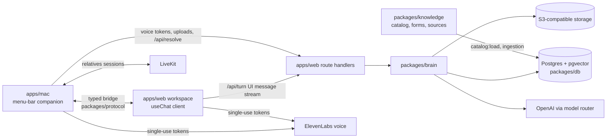

# SV KI-Lotse

SV KI-Lotse is a voice-first, screen-aware guide through Austria's health and social insurance
system, built for the Dachverband KI Challenge (Use Case 1). It understands a person's situation and
goal, finds the relevant benefits with sources, and carries them through to concrete next steps:
pre-filled forms, required documents, the responsible office, a suitable facility and a prepared
appointment. Benefits, processes, forms and offices are data, not code.

The requirements are in the [product requirements document](docs/prd/SV-KI-Lotse-PRD.md).

## Capabilities

| Area | What it does |
| --- | --- |
| Companion | Hold a key and speak; the Mac companion sees the screen, answers out loud and points at, highlights or circles what matters. The same loop runs in the browser. |
| Understanding and guidance | Turns a colloquial description or a document into relevant benefits inside and outside social insurance, with criteria and a citation for every claim. Confirms the goal and asks only what the next step needs. |
| Documents and forms | Imports documents by upload, scan or screen capture; extracts verbatim recommendations and administrative facts with their position. Finds, acquires and analyses official forms, fills them live with a source per value, and renders PDFs from confirmed values only. |
| Offices, facilities and appointments | Resolves the responsible office, searches facilities on a map and prepares appointments (call sheet, e-mail draft, calendar hold). It never books or submits. |
| Case management | Cases with a journey map, steps, document checklists, reminders, deadlines, background jobs and a handoff summary for counselors. |
| User context | Facts are saved only after the user confirms them; export and deletion of all data; anonymous sessions. |
| Relatives mode | A helper joins by invite, sees the shared screen and guides with a second cursor; approvals stay with the person. |
| Autonomy, language and accessibility | Autonomy levels L1 (show me) to L3 (prepare a package), any supported language, simple language, chosen level of detail, voice or text, WCAG 2.2 AA. |
| Medicines (administrative only) | EKO coverage and prescription-fee questions; never medical advice. |

## Architecture



| Part | Role |
| --- | --- |
| `apps/web` | Next.js App Router. The workspace UI is the only conversation client (AI SDK UI `useChat`), in the browser and inside the Mac app. Route handlers under `src/app/api` host the brain, anonymous sessions and voice-token minting; they contain no business logic. |
| `apps/mac` | SwiftUI/AppKit menu-bar app derived from Clicky (MIT). A capability provider for the embedded workspace: push-to-talk, screen capture and OCR, speech playback, the companion cursor, encrypted upload queue, guided portal windows and relatives screen sharing. It holds no provider key, no conversation logic and no fact store. |
| `packages/brain` | Agent runtime (AI SDK `ToolLoopAgent` with tool approvals), process engine, retrieval, context assembly, form engine, guards, model router and persistence. |
| `packages/protocol` | Zod schemas for every message between brain and clients, with generated JSON Schema and Swift types. |
| `packages/guide` | Page runtime injected into the workspace and guided windows: page snapshot, pointing, highlighting and visible typing. |
| `packages/knowledge` | Sourced YAML catalog (benefits, processes, forms, offices, facilities), allowlist, guard patterns, loaders and the ingestion pipeline for official pages and SozDok law texts. |
| `packages/db` | Drizzle schema, SQL migrations and the S3 storage client. |
| `packages/ui` | Shared React components and design tokens. |
| `packages/evals` | Evaluation suites E1 to E13, personas, rubrics and red-team sets. |

A turn flows like this: the Mac app captures speech and screen context and passes the transcript
over the bridge to the workspace; the workspace sends it to `/api/turn`; the brain answers with a
stream of text, speech segments and actions; the workspace forwards them over the bridge, and the
Mac app speaks each sentence and fires its actions. Approval-gated tools are checked against a
server-side approval record before they run.

## Setup

Prerequisites: Bun 1.4.4, Node.js 22 or later, Docker with Compose. For the Mac app: macOS 14.2 or
later, Xcode with Swift 6, XcodeGen and SwiftLint. The challenge's SV-Box files are not in git: put
them in `data/svbox/` (the SozDok XML snapshot in `data/svbox/Rechtstexte/`) or point `SVBOX_DIR` at
their folder.

```sh
bun install
cp .env.example .env.local
```

In `.env.local`, set `SESSION_SECRET`, `APPROVAL_HMAC_SECRET` and `CRON_SECRET` to separate random
values (`openssl rand -base64 48`), `OPENAI_API_KEY`, and the `ELEVENLABS_*` values for provider
voice. The local database, storage and LiveKit defaults match Docker Compose. Every variable is
described in [.env.example](.env.example).

Start the services, migrate and load data:

```sh
docker compose up -d --wait                        # Postgres/pgvector :5432, MinIO :9000, LiveKit :7880
bun run --filter @lotse/db db:migrate
bun run --filter @lotse/knowledge catalog:load     # benefits, processes, offices, facilities, forms
bun run --filter @lotse/knowledge sozdok:load      # SozDok law texts from SV-Box
bun run --filter @lotse/knowledge ingest:pilot     # official pages and provisions with embeddings
bun run ingest:e3                                  # optional: the E3 retrieval corpus
```

`catalog:load` prunes entries that are no longer in the files, so use a development database.
Ingestion needs network access and an OpenAI key; `ingest:pilot --dry-run` checks page extraction
without writing or embedding.

For the Mac app, `scripts/local/start.sh` does all of this idempotently in a separate `lotse_app`
database, builds the web app and serves it on :3000 in the background (log: `../sv-lotse-local.log`).
`LOTSE_PROVIDER_ENV_FILE` may point at a file with `OPENAI_BASE_URL`/`OPENAI_API_KEY` for a compatible endpoint.

Run the workspace and open <http://localhost:3000>:

```sh
bun run --filter @lotse/web dev
```

Checks:

```sh
bun run verify                    # lint, typecheck and unit tests
bun run typecheck
bun run test
bun run test:integration          # needs the Compose services
RUN_LIVE=1 bun run test:live      # paid provider calls
```

Use `bun run test`, not Bun's built-in `bun test`.

## Mac app

Start the web workspace first, then:

```sh
cd apps/mac
xcodegen generate
open SVKILotse.xcodeproj
```

Run the `SVKILotse` scheme. The app connects to `http://localhost:3000`; set `LOTSE_WORKSPACE_URL`
in the launch environment or as a build setting for another origin. The menu-bar menu opens the
dashboard, a new chat, settings and the setup guide, which walks through the macOS permissions.
Hold Control–Shift–Space to speak. Details are in the [Mac README](apps/mac/README.md).

## Scenario 3 demo

The demo takes the fictional discharge letter from the SV-Box to a rehabilitation application,
office, documents, facility and prepared appointment.

```sh
bun run demo:seed --catalog-only
bun run --filter @lotse/web dev --webpack
RUN_LIVE=1 bun run demo:e2e       # automated live rehearsal on a disposable database
```

The click-and-say script is in [docs/demo/run.md](docs/demo/run.md).

## Evaluation

```sh
bun run evals                                     # available suites, writes a summary JSON
bun run evals --suite E3,E13 --out /tmp/evals/summary.json
bun run --filter @lotse/evals eval:e4 --scenarios s3
```

Suites that call models need `OPENAI_API_KEY` and incur provider costs. Measured results and their
limits are in [docs/evals/results.md](docs/evals/results.md).

## Research

Lotse-RL is a research lane on top of the product: a benefits-navigation gym whose rewards come
from the catalog's executable eligibility rules, open models trained and evaluated in it, and
quantum optimization studies on real catalog instances. The plan is in
[docs/research/lotse-rl.md](docs/research/lotse-rl.md). Training and evaluation code lives in
[ml/](ml/) (Python 3.12, managed with `uv`; results are written to `ml/results/`), and the preprint
sources in [paper/](paper/).

## Deployment

**Container.** `apps/web/Dockerfile` builds the Next.js standalone server into a Node 22 image. It
listens on port 3000, applies migrations on start and reports readiness at `/api/health`.

```sh
docker build -f apps/web/Dockerfile -t lotse-web .
bash apps/web/scripts/container-smoke.sh          # builds, migrates and checks against Compose
```

Run the image next to Postgres with pgvector and an S3-compatible bucket. Inject the server
variables from `.env.example` at runtime (never at build time), set `LOTSE_WORKSPACE_URL` to the
public HTTPS origin, and terminate TLS at a reverse proxy. Mount the SV-Box files read-only at
`/data/svbox`. Load the catalog with the commands above against the target database. Schedule a
POST to `/api/jobs/worker` every minute with `Authorization: Bearer <CRON_SECRET>` for background
jobs.

**Vercel.** `apps/web/vercel.json` pins functions to Frankfurt (`fra1`) and runs the job worker as a
cron every minute. Set the project root to `apps/web` and add the same environment variables in the
project settings.

## Safety boundaries

The pilot never diagnoses, interprets findings, assesses risk or recommends therapy or medication;
it quotes what a document says and helps with the administration. Every claim carries a source.
It never submits applications, books appointments, sends messages or handles credentials:
approval-gated actions require a server-side approval record the user created. Provider keys stay
on the server; clients receive short-lived single-use tokens. Facts are stored only after the user
confirms them, and the user can export or delete everything.

The Mac app is derived from Clicky (MIT); see the
[third-party notices](apps/mac/THIRD_PARTY_NOTICES.md).
