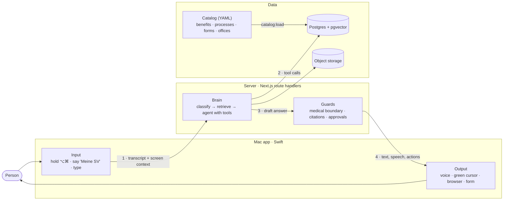

# Attention Seekers

<p>
  <a href="paper/lotse-rl.pdf"></a>
  <a href="https://huggingface.co/datasets/JulianAT/at-benefits"></a>
  <a href="https://huggingface.co/JulianAT/sv-lotse-qwen3-8b-sft"></a>
</p>


**SV KI-Lotse** is a voice-first guide through Austria's social insurance, built for the
Dachverband KI Challenge (Use Case 1). A person describes their situation in their own words; the
Lotse finds the benefits that apply, the responsible office, the documents and the next step, with
a source for every claim. It opens the official page, points at what matters and fills the form,
but never submits anything.

## How it works

The Mac app is the person's interface: it listens, speaks and acts on screen. The server makes
every decision. Benefits, processes, forms and offices are sourced data, not prompt text.



1. **Input.** The app transcribes speech (ElevenLabs Scribe) and sends it with the visible page
   context to `/api/turn`.
2. **Reasoning.** The brain classifies the request, retrieves official passages and runs an agent
   whose tools are deterministic: benefit catalog, process engine, office resolution, document
   checklist, official-page lookup and the form engine.
3. **Guards.** Every answer passes the medical-boundary and citation checks; actions that change
   anything need a server-side approval record.
4. **Output.** The server streams text, speech segments and UI actions. The app speaks each
   sentence, opens pages in the default browser, moves the cursor and fills forms live.

| Component | Responsibility |
| :-- | :-- |
| [`apps/mac`](apps/mac/) | SwiftUI/AppKit companion: push-to-talk, wake word, speech, cursor overlay, browser control via Accessibility. Holds no keys and no conversation logic. |
| [`apps/web`](apps/web/) | Route handlers (the API) and the chat page embedded in the Mac app. |
| [`packages/brain`](packages/brain/) | Agent runtime (AI SDK), process engine, retrieval, form engine, guards. |
| [`packages/knowledge`](packages/knowledge/) | Sourced catalog (51 benefits, 51 processes, 316 offices, forms), allowlist, ingestion. |
| [`packages/protocol`](packages/protocol/) | Zod schemas for every app–server message, generated to Swift. |
| [`ml`](ml/), [`paper`](paper/) | Datasets, training and evaluation code, quantum study, preprint. |

## Safety

- No diagnosis, no interpretation of findings, no therapy or medication advice; medical questions
  go to the treating doctor or the 1450 health line.
- Every factual claim carries a source; without one, the Lotse says it cannot confirm.
- It never submits applications, books appointments, logs in or pays.
- Facts are stored only after the person confirms them, and can be exported or deleted.
- Page and document text is untrusted data: it cannot grant approvals or change instructions.

## Results

Measured on 6 November 2026 against real services. These are automated, model-judged results, not
a human review. Details and artifacts: [docs/evals/results.md](docs/evals/results.md).

| Suite | Target | Measured |
| :-- | :-- | :-- |
| E3 Retrieval | Recall@10 ≥ 90% | **96.0%** (192/200) |
| E5 Medical boundary | 0 violations | **0** of 500 cases |
| E7 Form prefill | ≥ 95% | **100%** (218/218 values) |
| E12 Document extraction | P ≥ 98%, R ≥ 90% | **99.2% / 98.4%** (15 of 30 documents) |
| E13 Form field detection | R ≥ 90%, P ≥ 95% | 94.4% / 92.2% |
| E4 Full scenarios | ≥ 90% | 1 of 29 runs |

Full scenarios (E4) and form-field precision (E13) miss their targets. E3 was tuned on its own
question set.

## Data and research

Lotse-RL turns the product's rule engine into a training environment: for any simulated person, the
correct benefits, offices, documents and minimal questions are computed exactly, so rewards are
verifiable. Plan: [docs/research/lotse-rl.md](docs/research/lotse-rl.md).

| Dataset | Content | Size |
| :-- | :-- | --: |
| [`JulianAT/at-benefits`](https://huggingface.co/datasets/JulianAT/at-benefits) | Situations (11 language variants), tool-calling dialogues, synthetic letters, filled forms, legal QA | 1M situations, 10k dialogues |
| [`JulianAT/at-benefits-personas`](https://huggingface.co/datasets/JulianAT/at-benefits-personas) | Seeded personas with engine-computed gold and a held-out benefit family | 55k |
| [`JulianAT/at-sv-law`](https://huggingface.co/datasets/JulianAT/at-sv-law) | Consolidated social-insurance law from RIS, CC BY 4.0 | 2,863 sections |

The quantum study formulates case scheduling and document set cover as QUBOs from catalog data
and runs them on IBM hardware (`ibm_marrakesh`); classical CP-SAT solves every instance exactly, so
there is no quantum advantage. Results are in the [paper](paper/lotse-rl.pdf). The SFT recipe for
Qwen3-8B is in [`ml/sft`](ml/sft/). The LoRA SFT of Qwen3-8B is on Hugging Face as
[`JulianAT/sv-lotse-qwen3-8b-sft`](https://huggingface.co/JulianAT/sv-lotse-qwen3-8b-sft),
trained on 883 examples; task evaluation is pending.

## Quickstart

Requires Bun 1.4, Node.js 22, Docker; for the Mac app macOS 14.2+ and Xcode with XcodeGen. The
challenge's SV-Box files are not in git; put them in `data/svbox/`.

```sh
bun install
cp .env.example .env.local      # set the secrets, OPENAI_API_KEY and ELEVENLABS_* values
docker compose up -d --wait     # Postgres + pgvector, MinIO, LiveKit
bun run --filter @lotse/db db:migrate
bun run --filter @lotse/knowledge catalog:load
bun run --filter @lotse/web dev # API on http://localhost:3000

apps/mac/Scripts/install.sh     # build, sign and install the Mac app
```

Hold ⌥⌘ to speak or say "Meine SV". `bun run verify` runs lint, typecheck and unit tests;
`uv run pytest` in `ml/` and `make -C paper` cover the research side. Every variable is documented
in [.env.example](.env.example); the Scenario 3 demo script is in [docs/demo/run.md](docs/demo/run.md).

## Stack

Swift 6 · SwiftUI · Next.js 16 · TypeScript · AI SDK · Zod · Drizzle · Postgres/pgvector · OpenAI ·
ElevenLabs · LiveKit · Python · uv · TRL · Qiskit · OR-Tools · Bun · Turborepo · Vitest · Biome

The Mac app is derived from Clicky (MIT); see the [third-party notices](apps/mac/THIRD_PARTY_NOTICES.md).

## Team

<p align="center">
  <a href="https://github.com/julian-at"></a>
</p>
