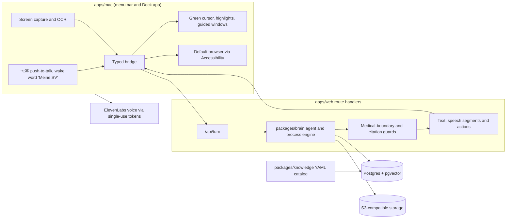

# Attention Seekers


> We turn a person's own words about their situation into the right benefits, office, documents
> and next step in Austria's social insurance, with a source for every claim.

[Datasets on Hugging Face](https://huggingface.co/datasets/JulianAT/at-benefits) ·
[Technical paper](paper/lotse-rl.pdf) · [Product requirements](docs/prd/SV-KI-Lotse-PRD.md)

## What it does

We built a voice-first companion for the Dachverband KI Challenge (Use Case 1). A person holds
⌥⌘ or says "Meine SV" and describes what is going on in plain words; we work out the life
situation and goal, ask only what the next step needs and answer with a source for every
statement. When the right page is not open, we offer to open it in the default browser and point
at what matters there with a green cursor. We import letters by upload, scan or screen capture,
quote documented recommendations verbatim, fill official forms with a source per value and
prepare appointments without ever submitting or booking anything. Benefits, processes, forms and
offices are data, not code.

## Challenge metrics

We measured the PRD §14 suites against real services (OpenAI, Postgres with pgvector, object
storage) on 6 November 2026. These are **automated, model-judged results, not human-reviewed
results or release approval**. Source: [docs/evals/results.md](docs/evals/results.md), which
keeps every artifact, base revision and deviation.

| Suite | Target | Measured |
| :-- | :-- | :-- |
| E1 Engine | 100% | 81/81 deterministic tests |
| E3 Retrieval | Recall@10 ≥ 90% | 96.0% (192/200), nDCG@10 0.747 |
| E5 Medical boundary | 0 violations | 0 in 500 cases; benign false positives 0/200 |
| E7 Form prefill | ≥ 95% | 100% (218/218 values, 1,030/1,030 blanks) |
| E12 Document extraction | Precision ≥ 98%, recall ≥ 90% | 99.2% / 98.4% on 15 of the required 30 documents |
| E13 Form field detection | Recall ≥ 90%, precision ≥ 95% | 94.4% / 92.2% |
| E4 Scenario success | ≥ 90% | 1 of 29 judged runs |

**E4 misses its target by a wide margin, and E13 precision is below 95%.** The E4 runs exposed
pipeline crashes that we fixed (failed turns fell from 122/206 to 0/47 in the S3 rerun), but the
model still rarely reaches the end state of a scenario. E3 was tuned on the same 200 questions, so
it is an in-set result. E12 has half of its release minimum. The judges are uncalibrated.

## Architecture

We build two connected sides: the Mac app owns the senses (voice, screen, cursor), the server owns
every decision.



A turn flows like this: the Mac app transcribes speech, attaches screen context and sends the
transcript over the bridge to the embedded chat; the chat posts it to `/api/turn`; the brain
streams text, speech segments and actions back; the Mac app speaks each sentence of a voice turn
and fires each action. Approval-gated tools check a server-side approval record before they run.

| Component | What we built | Connection |
| :-- | :-- | :-- |
| `apps/mac` | SwiftUI/AppKit companion derived from Clicky (MIT): push-to-talk, wake word, screen capture, speech playback, cursor overlay, browser pointing, encrypted uploads, guided portal windows, relatives screen sharing | Holds no provider key, conversation logic or fact store |
| `apps/web` | Next.js route handlers, the chat page embedded in the Mac app and the helper pages for relatives | No standalone website; `/` is a service notice |
| `packages/brain` | AI SDK `ToolLoopAgent` with tool approvals, process engine, retrieval, form engine, guards, model router | Called only from route handlers |
| `packages/knowledge` | Sourced YAML catalog: 51 benefits, 51 processes, 316 offices, facilities and forms; allowlist and ingestion for official pages and SozDok law | Loaded into Postgres with `catalog:load` |
| `packages/protocol` | Zod schemas for every brain–client message, with generated JSON Schema and Swift types | Shared by web and Mac |
| `packages/guide` | Page runtime for snapshots, pointing, highlighting and visible typing | Injected into the chat and guided windows |
| `packages/db`, `ui`, `evals` | Drizzle schema and storage client, shared components, suites E1–E13 | |
| `ml`, `paper` | Datasets, gym, training code, quantum study and preprint | Paper tables are generated from result files |

### Models and services

| Service | Role |
| :-- | :-- |
| OpenAI (or any compatible endpoint via `OPENAI_BASE_URL`) | Orchestrator, classifier, guard, extractor and vision roles; model ids stay in `.env.local` |
| OpenAI `text-embedding-3-small` | Retrieval vectors; full-text search is the fallback when embeddings are unavailable |
| Postgres with pgvector | Catalog, cases, facts, approvals, passages and jobs |
| S3-compatible storage (MinIO locally) | Encrypted documents and rendered PDFs |
| ElevenLabs `eleven_flash_v2_5` and Scribe | Speech output and transcription; Apple speech is the fallback |
| Apple Speech (on device) | Wake word "Meine SV"; audio never leaves the Mac |
| LiveKit | Relatives mode screen sharing |
| IBM Quantum / Qiskit | QAOA study outside the product |
| Hugging Face | Dataset releases |

## Guarantees

- We never diagnose, interpret findings, assess risk or recommend therapy or medication; we quote
  what a document says and hand medical questions to the treating doctor or 1450.
- We attach a source to every factual claim; an answer without evidence says so.
- We never submit applications, book appointments, send messages or handle credentials.
- We store a fact only after the person confirms it, and the person can export or delete
  everything.
- We keep provider keys on the server; clients get short-lived single-use tokens.
- We treat document and page text as untrusted data: it never grants approvals or enables tools.

## Own data and research

We built Lotse-RL, a benefits-navigation gym whose rewards come from the catalog's executable
eligibility rules, and released its data. Every label comes from the product's rule engine, not
from a model. Plan: [docs/research/lotse-rl.md](docs/research/lotse-rl.md).

| Dataset | Content | Size |
| :-- | :-- | --: |
| [`at-sv-law`](https://huggingface.co/datasets/JulianAT/at-sv-law) | Consolidated federal social-insurance law from RIS (ASVG, GSVG, BSVG, B-KUVG, BPGG and more), CC BY 4.0 | 2,863 sections |
| [`at-benefits-personas`](https://huggingface.co/datasets/JulianAT/at-benefits-personas) | Seeded personas with engine gold and a held-out benefit family | 55,000 |
| [`at-benefits`](https://huggingface.co/datasets/JulianAT/at-benefits) `situations` | Personas with engine gold; model-rewritten texts in 11 language variants, judge-filtered | 1,000,000 |
| `at-benefits` `dialogues` | Oracle tool trajectories plus judged natural dialogues in 9 languages | 10,352 |
| `at-benefits` `documents` | Synthetic letters as PDFs with verbatim extraction gold | 449 |
| `at-benefits` `forms` | Filled official forms with field gold | 15,120 |
| `at-benefits` `legal_qa` | Questions over the law corpus with section citations | 404 |

Generation runs through an OpenAI-compatible endpoint with a token ledger, rule checks on every
row and an LLM judge. The judge pass rate for model-written situation texts is 0.88 (Wilson 95%
0.85–0.91), with Austrian dialect lowest at 0.79. The gym self-test scores gold plans at 1.0 and
penalises boundary violations, uncited claims and malformed tool calls as specified.

On `ibm_marrakesh` we ran 10 QAOA circuits (p = 1, 11–17 qubits, median transpiled depth 285) on
five catalog instances: three case schedules from real office opening hours and two document set
covers. Plain QAOA found the optimum only on the two set covers; warm-start QAOA, seeded from the
CP-SAT solution, recovered it on all five. CP-SAT
solves every instance exactly in milliseconds, so this establishes **no quantum advantage**. See
[ml/quantum](ml/quantum/) and the [paper](paper/lotse-rl.pdf).

## What works and what does not

We support voice and text conversations in the Mac app, cited answers from the catalog and law
texts, opening official pages in the default browser with pointing, document import with verbatim
quotes, live form filling, office resolution and appointment preparation. Answers that need
catalog tools still take noticeably longer than direct answers. Full scenarios rarely reach their
end state (E4), and some well-supported questions still end in "no sufficiently sourced answer".
No model is trained yet: the SFT recipe for Qwen3-8B is ready in `ml/sft` and waits for GPU time.
There is no human study, and the judges are uncalibrated. This is a hackathon prototype.

## Run it locally

### Development setup

Prerequisites: Bun 1.4.4, Node.js 22+, Docker with Compose; for the Mac app macOS 14.2+, Xcode
with Swift 6, XcodeGen and SwiftLint; for `ml/` Python 3.12 with uv. The challenge's SV-Box files
are not in git: put them in `data/svbox/` or point `SVBOX_DIR` at their folder.

```sh
bun install
cp .env.example .env.local
docker compose up -d --wait                        # Postgres/pgvector, MinIO, LiveKit
bun run --filter @lotse/db db:migrate
bun run --filter @lotse/knowledge catalog:load     # benefits, processes, offices, facilities, forms
bun run --filter @lotse/knowledge sozdok:load      # SozDok law texts from the SV-Box
bun run --filter @lotse/knowledge ingest:pilot     # official pages and provisions
bun run --filter @lotse/web dev
```

In `.env.local`, set `SESSION_SECRET`, `APPROVAL_HMAC_SECRET` and `CRON_SECRET` to separate random
values (`openssl rand -base64 48`), `OPENAI_API_KEY` and the `ELEVENLABS_*` values.
**Never commit `.env.local`, `data/svbox/` or model weights.** Every variable is described in
[.env.example](.env.example). `catalog:load` prunes entries that are no longer in the files, so use
a development database. `scripts/local/start.sh` runs all of this idempotently in a separate
`lotse_app` database and serves the server on :3000 in the background.

### Mac app

```sh
apps/mac/Scripts/install.sh     # builds, signs and installs SV KI-Lotse.app, keeps privacy grants
```

The app asks for its permissions on first start and connects to `http://localhost:3000`
(`LOTSE_WORKSPACE_URL` changes the origin). Hold ⌥⌘ to speak, or say "Meine SV". Details are in
the [Mac README](apps/mac/README.md).

### Checks

```sh
bun run verify                    # lint, typecheck and unit tests
bun run test:integration          # needs the Compose services
RUN_LIVE=1 bun run test:live      # paid provider calls
bun run evals --suite E3,E13 --out /tmp/evals/summary.json
```

Use `bun run test`, not Bun's built-in `bun test`. Suites that call models incur provider costs.

From `ml/`:

```sh
uv sync
uv run pytest
uv run python -m gym.selftest
uv run python -m datagen.publish --help
```

Build the paper with `make -C paper`; it regenerates every table from `ml/results/` and
`docs/evals/results.md`. The [paper README](paper/README.md) explains how numbers get in.

### Scenario 3 demo

The demo takes the fictional discharge letter from the SV-Box to a rehabilitation application,
office, documents, facility and prepared appointment; the script is in
[docs/demo/run.md](docs/demo/run.md).

```sh
bun run demo:seed --catalog-only
RUN_LIVE=1 bun run demo:e2e       # live rehearsal on a disposable database
```

### Deploy

`apps/web/Dockerfile` builds the standalone server into a Node 22 image that applies migrations on
start and reports readiness at `/api/health`. Inject the server variables at runtime, set
`LOTSE_WORKSPACE_URL` to the public HTTPS origin, mount the SV-Box files read-only at `/data/svbox`
and POST to `/api/jobs/worker` every minute with `Authorization: Bearer <CRON_SECRET>`.
`apps/web/vercel.json` pins functions to Frankfurt (`fra1`) and runs the worker as a cron.

## Workspace

| Path | Responsibility |
| :-- | :-- |
| `apps/mac` | Mac companion, XcodeGen project and the LotseKit Swift package |
| `apps/web` | Route handlers, embedded chat and helper pages |
| `packages/brain` | Agent runtime, process engine, retrieval, forms, guards |
| `packages/knowledge` | Sourced catalog, allowlist, guard patterns and ingestion |
| `packages/protocol` | Message schemas with generated JSON Schema and Swift types |
| `packages/guide` | In-page pointing, highlighting and typing |
| `packages/db` | Drizzle schema, migrations and storage client |
| `packages/ui` | Shared React components and tokens |
| `packages/evals` | Suites E1–E13, personas, rubrics and red-team sets |
| `ml` | uv workspace: corpus, personas, datagen, gym, SFT/RL, quantum, publishing |
| `paper` | LaTeX preprint with generated tables and a Tectonic build |
| `docs` | PRD, ADRs, evaluation results, demo script and research plan |

## Stack

| Layer | Technology |
| :-- | :-- |
| Mac | Swift 6, SwiftUI, AppKit, ScreenCaptureKit, Accessibility, Speech |
| Web | Next.js 16, React, TypeScript, AI SDK, shadcn/ui, Tailwind |
| Data and AI | Zod, Drizzle, Postgres, pgvector, OpenAI, ElevenLabs, LiveKit |
| Research | Python, uv, TRL, PEFT, verl, Qiskit, OR-Tools, Hugging Face |
| Tooling | Bun, Turborepo, Vitest, Biome, Husky, commitlint, XcodeGen, Tectonic |

### Design principles

We keep benefits, processes and forms in sourced data, not prompts. We let the server decide and
the Mac app act. We ask only the questions the process engine needs. We report measured numbers
only, and say when a target is missed. See the [ADRs](docs/adr/) for the decisions behind the
toolchain, data model, sessions and agent runtime.

The Mac app is derived from Clicky (MIT); see the
[third-party notices](apps/mac/THIRD_PARTY_NOTICES.md).

## Team

<p align="center">
  <a href="https://github.com/julian-at"></a>
</p>
