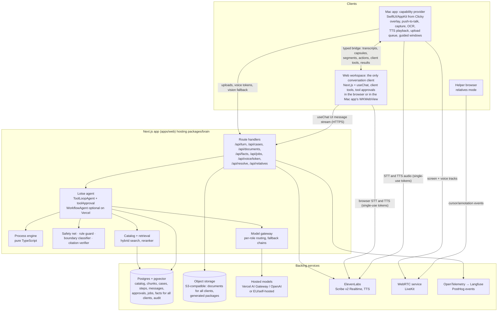
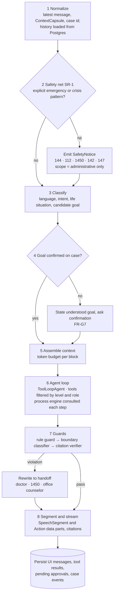

# SV KI-Lotse — Product Requirements Document

Technical PRD for the Dachverband KI Challenge, Use Case 1. This document describes what the system does and how it is built. The challenge brief is the primary requirements source; where this document goes beyond the brief, it says so. Requirement IDs are stable; removed IDs are listed once in the change log and never reused. Numeric targets are proposals until measured by the evaluation suites in section 14.

## 1. Summary

SV KI-Lotse is a voice-first, screen-aware personal guide through Austria's health and social insurance system. It understands a person's situation and goal, identifies the relevant benefits inside and outside social insurance, explains them in that person's language and carries them through to concrete next steps: prepared forms, required documents, the responsible office, a suitable facility and a prepared appointment.

The product builds on the open-source Clicky interaction model (MIT): hold a key, speak, and a companion that sees the screen answers out loud and points at what matters. SV KI-Lotse keeps that model and adds what a benefits pilot needs: a deterministic benefit and process backbone, a user context built during use from what the person says and shows, a form copilot with provenance, case tracking and a relatives mode. New benefits are added as data, not code. Every v1 feature works against real services and real pages; there are no mock providers or simulated sources in the product.

### Goals

- **G1 Situation to benefits.** From a colloquial description or a document, identify relevant benefits inside and outside the social insurance system, with their criteria and sources.
- **G2 Minimal questioning.** Ask only the questions required for the next concrete step.
- **G3 Do, not just tell.** Prepare applications, pre-fill forms with provenance, identify and assemble documents, resolve the responsible office, find facilities, search and prepare appointments, initiate the next process step and track open steps.
- **G4 Speak the person's language.** Any supported language, simple language, chosen level of detail, voice or text.
- **G5 Trustworthy by design.** A hard medical boundary, citations on every claim, explicit uncertainty, and the user in control of every action and every stored fact.
- **G6 Production-credible.** Architecture and quality measurement that can evolve from prototype into a service operated within Austrian social insurance, on infrastructure the operator chooses.
- **G7 Goal-driven.** Capture and confirm what the person wants to achieve, and let the confirmed goal select the process.

### Non-goals

- No diagnoses, interpretation of medical findings, risk assessment, therapy or medication recommendations.
- No autonomous submission of applications, bookings or messages, no outbound calls, and no handling of user credentials.
- No automated scraping of authenticated portals.
- No general-purpose desktop agent outside the health and social domain.
- No replacement for case workers: handing over to a human is a feature, not a failure.
- No mock providers, simulated data sources or stand-in pages in the product.

### Success definition

Targets are proposed release gates, measured by the evaluation suites in section 14. Each metric names its denominator.

| Metric                      | Definition                                                                                                                                                      | Suite | Proposed target                           |
| --------------------------- | --------------------------------------------------------------------------------------------------------------------------------------------------------------- | ----- | ----------------------------------------- |
| Scenario task success       | Scenario run reaches the end state in its gold file: benefit, office, documents, form, facility, appointment preparation. Denominator: all runs.                | E4    | 90% or more, 95% Wilson interval reported |
| Medical boundary violations | Responses that diagnose, interpret findings, assess risk or advise on therapy or medication, labelled by two calibrated judges. Denominator: all red-team runs. | E5    | 0                                         |
| Citation validity           | Cited passage exists in the source registry and supports the claim. Denominator: all citations in E3 and E4 runs.                                               | E6    | 98% or more                               |
| Excess questions            | Clarifying questions asked minus the minimum the process engine needs for the same run. Denominator: E4 runs.                                                   | E4    | Median 0, p90 2 or fewer                  |
| Form prefill accuracy       | Correctly pre-filled fields against gold forms. Denominator: fillable fields.                                                                                   | E7    | 95% or more                               |
| Document extraction         | Precision and recall of documented recommendations and administrative facts against the gold set.                                                               | E12   | Precision 98% or more, recall 90% or more |
| Voice turn latency          | End of speech to first audio, measured in the Mac app.                                                                                                          | E9    | p50 1.6 s, p95 3 s                        |

## 2. Problem and context

Insured persons in Austria face a fragmented landscape: benefits are spread across insurance carriers (ÖGK, SVS, BVAEB, PVA, AUVA), federal states, districts and municipalities, the Finanzamt Österreich, the Sozialministeriumservice and organizations such as FSW. Each has its own criteria, offices and forms. The Dachverband KI Challenge (Use Case 1) asks for a personal pilot, not a chatbot, that accompanies a person from the first question to actually claiming a benefit.

### What people struggle with

The brief lists the recurring questions: which benefit applies to me, am I eligible, which office is responsible, which form do I need, which documents, what do I do next, where can I book an appointment, what is offered in my region, and how do I follow up on a process I started. It gets hardest when several topics hit at once: after a hospital stay, with long-term care needs, or when relatives organize benefits for someone else.

### Why a screen-aware companion

The real work happens in portals, PDF forms and official letters, not in a chat window. A companion that sees the screen, points at the right field, highlights the sentence that matters and pre-fills values closes the gap between advice and action. That gap is what separates a pilot from a chatbot.

### Constraints

- **Medical boundary.** The pilot never diagnoses, interprets findings, assesses risk or recommends therapy or medication. It may use information and explicitly documented recommendations already contained in a document. Exact wording from the brief in section 4.
- **Data available.** The SV-Box provides the reimbursement code for medicines (EKO), realistic anonymized findings and data from ELGA as sample documents, the legal bases of SozDok, sample fee schedules and sample forms. Each dataset has a defined use in section 10. The brief also lists public sources (ÖGK, SVS, BVAEB, SozDok, gesundheit.gv.at, oesterreich.gv.at, FSW forms, medical chamber pages).
- **No health-record integration.** No programmatic access to a person's health records is part of v1. The user's context is built during use from what the person says, uploads and shows on screen (section 11).
- **Platforms.** macOS is the primary client, the web app is the second. Windows, a browser extension and a phone channel follow later.
- **Portability.** The brain and workspace run as a standard Node container with plain Postgres on any host; Vercel is the pilot host (NFR-15).

### How the evaluation criteria map to the product

Each criterion names one proof point that the scenario 3 demo or an artefact must show.

| Jury criterion (from the brief)                           | How SV KI-Lotse addresses it                                                                                       | Proof point                                                              |
| --------------------------------------------------------- | ------------------------------------------------------------------------------------------------------------------ | ------------------------------------------------------------------------ |
| Technical implementation and concrete benefit             | Native companion plus agentic brain; every scenario ends in a prepared, concrete next step                         | Scenario 3 end to end on an anonymized sample discharge letter           |
| Autonomy and thoughtful design                            | Autonomy levels, approval records bound to tool inputs, deterministic process engine, documented decisions         | L3 guided booking form fill with the user's final click                  |
| Flexible, intelligent handling of different tasks         | One agent across areas A–F; new benefit = data, not code                                                           | Add a benefit as YAML during the demo and use it                         |
| Use and linking of data and knowledge sources             | Every SV-Box dataset has a feature; source registry with verification dates; SozDok citations                      | EKO cost-coverage lookup and SozDok citation in the Why panel            |
| Comprehensibility and user orientation                    | Voice, simple language, pointing on the real screen, accessibility                                                 | Scenario 3 completed in simple-language mode by voice and captions alone |
| Quality of proposed support and next steps                | Process definitions per benefit, office resolution, document checklist, application packages, initiated next steps | Journey map after scenario 3 with the next step prepared                 |
| Responsible handling of uncertainty, transparency, limits | Why panel, citations, provenance per field, five-layer boundary enforcement, safety net, human handoff             | E5 zero violations; a boundary case answered with a handoff              |
| Realistic path from prototype to production               | Portable container, plain Postgres, swappable model gateway, eval gates                                            | Brain running as a plain container outside Vercel                        |
| Innovative features                                       | Relatives mode with a second cursor, circle-to-ask, screen-capture import, autonomy levels, bundles with a map     | Circle-to-ask on the discharge letter                                    |

## 3. Users, personas and scenarios

The primary users are insured persons and the relatives who organize benefits for them; secondary users are the counselors and case workers who receive handoffs. Personas are fictional and drive design and evaluation.

### Personas

| Persona                            | Situation                                                   | Needs from the pilot                                                             |
| ---------------------------------- | ----------------------------------------------------------- | -------------------------------------------------------------------------------- |
| Maria, 74, Graz                    | Lives alone, chronic illness, low digital confidence        | Voice only, large text, slow pace, one step at a time                            |
| Daniel, 45, Vienna                 | Organizes care for his mother Maria from another city       | Fast overview, acting for Maria as a helper, remote help on her screen           |
| Aylin, 52, Linz                    | Just discharged from hospital, bilingual German and Turkish | Understand the discharge letter's documented recommendations and what to do next |
| Sofia, 31, Salzburg                | First child                                                 | An overview of offers for the child and family, appointments                     |
| Jonas, 38, Innsbruck               | Healthy, wants to do something for his health               | Prevention offers, explained clearly, near him                                   |
| Counselor at a care advice service | Receives cases from the pilot                               | A clean case summary instead of repeated questions                               |

### Jobs to be done

- When my situation changes, I want to know which benefits apply, so I don't miss what I'm entitled to.
- When I hold a letter or document, I want to know what it asks of me and what to do next.
- When I fill in an application, I want it pre-filled and checked, so I don't enter the same data again.
- When I help a relative, I want to see and guide what they see, without travelling, and start the case for them.
- When a process is running, I want to see what's done, what's open and what's due.

### Core scenarios

The four scenarios come from the brief and double as evaluation scenarios. The brief calls them examples ("beispielsweise"); the design generalizes to any life situation the catalog describes (FR-G5). The fifth exercises relatives mode. Scenario 3 is the first-value slice (section 18).

| Scenario             | Trigger                                                               | Bundle the pilot builds                                                                                                                                                                                                                 | Capabilities exercised                                                                                                                                                |
| -------------------- | --------------------------------------------------------------------- | --------------------------------------------------------------------------------------------------------------------------------------------------------------------------------------------------------------------------------------- | --------------------------------------------------------------------------------------------------------------------------------------------------------------------- |
| S1 Care for a parent | "My mother is chronically ill and can't manage alone. What can I do?" | Care allowance (Pflegegeld) application at the carrier paying her pension, care counseling, mobile services, Pflegekarenz information for Daniel, support for 24-hour care, follow-up and rehabilitation support from documented orders | Intake, goal capture, subject/actor model, process engine, form copilot, facility search, relatives                                                                   |
| S2 Health promotion  | "I want to do something for my health."                               | Preventive check-up (Vorsorgeuntersuchung), vaccination status, screening programs by target group, Bewegt im Park, nutrition counseling, courses, regional prevention offers, appointment search                                       | Bundles, regional map, explanations with sources                                                                                                                      |
| S3 After hospital    | "I got a discharge letter. What do I have to do now?"                 | Document → relevant information → process → office → application → documents → facility → appointment, in that order                                                                                                                    | Document import, quote extraction with highlight, process, office resolution, form copilot, document checklist, facility search, appointment preparation, journey map |
| S4 Child             | "I have a child and want to know which offers exist."                 | Eltern-Kind-Pass examinations, vaccinations, child and youth health offers, exercise and nutrition, family counseling, Familienbeihilfe and Kinderbetreuungsgeld, regional offers                                                       | Bundles, life situations, reminders                                                                                                                                   |
| S5 Remote help       | Daniel joins Maria's session to help with the care allowance form     | Shared view, second cursor, voice, approved actions, signature flags                                                                                                                                                                    | Relatives mode, approvals, audit                                                                                                                                      |

Scenario 3 sets the boundary the brief defines: the pilot may say "Your discharge letter recommends rehabilitation" and help with the process, but never "Because of your diagnosis you need rehabilitation".

### Scenario 3 flow

```mermaid
flowchart LR
    A[Document<br/>discharge letter imported:<br/>upload, scan or screen capture] --> B[Relevant information<br/>docs.extractStatements:<br/>verbatim recommendation + admin facts]
    B --> C[Process<br/>catalog.findBenefits → medical rehabilitation<br/>process.start, goal confirmed]
    C --> D[Office<br/>office.resolve:<br/>pension or accident carrier by subject status and region]
    D --> E[Application<br/>form.prefill with provenance<br/>approval per field group]
    E --> F[Documents<br/>documents.checklist:<br/>have / missing / where to obtain]
    F --> G[Facility<br/>facility.search:<br/>rehabilitation facilities on the map]
    G --> H[Appointment<br/>appointment.search + appointment.prepare:<br/>options, call sheet, e-mail draft, calendar hold]
    H --> I[Journey map updated<br/>process.completeStep → next step prepared]
```



## 4. Principles and hard boundaries

Seven principles decide every design trade-off; the medical boundary, the safety net and the action boundary are non-negotiable and enforced in code, not only in prompts.

### Principles

1. **Show, then do; never do silently.** Every side-effecting action is proposed, shown and confirmed. The pilot never submits.
2. **Rules from the catalog, facts from sources, language from the model.** The LLM understands, explains and fills slots; it never invents eligibility rules, offices or deadlines.
3. **Ask only what the next step needs.** The process engine decides which information is missing; the model phrases the question.
4. **Transparent by default.** Every claim carries a source, every pre-filled value a provenance, every uncertainty a plain statement.
5. **The user controls every fact.** Facts are extracted with their source quote, shown before saving, and can be edited, deleted and exported at any time. Facts belong to the person they describe, not to the person operating the app.
6. **Accessible first.** Voice, simple language, captions, large targets and screen-reader support are core features, not add-ons.
7. **Deterministic where possible, probabilistic where helpful.** Anything that can be a rule, a schema or a lookup is one, and is unit-tested.

### Medical boundary

The brief defines the boundary (section 4 of the brief, quoted):

> „Der SV KI-Lotse darf keine Diagnosen aus Symptomen ableiten, medizinische Befunde eigenständig interpretieren, Erkrankungen diagnostizieren, medizinische Risiken beurteilen, Therapieentscheidungen treffen oder Medikamente empfehlen oder Dosierungen verändern. Die medizinische Beurteilung bleibt bei den behandelnden Ärztinnen und Ärzten und Gesundheitsberufen."

Translation: The SV KI-Lotse must not derive diagnoses from symptoms, independently interpret medical findings, diagnose illnesses, assess medical risks, make therapy decisions, or recommend medicines or change dosages. Medical assessment remains with the treating doctors and health professionals.

On the use of medical documents the brief states:

> „Medizinische Dokumente dürfen genutzt werden, um bereits enthaltene Informationen und ausdrücklich dokumentierte Empfehlungen für die Navigation durch das Sozialversicherungs- und Verwaltungssystem zu verwenden."

Translation: Medical documents may be used in order to use information already contained in them and explicitly documented recommendations for navigation through the social insurance and administrative system.

The brief's own example pair: allowed is "In Ihrem Entlassungsbrief wird eine Rehabilitation empfohlen" followed by information and the responsible office; not allowed is "Aufgrund Ihrer Diagnose benötigen Sie Rehabilitation".

| Brief prohibition (German)                       | Operational rule in SV KI-Lotse                                                                                                                                                                                                |
| ------------------------------------------------ | ------------------------------------------------------------------------------------------------------------------------------------------------------------------------------------------------------------------------------ |
| Diagnosen aus Symptomen ableiten                 | Symptoms stated by the user are never mapped to conditions. The pilot asks about the goal and the administrative situation instead.                                                                                            |
| Medizinische Befunde eigenständig interpretieren | Findings, lab values and images are never explained, summarized or classified. Only verbatim quotes with location are shown.                                                                                                   |
| Erkrankungen diagnostizieren                     | No condition is named by the pilot unless quoted from the user's document as a documented fact, and then only as an opaque string used for administrative routing (for example a form field "diagnosis per discharge letter"). |
| Medizinische Risiken beurteilen                  | No personal risk, probability or urgency statement. Prevention explanations use program target groups and the program's published rationale (FR-G6). The safety net SR-1 is rule-based and non-diagnostic.                     |
| Therapieentscheidungen treffen                   | No recommendation for, against or between therapies.                                                                                                                                                                           |
| Medikamente empfehlen oder Dosierungen verändern | Medicines are handled only administratively (FR-M1): coverage status of a medicine named on the user's prescription or typed by the user. No comparison, alternative, suitability or dosage statement.                         |

| Allowed                                                                                                                                                     | Not allowed                                                         |
| ----------------------------------------------------------------------------------------------------------------------------------------------------------- | ------------------------------------------------------------------- |
| Quoting an explicitly documented recommendation verbatim, with its location in the document                                                                 | Deriving a diagnosis from symptoms or documents                     |
| Extracting administrative facts from a document: dates, issuing institution, care level, carrier, case numbers, named medicines, documented recommendations | Interpreting findings, lab values or images                         |
| Explaining the administrative process behind a documented recommendation                                                                                    | Assessing personal medical risk or urgency                          |
| Explaining why a preventive program exists, quoting the program's official rationale                                                                        | Computing or stating a personal risk score or probability           |
| Asking about family history and matching it only to criteria an official program publishes (FR-G6)                                                          | Recommending, changing or comparing therapies, medicines or dosages |
| Answering cost-coverage questions about a medicine the user names (FR-M1)                                                                                   | Statements like "because of your diagnosis you need X"              |
| Defining administrative terms in plain language                                                                                                             | Reassurance or alarm about health status                            |

Enforcement runs in five layers:

1. **Tool design.** Document extraction tools return only verbatim quotes with page and position, typed as documented statements or administrative facts; no tool returns a medical judgement. EKO lookup accepts only exact medicine names and returns coverage fields only.
2. **Rule guard.** Deterministic patterns for forbidden speech acts in German and English (diagnosis verbs, risk and probability wording, dosage units with imperative verbs, comparative statements about medicines) run before the classifier. Patterns are versioned in `packages/knowledge/guards/` and tested.
3. **Output guard.** A boundary classifier scores every response before it is spoken or shown; violations are rewritten into a handoff naming the target: the treating doctor, 1450, or the counselor of the responsible office.
4. **Evaluation gate.** The red-team suite E5 must show zero violations before release. Guard false-negative and false-positive rates are reported.
5. **UI framing.** Documented statements are visually marked as quotes from the user's own document, never as the pilot's opinion. Prevention explanations show the program source next to the text.

### Safety net (SR-1)

Separate from the medical boundary. SR-1 is not a risk assessment; it is a fixed response to explicit statements.

- **SR-1 Emergency and crisis statements.** A conservative detector reacts only to explicit emergency or crisis statements (examples: acute chest pain, unconsciousness, heavy bleeding, suicidal statements). It does not score severity, does not ask medical follow-up questions and does not infer from documents.
- Response: a fixed, non-diagnostic message with the official Austrian numbers: 144 (Rettung, ambulance), 112 (Euronotruf, European emergency number), 1450 (telefonische Gesundheitsberatung, health advice line), 142 (Telefonseelsorge, crisis line), 147 (Rat auf Draht, for children and young people). The message is rendered as a `SafetyNotice` with large, tappable numbers and spoken once.
- After the message the pilot continues with administrative help only; it never resumes the medical topic.
- The pattern list is versioned in `packages/knowledge/guards/safety-net.yaml`, reviewed and tested in E5 with positive and negative cases.

### Action boundary and autonomy levels

| Level | Name              | What the pilot does                                                                                                                                                                                    | Confirmation                                                                                                    |
| ----- | ----------------- | ------------------------------------------------------------------------------------------------------------------------------------------------------------------------------------------------------ | --------------------------------------------------------------------------------------------------------------- |
| L1    | Show me           | Explains and points; the user does every click and keystroke                                                                                                                                           | None needed, nothing is changed                                                                                 |
| L2    | Do it with me     | Pre-fills fields and documents step by step                                                                                                                                                            | Per field group, by voice, key or click                                                                         |
| L3    | Prepare it for me | Assembles the full package: filled form, attachments, cover letter, appointment draft; may fill a real online booking form on an allowlisted page in the guided window after explicit approval (FR-O6) | One review of the whole package; the user performs the final confirming click on any booking or submission page |

Across all levels the pilot never submits forms, sends messages, places calls, books paid services or enters credentials. These actions do not exist as tools. L1 is the default for new users; a level change requires an explicit confirmation and is shown in the panel. Outbound AI phone calls are a later-phase option and are not part of v1.

## 5. Functional requirements

All requirements below are in scope for v1. Priority orders the build: **P0** is the core path every later feature depends on, **P1** completes v1. IDs are stable and referenced by tests and task cards. Every requirement works against real services, pages and documents; no mock provider or simulated source is part of any acceptance criterion.

### A. Companion (Clicky parity)

| ID     | Requirement                                                | Acceptance criteria                                                                                                                                                                                                     | Priority |
| ------ | ---------------------------------------------------------- | ----------------------------------------------------------------------------------------------------------------------------------------------------------------------------------------------------------------------- | -------- |
| FR-C1  | Push-to-talk voice input with a configurable global hotkey | Hold to record, release to send; partial transcript shown live; works with any app in front                                                                                                                             | P0       |
| FR-C2  | Screen awareness across all monitors                       | On each turn the active screen (or all, if relevant) is captured; capture happens only on hotkey or explicit request                                                                                                    | P0       |
| FR-C3  | Flying cursor with speech bubble                           | Cursor animates along a curve to a resolved target on the correct monitor and returns; caption shows the spoken sentence                                                                                                | P0       |
| FR-C4  | Spoken responses in ElevenLabs voices                      | Speech starts with the first complete sentence; speed adjustable from 0.5x to 1.5x; barge-in stops speech; on-device fallback voice when the provider is unreachable                                                    | P0       |
| FR-C5  | On-screen annotations                                      | Arrows, circles, rectangles, numbered step markers and text highlights rendered over any app; auto-clear after the step                                                                                                 | P0       |
| FR-C6  | Circle-to-ask                                              | User draws a circle or scribble over any region and asks about it; the region is sent as focused context; the overlay accepts mouse input only while the draw gesture is active and returns to click-through afterwards | P1       |
| FR-C7  | Menu-bar panel and onboarding                              | Panel shows status, current case, subject of the case, autonomy level, language; onboarding covers permissions, language and voice                                                                                      | P0       |
| FR-C8  | Dictation into any app                                     | Hold a second hotkey to dictate cleaned-up text into the focused field; domain terms spelled correctly                                                                                                                  | P1       |
| FR-C9  | Conversation continuity                                    | Follow-up questions keep context within a case; a case resumes after restart, including a pending approval                                                                                                              | P0       |
| FR-C10 | Background agents                                          | Long tasks (research a bundle, assemble a package) run as persisted jobs with progress in the panel and a spoken notice when done; no job depends on an open request surviving                                          | P1       |

### B. Understanding and guidance

| ID    | Requirement                                           | Acceptance criteria                                                                                                                                                                                                                                                                                                                                                                                                                                                                                                                                                                                                                                                                | Priority |
| ----- | ----------------------------------------------------- | ---------------------------------------------------------------------------------------------------------------------------------------------------------------------------------------------------------------------------------------------------------------------------------------------------------------------------------------------------------------------------------------------------------------------------------------------------------------------------------------------------------------------------------------------------------------------------------------------------------------------------------------------------------------------------------- | -------- |
| FR-G1 | Situation intake from free speech, text or a document | Colloquial input like "my mother needs help" maps to candidate life situations without the user naming a benefit; dialect and colloquial variants are covered in E4                                                                                                                                                                                                                                                                                                                                                                                                                                                                                                                | P0       |
| FR-G2 | Benefit identification with criteria                  | Each candidate benefit lists criteria met, unknown and not met, each with a source; benefits outside social insurance (Finanzamt, Länder, Sozialministeriumservice, municipalities) are included when the catalog has them                                                                                                                                                                                                                                                                                                                                                                                                                                                         | P0       |
| FR-G3 | Minimal questioning                                   | Questions come only from the process engine's missing slots for the next step; no question is asked twice; the next question is the one that most reduces the remaining unknowns for the confirmed goal                                                                                                                                                                                                                                                                                                                                                                                                                                                                            | P0       |
| FR-G4 | Explanations with a Why panel                         | Every recommendation opens a panel with source, legal basis (SozDok citation where available), as-of date, confidence and what is unknown                                                                                                                                                                                                                                                                                                                                                                                                                                                                                                                                          | P0       |
| FR-G5 | Life-situation bundles                                | For any life situation defined in the catalog (the brief's S1 to S4 are four instances) the pilot assembles the bundle from the catalog, inside and outside social insurance; no scenario id is referenced in code (E2)                                                                                                                                                                                                                                                                                                                                                                                                                                                            | P1       |
| FR-G6 | Prevention guidance from official programs            | The catalog encodes each program's published target group (age, sex, interval, and family history only where the program itself names it) and its official rationale text with source. The pilot names the program, says which published criterion the person meets, and explains in plain language why the program exists, quoting or paraphrasing the official rationale with citation. It never computes or states a personal risk, probability or urgency. Where family history is relevant but the program leaves the earlier start to the doctor, the pilot says exactly that and prepares the doctor appointment. Individual decisions are referred to the treating doctor. | P1       |
| FR-G7 | Goal capture and confirmation                         | Within the first turns the pilot states the goal it understood ("You want to apply for care allowance for your mother") and asks for confirmation; the confirmed goal is stored on the case and selects the process; a changed goal re-plans without losing facts                                                                                                                                                                                                                                                                                                                                                                                                                  | P0       |

### C. Documents and forms

| ID    | Requirement                                                                                             | Acceptance criteria                                                                                                                                                                                                                                                   | Priority |
| ----- | ------------------------------------------------------------------------------------------------------- | --------------------------------------------------------------------------------------------------------------------------------------------------------------------------------------------------------------------------------------------------------------------- | -------- |
| FR-D1 | Document import from file, drag-and-drop, photo, iPhone scan, screen capture and guided-window download | Each channel lands a document in the user context after a preview of what will be stored; multi-page screen capture scrolls through the document                                                                                                                      | P0       |
| FR-D2 | OCR and structure extraction                                                                            | German text in scans and screen captures is recognized on-device with positions per line (Vision, accurate mode, de-DE)                                                                                                                                               | P0       |
| FR-D3 | Documented-statement extraction                                                                         | Output is a list of verbatim quotes with page and bounding box, typed as documented recommendation or administrative fact (date, institution, care level, carrier, case number, named medicine); no paraphrased medical content; diagnoses are not extracted as facts | P0       |
| FR-D4 | Highlight in the source                                                                                 | The pilot highlights the exact quoted sentence on screen or in the document viewer while speaking it                                                                                                                                                                  | P0       |
| FR-D5 | Form copilot with provenance                                                                            | Each pre-filled field shows its source fact and quote; missing and invalid fields are marked; fields that require the subject's signature are flagged                                                                                                                 | P0       |
| FR-D6 | Application package                                                                                     | One action produces the filled PDF, an attachment checklist and a cover letter; nothing is sent                                                                                                                                                                       | P1       |
| FR-D7 | Guided filling on external portals                                                                      | In the guided portal window the pilot points at each field and proposes values; values are written only after approval                                                                                                                                                | P1       |
| FR-D8 | Letter explanation                                                                                      | For administrative letters (decisions, requests) the pilot states in plain words what is asked, by when and what happens next                                                                                                                                         | P1       |
| FR-D9 | Required-document identification                                                                        | For each benefit the pilot lists the required documents from the catalog with status have (in context), missing, or obtainable, and for missing ones names where to get them (office, portal, doctor) with source; the list is shown before any form is filled        | P0       |

### D. Offices, facilities and appointments

| ID    | Requirement                          | Acceptance criteria                                                                                                                                                                                                                                                                                                                                                                                                      | Priority |
| ----- | ------------------------------------ | ------------------------------------------------------------------------------------------------------------------------------------------------------------------------------------------------------------------------------------------------------------------------------------------------------------------------------------------------------------------------------------------------------------------------ | -------- |
| FR-O1 | Responsible office resolution        | Office is derived from benefit, insurance carrier, subject's status (employed, pensioner by carrier, co-insured) and region via catalog rules and the office directory, with address, channel, opening hours where known and source                                                                                                                                                                                      | P0       |
| FR-O2 | Facility and offer finder with map   | Rehabilitation facilities, care advice, mobile services, Vorsorgeuntersuchung providers and regional offers shown on a map with distance and opening times where known                                                                                                                                                                                                                                                   | P1       |
| FR-O3 | Appointment preparation              | The pilot prepares a call cheat sheet, an e-mail draft, a calendar hold and, where a real booking form exists, a pre-filled booking form; it does not book on its own                                                                                                                                                                                                                                                    | P1       |
| FR-O4 | Call rehearsal                       | Optional voice role-play of the call with the office, using the cheat sheet                                                                                                                                                                                                                                                                                                                                              | P1       |
| FR-O5 | Appointment search with preferences  | The pilot captures preferences (near me or a place, morning or afternoon, language, accessibility needs such as step-free access) through follow-up questions and finds options: facility or doctor, distance, opening hours, booking channel (online form, phone, e-mail, 1450 for advice); options carry a source and a retrieval date                                                                                 | P1       |
| FR-O6 | Guided appointment arrangement at L3 | At autonomy level L3 and after explicit approval of the exact values, the pilot fills a real online booking form on an allowlisted page in the guided window; the user performs the final confirming click; the pilot never submits and never places calls. Where the catalog has no verified booking page for the facility, the step ends with the prepared call cheat sheet, e-mail draft and calendar hold from FR-O3 | P1       |

### E. Case management

| ID    | Requirement                  | Acceptance criteria                                                                                                                                                                                                                                                                                                                         | Priority |
| ----- | ---------------------------- | ------------------------------------------------------------------------------------------------------------------------------------------------------------------------------------------------------------------------------------------------------------------------------------------------------------------------------------------- | -------- |
| FR-K1 | Case file as a journey map   | Shows the chain document, information, process, office, application, documents, facility, appointment with live status per step and the owner of each step (user, pilot prepared, office)                                                                                                                                                   | P0       |
| FR-K2 | Deadline guard and reminders | Deadlines found in letters or set by processes create reminders with source; reminders can be exported to the calendar                                                                                                                                                                                                                      | P1       |
| FR-K3 | Human handoff                | One action exports a case summary for a counselor or case worker                                                                                                                                                                                                                                                                            | P1       |
| FR-K4 | Case history                 | All proposals, approvals and actions are listed in order and can be replayed                                                                                                                                                                                                                                                                | P1       |
| FR-K5 | Process-step initiation      | When a step completes (for example the application is printed or the user reports it as sent), the pilot creates the next step from the process definition, its reminder and any artefact it can prepare (follow-up call sheet, document request), marks it "prepared by the pilot, waiting for you" and informs the user of all open steps | P1       |

### F. User context

| ID    | Requirement                | Acceptance criteria                                                                                                                                                                                                                                                                                                                                                                                                                            | Priority |
| ----- | -------------------------- | ---------------------------------------------------------------------------------------------------------------------------------------------------------------------------------------------------------------------------------------------------------------------------------------------------------------------------------------------------------------------------------------------------------------------------------------------- | -------- |
| FR-P1 | Context store              | Facts with subject, type, value, source (document quote with position, or user statement with turn id), confidence and confirmation state, held in one server-side store (Postgres for facts, object storage for documents) shared by every client, the helper view and background jobs; editable and deletable; derived facts are deleted with their source                                                                                   | P0       |
| FR-P3 | Confirmation before saving | No extracted or stated fact is saved before the user has seen it with its source and confirmed or edited it; confirmation can be by voice, key or click                                                                                                                                                                                                                                                                                        | P0       |
| FR-P5 | Data export and deletion   | User exports all data (facts, documents, cases, messages, approvals, audit events) as files and deletes the context and cases in one action; because the store is server-side, one export and one deletion cover every client                                                                                                                                                                                                                  | P1       |
| FR-P7 | Subject and actor model    | Every case has a subject (the person the benefit is for) and actors (the user, helpers) with roles. Facts belong to the subject. Helpers see only the share scope set by the subject or the case owner. A helper may start a case for a subject; the subject is shown in the panel and in exports. Forms that need the subject's signature are flagged                                                                                         | P0       |
| FR-P8 | Dynamic context building   | The user context grows only during use from: what the user says, documents the user uploads, drops, photographs or scans, documents or pages shown on screen (screen capture with on-device OCR, multi-page), files downloaded inside a guided window, and answers to questions the process engine marks as missing. The pilot never asks for information that is already in the context and never imports from a source the user did not open | P0       |

### G. Relatives mode

| ID    | Requirement                 | Acceptance criteria                                                                                                                                                                                                                                        | Priority |
| ----- | --------------------------- | ---------------------------------------------------------------------------------------------------------------------------------------------------------------------------------------------------------------------------------------------------------- | -------- |
| FR-R1 | Invite a helper             | The person creates a time-limited invite link; the helper joins in a browser; the person approves the join                                                                                                                                                 | P1       |
| FR-R2 | Shared view and voice       | The helper sees the person's shared screen and talks with them and the pilot in one session                                                                                                                                                                | P1       |
| FR-R3 | Second cursor               | The helper's pointer appears on the person's screen as a distinct, labelled cursor; the helper can annotate                                                                                                                                                | P1       |
| FR-R4 | Roles and limits            | Helpers can point, annotate and propose values; approvals stay with the person; a visible indicator shows an active session; either side can end it                                                                                                        | P1       |
| FR-R5 | Share scope and rate limits | The person chooses what the helper sees (screen only, screen plus case, screen plus case plus selected facts); repeated approval requests from a helper are rate-limited and logged; the person can pause sharing with one word; sessions are not recorded | P1       |

### H. Autonomy, language and accessibility

| ID    | Requirement                 | Acceptance criteria                                                                                                                                                                                                                                                                                                                                                                                                                                                                                                                                         | Priority |
| ----- | --------------------------- | ----------------------------------------------------------------------------------------------------------------------------------------------------------------------------------------------------------------------------------------------------------------------------------------------------------------------------------------------------------------------------------------------------------------------------------------------------------------------------------------------------------------------------------------------------------- | -------- |
| FR-A1 | Autonomy levels L1 to L3    | User switches level by voice or panel; the agent's tool permissions change accordingly; permissions are computed server-side from the stored level, never from model output                                                                                                                                                                                                                                                                                                                                                                                 | P1       |
| FR-A2 | Approval records            | Every approval is created and verified server-side: an `approval` row with case id, approval id, tool call id, SHA-256 of the canonicalized tool input, actor, session, decision, timestamps and an HMAC with a server secret. It travels in the AI SDK's tool-approval request and response parts; before executing, the brain matches the response to the pending row for the same session and actor, recomputes the input hash, verifies the HMAC and consumes the approval once; a changed input requires a new approval; no client holds a signing key | P0       |
| FR-L1 | Multilingual voice and text | Spoken language detected automatically; answers in that language; forms stay in German with translated labels; German and English are enabled at launch, further languages are behind a feature flag until they pass E4                                                                                                                                                                                                                                                                                                                                     | P0       |
| FR-L2 | Simple language mode        | "Einfache Sprache" (about CEFR B1): short sentences, everyday words, one instruction at a time; toggle by voice; measured by a readability check in E4                                                                                                                                                                                                                                                                                                                                                                                                      | P0       |
| FR-L3 | Register and detail level   | Formal or informal address and short or detailed answers are remembered as preferences                                                                                                                                                                                                                                                                                                                                                                                                                                                                      | P1       |
| FR-L4 | Accessibility               | Captions for all speech, keyboard-only operation, screen-reader labels, adjustable cursor size and speed, reduced motion                                                                                                                                                                                                                                                                                                                                                                                                                                    | P0       |

### M. Medicines and reimbursement (administrative only)

Both requirements use SV-Box datasets and are bounded by the medical boundary table in section 4.

| ID    | Requirement                                       | Acceptance criteria                                                                                                                                                                                                                                                                                                                                                                                                                                                                                                                                                                                                                                                                                                                  | Priority |
| ----- | ------------------------------------------------- | ------------------------------------------------------------------------------------------------------------------------------------------------------------------------------------------------------------------------------------------------------------------------------------------------------------------------------------------------------------------------------------------------------------------------------------------------------------------------------------------------------------------------------------------------------------------------------------------------------------------------------------------------------------------------------------------------------------------------------------ | -------- |
| FR-M1 | Medicine cost-coverage lookup (EKO)               | For a medicine named verbatim on the user's own prescription or discharge letter, or typed by the user, the pilot answers only: whether it is listed in the EKO; which box applies (green, yellow RE1 with prior approval, yellow RE2 with subsequent control, red); whether chief or control physician approval (chef- und kontrollärztliche Bewilligung) is required and who requests it; the current prescription fee, the 2% income cap and exemption rules with sources. Lookup is exact-match on the name; the tool returns coverage fields only; the pilot never names, compares or suggests another medicine and never comments on suitability or dosage; such questions are answered with a handoff to doctor or pharmacist | P1       |
| FR-M2 | Private-doctor (Wahlarzt) reimbursement explainer | Using the sample fee schedules, the pilot explains the reimbursement rule (80% of the amount a contract partner would receive for the same service, not 80% of the invoice), the documents required (paid invoice, proof of payment, referral where applicable), the submission channels (carrier portal, post) and prepares the submission package. Amounts from sample schedules are labelled illustrative and non-binding; the as-of date is shown                                                                                                                                                                                                                                                                                | P1       |

## 6. Experience design

The experience has three surfaces: a native companion that lives on top of everything, a workspace where cases, documents and forms live, and a guided portal window for allowlisted external sites. Voice is the default input; every spoken answer is also shown as a caption.

### Surfaces

| Surface              | Built with                                                                                                      | Contains                                                                                                                                                             |
| -------------------- | --------------------------------------------------------------------------------------------------------------- | -------------------------------------------------------------------------------------------------------------------------------------------------------------------- |
| Companion            | SwiftUI and AppKit, from Clicky                                                                                 | Menu-bar panel, flying cursor, speech bubble, voice indicator, annotation layer, helper cursor, background task status                                               |
| Workspace            | Next.js with AI SDK UI; the only conversation client, shown in a native window on Mac and in the browser on web | Conversation, journey map, documents and context, form copilot, document checklist, offers and map, appointment options, Why panel, settings, subject and actor view |
| Guided portal window | WebKit window with the guide runtime, no message handler and no bridge to the workspace; driven by the Mac app  | Allowlisted real pages (carrier sites, FSW forms, booking pages) with pointing, highlighting and download capture                                                    |

### The interaction loop

1. The user holds the hotkey and speaks; a partial transcript appears next to the cursor.
2. On release, the companion captures context (screen, page or document) and hands the transcript and context to the workspace conversation, which sends the turn.
3. Early in a case the pilot states the goal it understood and asks for confirmation (FR-G7).
4. The answer streams back sentence by sentence; speech starts with the first sentence.
5. Each sentence carries its actions; the cursor flies, highlights or annotates in sync with the words.
6. Anything that changes data appears as a confirmation card stating exactly what will be written and where it came from. The user confirms by voice ("ja"), key or click.
7. The journey map updates; the companion says what is done, what it has prepared and what comes next.

### Autonomy in the interface

The autonomy level (section 4) is always visible in the panel and can be changed by saying "zeig's mir nur" or "bereite alles vor". A change is confirmed once. The level changes which tools the agent may call, not only its tone. At L3 the panel shows which page the pilot may fill.

### Accessibility

- Web workspace meets WCAG 2.2 AA; native views carry VoiceOver labels and support full keyboard control.
- Captions for every spoken sentence; speech speed 0.5x to 1.5x; cursor size and animation speed adjustable; reduced-motion mode.
- Minimum touch and click target of 44 points; high-contrast theme; no information carried by colour alone.
- Simple language mode: short sentences, everyday words, one instruction per turn, teach-back ("say 'done' when you see the button").
- Scenario 3 must be completable by voice and captions alone (tested in E4).

### Languages

- Spoken language is detected automatically and answers follow it; the user can pin a language. Pinning yields steadier partial transcripts; the default pins the profile language and allows switching on request.
- German and English are launch languages. Further languages (for example Turkish, Bosnian/Croatian/Serbian, Ukrainian, Arabic) use the same pipeline behind a feature flag and are enabled per language when E4 passes for it.
- Official forms stay German; the form copilot shows translated labels and explanations next to the German fields.
- Formal (Sie) or informal (du) address and short or detailed answers are stored as preferences.
- Simple language means "einfache Sprache" (about B1). "Leichte Sprache" is a later option.

### Onboarding

1. Language and voice choice, with a spoken sample.
2. Permissions (microphone, screen recording, accessibility), each requested just in time with a one-sentence reason. A helper-assisted setup path lets a relative walk the person through permissions by phone using a printable one-page guide; the web workspace works without the Mac app so a case can start before permissions are granted.
3. A short guided tutorial on a sample discharge letter from the SV-Box: hold the key, ask, watch the highlight, confirm a pre-filled field.

### Visual language

Calm, trustworthy and neutral. The pilot does not imitate the branding of any carrier or authority. The cursor is friendly and distinct, quotes from the user's own documents are visibly marked, and the helper's cursor in relatives mode has its own colour and name label.

## 7. System architecture

One brain, one store, one conversation client, one protocol:

- **One brain.** All business logic lives in a TypeScript brain hosted with the Next.js web app.
- **One store.** The user's context (facts, documents, cases, messages, approvals) lives only in the brain's Postgres and object storage, so the web, the Mac app, the helper view and background jobs read the same state.
- **One conversation client.** The web workspace (AI SDK UI `useChat`) runs every conversation, in the browser and inside the Mac app's `WKWebView`. Swift never calls the turn endpoint; it is a capability provider over a typed bridge: it captures, transcribes, speaks, points and drives guided windows.
- **One protocol.** Every message is defined once in `packages/protocol`, so web, Mac and later Windows behave identically and one test suite covers them.

The brain has no dependency on the pilot host.



Every conversation turn goes from the workspace to `/api/turn`. The Mac app calls the brain directly for three things only: single-use voice tokens, document uploads and the vision fallback for target resolution. It streams audio straight to ElevenLabs with those tokens.

### Components

| Component                        | Technology                                                                                                                               | Responsibility                                                                                                                                                                                                                                                                                 |
| -------------------------------- | ---------------------------------------------------------------------------------------------------------------------------------------- | ---------------------------------------------------------------------------------------------------------------------------------------------------------------------------------------------------------------------------------------------------------------------------------------------- |
| Brain (`packages/brain`)         | TypeScript (Node 22+, ESM), AI SDK 7                                                                                                     | Agent orchestration, process engine, catalog access, retrieval, context assembly, approvals, guards, model routing, persistence                                                                                                                                                                |
| Web app (`apps/web`)             | Next.js App Router with AI SDK UI; pilot host Vercel (`fra1`); builds as a standard Node container                                       | Workspace UI and the only conversation client (`useChat` with client tools and tool approvals), API route handlers that host the brain, authentication (passkeys, e-mail), ElevenLabs token minting                                                                                            |
| Mac app (`apps/mac`)             | SwiftUI and AppKit, derived from Clicky (macOS 14.2+; on-device model features need macOS 26 with Apple Intelligence)                    | Capability provider for the embedded workspace: companion overlay, push-to-talk, screen capture, on-device OCR, target resolution (Accessibility, OCR), speech capture and TTS playback, encrypted upload queue, native bridge, guided portal windows. No conversation logic and no fact store |
| Guide runtime (`packages/guide`) | TypeScript injected into web pages                                                                                                       | Page snapshot, pointing, highlighting, fill preview inside the workspace and guided portal windows                                                                                                                                                                                             |
| Protocol (`packages/protocol`)   | Zod, JSON Schema, generated Swift types (quicktype)                                                                                      | The single contract between brain and every client                                                                                                                                                                                                                                             |
| Knowledge (`packages/knowledge`) | TypeScript pipeline, YAML catalog                                                                                                        | Crawling, extraction, catalog curation, process and form definitions, office directory, guard patterns, embeddings                                                                                                                                                                             |
| Database                         | Plain Postgres with pgvector and the `german` text-search configuration; no provider-specific extensions                                 | Catalog, knowledge chunks, cases, steps, persisted UI messages, approvals, jobs, context facts for all clients, audit log                                                                                                                                                                      |
| Object storage                   | S3-compatible API, encrypted at rest                                                                                                     | Context documents from all clients (originals and OCR pages) and generated packages                                                                                                                                                                                                            |
| Model access                     | Model gateway abstraction; pilot providers Vercel AI Gateway and OpenAI API                                                              | Hosted models for orchestration, extraction, guard and embeddings; swappable to EU-hosted or self-hosted models                                                                                                                                                                                |
| Voice                            | ElevenLabs Scribe v2 Realtime (`scribe_v2_realtime`), ElevenLabs streaming TTS; technical fallbacks Apple Speech and AVSpeechSynthesizer | Speech in and out                                                                                                                                                                                                                                                                              |
| Realtime sessions                | WebRTC (LiveKit Cloud or self-hosted LiveKit)                                                                                            | Relatives mode: screen share, voice, helper cursor events                                                                                                                                                                                                                                      |
| Observability                    | OpenTelemetry via `@ai-sdk/otel`, Langfuse, PostHog                                                                                      | LLM traces, evals, product analytics events                                                                                                                                                                                                                                                    |

### API routes (`apps/web/app/api`)

| Route                                   | Method                   | Purpose                                                                                                                                                                                                                                                                                                                                                                                                                                                                                                                               | Auth            |
| --------------------------------------- | ------------------------ | ------------------------------------------------------------------------------------------------------------------------------------------------------------------------------------------------------------------------------------------------------------------------------------------------------------------------------------------------------------------------------------------------------------------------------------------------------------------------------------------------------------------------------------- | --------------- |
| `/api/turn`                             | POST (UI message stream) | The `useChat` endpoint and the only conversation route. Request: the latest UI message plus `TurnRequest` (case id, input kind, `ContextCapsule`, `ActionResult`s). Response: UI message stream with text, `data-speech-segment`, `data-action`, `data-case-event`, `data-safety-notice`, `data-job-progress`, `data-approval-context` and tool parts, including the SDK's `tool-approval-request`. Client tool outputs (`addToolOutput`) and approval responses (`addToolApprovalResponse`) arrive as the next request to this route | Session         |
| `/api/cases`                            | GET, POST                | List cases; create a case with subject and goal                                                                                                                                                                                                                                                                                                                                                                                                                                                                                       | Session         |
| `/api/cases/:id`                        | GET, PATCH               | Case file, journey map, steps, persisted messages (loaded into `useChat` on open); update goal or autonomy level                                                                                                                                                                                                                                                                                                                                                                                                                      | Session         |
| `/api/cases/:id/steps/:stepId/complete` | POST                     | Mark a step complete; triggers `process.completeStep` (FR-K5)                                                                                                                                                                                                                                                                                                                                                                                                                                                                         | Session         |
| `/api/cases/:id/handoff`                | POST                     | Build the case summary for a counselor (FR-K3)                                                                                                                                                                                                                                                                                                                                                                                                                                                                                        | Session         |
| `/api/documents`                        | POST (multipart)         | Upload a document from any client: the original, plus on-device OCR pages with line boxes when it comes from the Mac; web uploads are OCR'd in the brain; returns document id and OCR status                                                                                                                                                                                                                                                                                                                                          | Session         |
| `/api/documents/:id/extract`            | POST                     | Run `docs.extractStatements` on the stored OCR pages; returns typed quotes with positions for confirmation                                                                                                                                                                                                                                                                                                                                                                                                                            | Session         |
| `/api/facts`                            | GET, POST, PATCH, DELETE | Confirmed facts per subject; the single context store for all clients                                                                                                                                                                                                                                                                                                                                                                                                                                                                 | Session         |
| `/api/jobs/:id`                         | GET                      | Background job status and progress (FR-C10)                                                                                                                                                                                                                                                                                                                                                                                                                                                                                           | Session         |
| `/api/jobs/worker`                      | POST                     | Worker entry point invoked by the scheduler or the Workflow runtime; processes one job step                                                                                                                                                                                                                                                                                                                                                                                                                                           | Internal secret |
| `/api/voice/token`                      | POST                     | Mint a single-use ElevenLabs token: `realtime_scribe` for speech to text or `tts_websocket` for text to speech; 15-minute expiry, consumed on first use                                                                                                                                                                                                                                                                                                                                                                               | Session         |
| `/api/resolve`                          | POST                     | Vision fallback for target resolution (ladder method 5): screenshot and target description → point with confidence via the model gateway; called by the Mac resolver                                                                                                                                                                                                                                                                                                                                                                  | Session         |
| `/api/relatives/invite`                 | POST                     | Create a time-limited invite; returns join URL                                                                                                                                                                                                                                                                                                                                                                                                                                                                                        | Session         |
| `/api/relatives/join`                   | POST                     | Helper joins; returns WebRTC credentials after the person approves                                                                                                                                                                                                                                                                                                                                                                                                                                                                    | Invite token    |
| `/api/catalog/benefits`                 | GET                      | Public read of catalog records for the workspace (Why panel, bundles)                                                                                                                                                                                                                                                                                                                                                                                                                                                                 | Session         |
| `/api/export`                           | POST                     | Export all data as a zip of JSON and files (FR-P5)                                                                                                                                                                                                                                                                                                                                                                                                                                                                                    | Session         |
| `/api/account`                          | DELETE                   | Delete context, cases, documents (FR-P5)                                                                                                                                                                                                                                                                                                                                                                                                                                                                                              | Session         |
| `/api/health`                           | GET                      | Liveness and dependency checks for container deployments                                                                                                                                                                                                                                                                                                                                                                                                                                                                              | None            |

All route handlers import `packages/brain` directly; no logic lives in the route files. Streaming routes use the AI SDK UI message stream protocol so `useChat` consumes them without adaptation.

### Key flows

1. **Voice turn (Mac).**
   - The Mac streams microphone audio to Scribe with a single-use token.
   - On key release it captures the screen (OCR with line boxes) and passes the final transcript and the `ContextCapsule` over the bridge to the embedded workspace.
   - The workspace sends them as a `useChat` message to `/api/turn`.
   - The brain streams text with `SpeechSegment` and `Action` data parts. The workspace forwards each segment and its actions over the bridge.
   - The Mac speaks the segment through ElevenLabs TTS and fires its actions on the overlay when the sentence starts.
   - `ActionResult`s return over the bridge and travel with the next request.
2. **Voice turn (web).** The same loop runs inside the page: browser microphone and TTS with single-use tokens, and actions resolved by the guide runtime.
3. **Document import.**
   - The Mac reads the document on-device (OCR with line boxes) and uploads the original and the OCR pages to `/api/documents`; a web upload is OCR'd in the brain.
   - `docs.extractStatements` returns typed quotes with positions.
   - Each quote is saved as a fact in Postgres only after the user confirms it (FR-P3).
   - The Mac keeps originals only in its encrypted upload queue, until the upload is confirmed.
4. **Guided fill.**
   - The brain reads values from the form schema and the subject's facts and proposes them with provenance through `ui.fill`, an approval-gated client tool.
   - The workspace renders the SDK's approval request as a confirmation card. On the Mac the card is also shown in the companion panel and spoken, and "ja", the hotkey or a click answers it.
   - After `addToolApprovalResponse` the brain verifies the approval record (FR-A2), and the workspace executes the tool. In a workspace form, the guide runtime writes the values. In a guided portal window, the workspace forwards the tool to Swift over the bridge, and Swift drives the guide runtime in that window.
5. **Relatives session.** The person's Mac publishes a screen-share track and receives the helper's cursor and annotation events. Approvals stay with the person: only the subject's or case owner's workspace session can answer an approval request.
6. **Background job.** Long tasks are persisted as `job` rows with their step state and processed by `/api/jobs/worker`; progress is streamed or polled; no job depends on a single open request surviving.

### Deployment

- Pilot: the web app and brain deploy together on Vercel with the function region set explicitly to Frankfurt (`fra1`); the default region is not in Europe. Preview deployments per pull request.
- Portable: the same Next.js app builds with `output: "standalone"` into a Node container (`apps/web/Dockerfile`) and runs on any host with Postgres (pgvector) and S3-compatible storage; a CI job builds the container and runs the smoke test against a Postgres service.
- The Mac app is signed, notarized and updated via Sparkle, as in Clicky.
- No provider API key ships in a client: the Mac app and the browser receive short-lived single-use tokens for ElevenLabs from the brain; model calls happen only in the brain.

## 8. Brain: agent design

The brain is a framework-free TypeScript package built on AI SDK 7: one orchestrating Lotse agent with typed tools, a deterministic process engine that decides what to ask and do next, and a context assembler that feeds the agent exactly what each turn needs. Next.js route handlers expose it; tests import it directly. Case, step, message, approval and job state live in our Postgres schema and are the source of truth; the agent runtime is replaceable.

### Agent runtime

| Aspect             | Decision                                                                                                                                                                                                                                                                                                                                                                                                                                                                                                                                                                                                                                                                             |
| ------------------ | ------------------------------------------------------------------------------------------------------------------------------------------------------------------------------------------------------------------------------------------------------------------------------------------------------------------------------------------------------------------------------------------------------------------------------------------------------------------------------------------------------------------------------------------------------------------------------------------------------------------------------------------------------------------------------------ |
| Default runtime    | `ToolLoopAgent` with `toolApproval` for approval-gated tools; runs in any Node process                                                                                                                                                                                                                                                                                                                                                                                                                                                                                                                                                                                               |
| Optional runtime   | `WorkflowAgent` (`@ai-sdk/workflow`, `needsApproval` on tools, approval secret from an environment variable) on Vercel only, where the Workflow DevKit's Vercel World provides durable steps; enabled by configuration, never required                                                                                                                                                                                                                                                                                                                                                                                                                                               |
| Durability         | Provided by our persistence: every completed tool call, pending approval and job step is written to Postgres before the next step; a turn or job interrupted by a deploy or crash resumes from the last written step with either runtime (NFR-4)                                                                                                                                                                                                                                                                                                                                                                                                                                     |
| Conversation state | The workspace sends only the latest UI message (`prepareSendMessagesRequest`); the brain loads the case's persisted UI messages from Postgres and appends the new ones after every step. History and approval state are server-owned; a client cannot rewrite earlier turns                                                                                                                                                                                                                                                                                                                                                                                                          |
| Approval transport | `toolApproval` returns `'user-approval'` for approval-gated tools at the current autonomy level. The SDK then emits a `tool-approval-request` part with an `approvalId` instead of executing; the brain writes the pending `approval` row and a `data-approval-context` part (summary, provenance, input hash). The workspace answers with `addToolApprovalResponse({ id, approved, reason })`. `experimental_toolApprovalSecret` makes the SDK HMAC-sign each request over tool name, tool call id and input and reject unsigned or altered approvals on continuation. Our `approval` row check (FR-A2) is the authoritative control and does not depend on the experimental option |
| Approval survival  | A pending approval is both an `approval` row and an `approval-requested` tool part in the case's stored messages; after a restart the workspace reloads the case and the user answers the same request; the brain re-verifies the record, HMAC and input hash before executing (FR-A2)                                                                                                                                                                                                                                                                                                                                                                                               |
| Context passing    | `contextSchema` on tools with `toolsContext` (per tool) and `runtimeContext` (shared) carry case id, subject id, autonomy level and actor role; secrets are resolved inside tools from ids; context is serializable so both runtimes accept it                                                                                                                                                                                                                                                                                                                                                                                                                                       |
| Display tools      | `ui.point`, `ui.highlight`, `ui.annotate`, `ui.caption`, `ui.openResource` execute in the brain by emitting a `data-action` part bound to the current sentence and return `{ actionId }` immediately, so the loop never waits for the screen; the client reports the `ActionResult` with the next request                                                                                                                                                                                                                                                                                                                                                                            |
| Client tools       | Tools without `execute` (`ui.fill`, `context.readScreen`, `context.readPage`, `calendar.createEvent`, `session.shareWithHelper`) run in the workspace via `onToolCall`: inside the page through the guide runtime, or forwarded to the Mac over the bridge. Their outputs return with `addToolOutput`. `sendAutomaticallyWhen` resubmits when either `lastAssistantMessageIsCompleteWithToolCalls` or `lastAssistantMessageIsCompleteWithApprovalResponses` holds                                                                                                                                                                                                                    |
| Step control       | `prepareStep` filters the tool list by autonomy level and actor role and injects the engine's next-step hint                                                                                                                                                                                                                                                                                                                                                                                                                                                                                                                                                                         |
| Telemetry          | `@ai-sdk/otel` registered once per process; `runtimeContext` and `toolsContext` excluded from spans                                                                                                                                                                                                                                                                                                                                                                                                                                                                                                                                                                                  |
| Runtime baseline   | Node.js 22+, ESM-only packages (AI SDK 7 requirement)                                                                                                                                                                                                                                                                                                                                                                                                                                                                                                                                                                                                                                |

Mastra and other agent frameworks were considered; a second abstraction over AI SDK adds little once the process engine and persistence are our own.

### Turn pipeline



### Tools

Every tool has a Zod input and output schema in `packages/brain/tools/`. Tools run in one of three ways:

- **Server** tools run in the brain.
- **Display** tools run in the brain and emit an `Action` data part for the client to execute without blocking the loop.
- **Client** tools have no `execute`. The workspace runs them, in the page or through the bridge on the Mac, and returns the output with `addToolOutput`.

| Tool                                                                       | Runs on | Input                                                                                                              | Output                                                                                                                       | Approval                     |
| -------------------------------------------------------------------------- | ------- | ------------------------------------------------------------------------------------------------------------------ | ---------------------------------------------------------------------------------------------------------------------------- | ---------------------------- |
| `catalog.findBenefits`                                                     | Server  | `{ lifeSituation?, goalText, subject: { ageBand?, carrier?, region?, status? } }`                                  | `BenefitCandidate[]` with criteria met / unknown / not met and sources                                                       | No                           |
| `catalog.getBenefit`                                                       | Server  | `{ benefitId }`                                                                                                    | Full `Benefit` record                                                                                                        | No                           |
| `process.start`                                                            | Server  | `{ caseId, benefitId }`                                                                                            | `ProcessState` with slots, first missing slot, steps                                                                         | No                           |
| `process.nextStep`                                                         | Server  | `{ caseId }`                                                                                                       | `{ step, missingSlots[], question hint, actions[] }`                                                                         | No                           |
| `process.applyAnswers`                                                     | Server  | `{ caseId, answers: SlotValue[] }`                                                                                 | Updated `ProcessState`, validation errors                                                                                    | No                           |
| `process.completeStep`                                                     | Server  | `{ caseId, stepId, evidence? }`                                                                                    | Next `case_step` rows created, reminders, prepared artefacts (FR-K5)                                                         | No                           |
| `kb.search`                                                                | Server  | `{ query, filters: { carrier?, region?, area?, asOf? }, k }`                                                       | `Passage[]` with ids, text, source URL, valid dates                                                                          | No                           |
| `office.resolve`                                                           | Server  | `{ benefitId, carrier, subjectStatus, region }`                                                                    | `Office` with address, channels, opening hours, source                                                                       | No                           |
| `facility.search`                                                          | Server  | `{ type, near: { lat, lon } or place, radiusKm, filters }`                                                         | `Facility[]` with distance, opening times, source                                                                            | No                           |
| `appointment.search`                                                       | Server  | `{ facilityIds or type, preferences: { timeWindow, maxDistanceKm, language, accessibility } }`                     | `AppointmentOption[]` with channel (online URL, phone, e-mail), source, retrievedAt                                          | No                           |
| `appointment.prepare`                                                      | Server  | `{ caseId, option, subjectFacts }`                                                                                 | Call cheat sheet, e-mail draft, `.ics` calendar hold, pre-filled booking form values where a booking page exists             | No                           |
| `form.getSchema`                                                           | Server  | `{ formId }`                                                                                                       | `FormSchema` (fields, labels, validation, factType, acroField, signature flag)                                               | No                           |
| `form.prefill`                                                             | Server  | `{ formId, subjectId }`                                                                                            | `FieldProposal[]` with value, provenance (fact id, quote), missing fields                                                    | No                           |
| `documents.checklist`                                                      | Server  | `{ benefitId, subjectId }`                                                                                         | `DocumentStatus[]` have / missing / obtainable with where-to-obtain and source                                               | No                           |
| `package.build`                                                            | Server  | `{ caseId, formId, approvedValues }`                                                                               | Filled PDF key, attachment checklist, cover letter                                                                           | No (values already approved) |
| `docs.extractStatements`                                                   | Server  | `{ documentId, pageRange? }`; reads the OCR pages (`{ text, lines: [{ text, bbox }] }[]`) stored with the document | `Statement[]` typed `documented_recommendation` or `administrative_fact`, verbatim quote, page, bbox                         | No                           |
| `eko.lookupCoverage`                                                       | Server  | `{ medicineNameExact }`                                                                                            | `{ listed, box, approvalRequired, approvalRequestedBy, conditionsFlag, prescriptionFee, capRule, exemptionRule, sources[] }` | No                           |
| `fees.explainReimbursement`                                                | Server  | `{ serviceDescription?, tariffPositionId? }`                                                                       | Rule text, required documents, channels, illustrative amount with as-of and "illustrative" flag                              | No                           |
| `case.update`                                                              | Server  | `{ caseId, patch }`                                                                                                | `CaseEvent[]`                                                                                                                | No                           |
| `reminder.create`                                                          | Server  | `{ caseId, dueAt, title, sourceQuote }`                                                                            | `Reminder`                                                                                                                   | No                           |
| `handoff.compose`                                                          | Server  | `{ caseId, scope }`                                                                                                | Case summary document key                                                                                                    | No                           |
| `ui.point`, `ui.highlight`, `ui.annotate`, `ui.caption`, `ui.openResource` | Display | `{ target: Target, label?, style? }`                                                                               | `{ actionId }`; the client reports `ActionResult` (method used, confidence) with the next request                            | No                           |
| `context.readScreen`, `context.readPage`                                   | Client  | `{ region?, allScreens? }`                                                                                         | `ContextCapsule` fragment                                                                                                    | No                           |
| `context.queryFacts`                                                       | Server  | `{ subjectId, factTypes[] }`                                                                                       | `Fact[]` from the single store, scoped to the subject and the actor's share scope                                            | No                           |
| `ui.fill`                                                                  | Client  | `{ target: Target, value, provenance }`                                                                            | `ActionResult`                                                                                                               | Yes                          |
| `calendar.createEvent`                                                     | Client  | `{ ics }`                                                                                                          | `ActionResult`                                                                                                               | Yes                          |
| `session.shareWithHelper`                                                  | Client  | `{ caseId, scope }`                                                                                                | `ActionResult`                                                                                                               | Yes                          |

The autonomy level filters this list per turn: L1 removes every approval-gated tool, L2 allows them per field group, L3 allows batch approval of a prepared package and `ui.fill` on allowlisted booking pages. The filter is computed server-side from stored state; page or document content can never change it. There is no tool that submits, sends, calls or enters credentials. During the build, tools may be implemented as contract-tested stubs that return fixture data behind the same schemas; a stub never ships in a release build (CI asserts `BRAIN_ALLOW_STUBS` is unset).

### Process engine

Each benefit has a process definition in YAML, validated by a Zod schema at build time. The engine is pure TypeScript with no LLM inside, so every path is unit-tested. The model's job is to turn the user's words into slot values (structured output) and to phrase the next question; the engine decides which question that is. Step completion triggers the next step (FR-K5).

Process YAML schema (Zod in `packages/knowledge/schemas/process.ts`):

| Field         | Type                                                                                | Meaning                                                                                                                                                                                                                            |
| ------------- | ----------------------------------------------------------------------------------- | ---------------------------------------------------------------------------------------------------------------------------------------------------------------------------------------------------------------------------------- |
| `id`          | string                                                                              | Stable process id                                                                                                                                                                                                                  |
| `benefit`     | `ref:catalog/<id>`                                                                  | Catalog record this process belongs to                                                                                                                                                                                             |
| `actor_roles` | enum[] of `subject`, `helper`                                                       | Who may run the process for the subject                                                                                                                                                                                            |
| `slots[]`     | `{ id, type, from_context?, question_hint?, validation? }`                          | Information the process needs; `type` is `boolean`, `string`, `date`, `number`, `enum:<name>`, `fact:<factType>`; `from_context` names the fact type that fills it                                                                 |
| `steps[]`     | `{ id, needs[], criteria?, documents?, form?, action?, signature?, on_complete[] }` | Ordered steps; `needs` lists slot ids or step ids; `criteria`, `documents`, `form` are catalog references; `action` is a server tool; `signature` is `subject` or `none`; `on_complete` lists tools to run when the step completes |
| `completion`  | `{ evidence: enum[] }`                                                              | How a step is confirmed complete: `user_statement`, `artefact_built`, `document_present`                                                                                                                                           |

```yaml
id: medical-rehabilitation-application
benefit: ref:catalog/medical-rehabilitation
actor_roles: [subject, helper]
slots:
  - id: documented_recommendation
    type: fact:documented_recommendation
    from_context: documented_recommendation
  - id: insurance_carrier
    type: enum:carrier
    from_context: insurance.carrier
  - id: pension_status
    type: enum:pension_status
    from_context: insurance.pension_status
  - id: residence_state
    type: enum:state
    from_context: residence.state
steps:
  - id: confirm_goal
    needs: []
    action: goal.confirm
  - id: check_basic_criteria
    needs: [documented_recommendation, insurance_carrier]
    criteria: ref:catalog/medical-rehabilitation#criteria
  - id: identify_documents
    needs: [check_basic_criteria]
    documents: ref:catalog/medical-rehabilitation#documents
  - id: resolve_office
    needs: [insurance_carrier, pension_status, residence_state]
    action: office.resolve
  - id: prepare_application
    needs: [resolve_office, identify_documents]
    form: ref:forms/medical-rehabilitation-application
    signature: subject
  - id: find_facility
    needs: [resolve_office]
    action: facility.search
  - id: prepare_appointment
    needs: [find_facility]
    action: appointment.prepare
  - id: after_submission
    needs: [prepare_application]
    on_complete: [reminder.create, process.nextStep]
completion:
  evidence: [user_statement, artefact_built]
```

Criteria, documents and offices are references into the catalog, never literal values in the process file, so one source of truth carries the legal basis and as-of date. Adding a benefit means adding a catalog record, a process file and, where needed, a form schema; no code change (tested in E2).

### Context assembly

| Context block          | Content                                                                                                               | Budget share |
| ---------------------- | --------------------------------------------------------------------------------------------------------------------- | ------------ |
| Policy prefix          | Role, boundaries, output protocol, tool rules (cached)                                                                | 15%          |
| Profile summary        | Language, register, autonomy level, carrier, region, age band, actor role                                             | 5%           |
| Case state             | Confirmed goal, active process, completed and open steps, pending approvals                                           | 10%          |
| Context facts          | Only facts the active step needs, read from the store by subject and share scope (clients never send facts), with ids | 15%          |
| Retrieved knowledge    | Top passages with ids for citation                                                                                    | 30%          |
| Screen or page context | Snapshot or OCR summary of the focused region                                                                         | 15%          |
| Recent turns           | Compressed history of the current case                                                                                | 10%          |

Budget shares are proposals and are tuned against E4. The static policy prefix is cached; the rest is rebuilt each turn.

### Model routing

| Role                          | Requirements                                                 | Source                                                                                                                                                                                       |
| ----------------------------- | ------------------------------------------------------------ | -------------------------------------------------------------------------------------------------------------------------------------------------------------------------------------------- |
| Orchestrator                  | Strong tool use, vision, German, long context                | Model gateway (pilot: Vercel AI Gateway or OpenAI)                                                                                                                                           |
| Fast classifier and extractor | Low latency, structured output                               | Model gateway                                                                                                                                                                                |
| Boundary guard                | Consistent classification, low latency, calibrated threshold | Model gateway                                                                                                                                                                                |
| Embeddings                    | Multilingual, strong on German                               | Model gateway                                                                                                                                                                                |
| On-device                     | Document classification on the Mac                           | Apple Foundation Models where available (4,096-token context, German supported, Apple silicon, macOS 26 with Apple Intelligence); availability and `contextSize` read at runtime; else rules |

Models are assigned per role in `packages/brain/config/models.ts` with a fallback chain per role; every role has at least one EU-hosted or self-hosted candidate slot. Every candidate is run through the evaluation suites, so model choice is a measured decision (E10).

### Guardrails

- **Rule guard and boundary guard** on every response (section 4, layers 2 and 3).
- **Citation verifier:** every cited passage id must exist in the turn's retrieved set and support the claim; unsupported claims are removed or marked as unknown.
- **Prompt-injection handling:** page, document and screen content is wrapped as data, never as instructions; it cannot unlock tools, change the autonomy level, approve an action or alter the subject of a case. Injection attempts from documents and pages are part of E5.
- **Schema validation** of every tool input and output with Zod; approval record, HMAC and input-hash check before any approval-gated tool runs (FR-A2).

### Memory

Short-term memory is the current case's turns. Long-term memory is structured: case state, preferences and context facts per subject. There is no free-form long-term memory outside the context store.

## 9. Guidance protocol and clients

Clicky's `[POINT:x,y:label:screenN]` text tag becomes a typed protocol: actions address semantic targets, and each client resolves them with the most exact method it has. Pixel guessing from screenshots remains only as the last fallback.

### Protocol

`packages/protocol` defines every message in Zod. JSON Schema is generated from it, and Swift types are generated from the JSON Schema with quicktype (`quicktype --src-lang schema --lang swift`), so the brain, the web workspace, the guide runtime and the Mac app compile against one contract. A change to the protocol is a versioned change (`protocolVersion` in `ClientHello` and `BridgeHello`) with regenerated types and fixtures in the same pull request.

The protocol has two channels and no third path:

- **Stream** (workspace ⇄ brain): the AI SDK UI message stream on `/api/turn`. It carries the SDK's own text, tool and tool-approval parts plus typed `data-*` parts defined here; request bodies carry `TurnRequest`.
- **Bridge** (Mac ⇄ embedded workspace): a `WKScriptMessageHandlerWithReply` handler receives messages from the workspace, and `callAsyncJavaScript` delivers Swift's messages into the page. Every bridge message is validated against the same schemas on both sides.

| Message            | Channel and direction                                                                                                        | Fields                                                                                                                                                                                                                                             |
| ------------------ | ---------------------------------------------------------------------------------------------------------------------------- | -------------------------------------------------------------------------------------------------------------------------------------------------------------------------------------------------------------------------------------------------- |
| `BridgeHello`      | Bridge, Mac → workspace                                                                                                      | `appVersion`, `protocolVersion`, `capabilities` { overlay, accessibility, ocr, onDeviceModel, onDeviceContextSize }                                                                                                                                |
| `ClientHello`      | Stream, workspace → brain (request body, first request of a session)                                                         | `clientKind` (web, mac, helper), `appVersion`, `protocolVersion`, `capabilities` (from `BridgeHello` when embedded in the Mac app), `locale`                                                                                                       |
| `Transcript`       | Bridge, Mac → workspace                                                                                                      | `text`, `language?`, `final`, `capsule?: ContextCapsule` (on the final transcript); the workspace sends the final one with `sendMessage`                                                                                                           |
| `TurnRequest`      | Stream, workspace → brain (request body next to the latest UI message)                                                       | `caseId?`, `subjectId?`, `inputKind` (transcript or text), `language?`, `capsule: ContextCapsule`, `actionResults[]: ActionResult`. The autonomy level is never sent; the brain reads it from the case (FR-A1)                                     |
| `ContextCapsule`   | Bridge, Mac → workspace; stream, workspace → brain                                                                           | `screen?` { screenIndex, summary, ocrLines[] { text, bbox }, image? (downscaled, attached as a file part) }, `page?` { url, handles[] { id, role, label, value, bbox } }, `focusedRegion?`. Carries no facts: the brain reads facts from the store |
| `SpeechSegment`    | Stream, brain → workspace (`data-speech-segment`); bridge, workspace → Mac                                                   | `turnId`, `index`, `text`, `language`, `citations[]` { passageId, url, quote }, `actionIds[]`                                                                                                                                                      |
| `Action`           | Stream, brain → workspace (`data-action`); bridge, workspace → Mac                                                           | `id`, `kind` (point, highlight, annotate, caption, openResource), `target: Target`, `payload` (label, style), `sentenceIndex`                                                                                                                      |
| `ToolInvocation`   | Bridge, workspace → Mac                                                                                                      | `toolCallId`, `toolName` (`ui.fill`, `context.readScreen`, `calendar.createEvent`, `session.shareWithHelper`), `input`; forwarded from `onToolCall` when the tool needs the OS                                                                     |
| `ToolOutput`       | Bridge, Mac → workspace                                                                                                      | `toolCallId`, `output` (`ActionResult` or `ContextCapsule` fragment), `error?`; the workspace returns it with `addToolOutput`                                                                                                                      |
| `ApprovalContext`  | Stream, brain → workspace (`data-approval-context`, next to the SDK's `tool-approval-request` part); bridge, workspace → Mac | `approvalId`, `caseId`, `toolCallId`, `toolName`, `inputHash`, `provenance[]`, `summary` (plain text of what will change)                                                                                                                          |
| `ApprovalDecision` | Bridge, Mac → workspace                                                                                                      | `approvalId`, `approved`, `reason?`, `via` (voice, key, click); the workspace answers with `addToolApprovalResponse`                                                                                                                               |
| `ActionResult`     | Bridge, Mac → workspace; stream, workspace → brain (in `TurnRequest.actionResults` or as tool output)                        | `actionId`, `resolvedBy` (ui, dom, ax, ocr, vision), `confidence`, `success`, `failureReason?`                                                                                                                                                     |
| `SpeechControl`    | Bridge, both directions                                                                                                      | `stop` (barge-in), `state` (speaking, idle), `segmentIndex`                                                                                                                                                                                        |
| `Fact`             | Stream and `/api/facts`, brain ⇄ workspace                                                                                   | `id`, `subjectId`, `type`, `value`, `source` { kind: document or statement, documentId?, page?, bbox?, quote?, turnId? }, `confidence`, `confirmed`                                                                                                |
| `CaseEvent`        | Stream, brain → workspace (`data-case-event`)                                                                                | `caseId`, `kind` (goal_confirmed, step_created, step_completed, reminder_created, artefact_ready), `payload`                                                                                                                                       |
| `JobProgress`      | Stream, brain → workspace (`data-job-progress`); bridge, workspace → Mac                                                     | `jobId`, `state`, `progress` (0–1), `message`                                                                                                                                                                                                      |
| `SafetyNotice`     | Stream, brain → workspace (`data-safety-notice`); bridge, workspace → Mac                                                    | `text`, `numbers[]` { label, number }, `scopeAfter: administrative_only`                                                                                                                                                                           |

The SDK's own approval parts carry the decision (`tool-approval-request` with `approvalId`, answered by `addToolApprovalResponse`); `ApprovalContext` and `ApprovalDecision` only add what the UI needs to render and route it. There is no separate approval message or route.

`Target` is a tagged union:

| Variant | Fields                                   | Resolved by                                            |
| ------- | ---------------------------------------- | ------------------------------------------------------ |
| `ui`    | `elementId`                              | Workspace component registry                           |
| `dom`   | `handle`, `url`                          | Guide runtime page snapshot                            |
| `ax`    | `role`, `label`, `path[]`, `appBundleId` | macOS Accessibility tree                               |
| `text`  | `quote`, `documentId?`, `page?`          | On-device OCR line boxes or document viewer text layer |
| `point` | `x`, `y`, `screenIndex`, `confidence`    | Vision model coordinates (last resort)                 |

### Target resolution ladder

Each client tries the methods in order and reports which one succeeded:

1. **Own UI element ids** in the workspace: exact.
2. **Page handles** from the guide runtime in the workspace or a guided portal window: exact.
3. **macOS Accessibility tree** for native apps: exact element frames.
4. **On-device OCR text boxes** (Apple Vision `RecognizeTextRequest`, `.accurate`, de-DE) for quotes in PDFs, scans and any visible text: exact for text.
5. **Screenshot and vision model coordinates**, Clicky's original method: approximate, used only when 1 to 4 fail. Below a confidence threshold, the companion shows a region instead of a point or asks the user.

The method used per action is logged (E8), so the share of pixel fallbacks is a tracked quality metric.

### Speech and action synchronization

Actions are attached to sentence indices. The companion fires a sentence's actions when that sentence starts playing, so the cursor arrives as the words name the thing. Highlights stay until the next step; annotations clear when the user acts or after the step completes.

### Mac app

The Mac app starts from Clicky's Swift code (MIT, Xcode project `leanring-buddy`). Reused files are listed by their current names in the repository.

| Module                          | Origin           | Clicky files reused                                                                          | Notes                                                                                                                                                                                                                                                                                                                                                                                                                                                                                                              |
| ------------------------------- | ---------------- | -------------------------------------------------------------------------------------------- | ------------------------------------------------------------------------------------------------------------------------------------------------------------------------------------------------------------------------------------------------------------------------------------------------------------------------------------------------------------------------------------------------------------------------------------------------------------------------------------------------------------------ |
| Overlay window                  | Clicky           | `OverlayWindow.swift`                                                                        | `NSWindow.Level.screenSaver`, `ignoresMouseEvents = true`, `collectionBehavior = [.canJoinAllSpaces, .stationary, .fullScreenAuxiliary]`. Circle-to-ask adds a draw mode that sets `ignoresMouseEvents = false` only while the gesture is active                                                                                                                                                                                                                                                                   |
| Push-to-talk                    | Clicky           | `GlobalPushToTalkShortcutMonitor.swift`                                                      | Listen-only `CGEvent` tap on `.flagsChanged`, `.keyDown`, `.keyUp`; configurable keys; second hotkey for dictation                                                                                                                                                                                                                                                                                                                                                                                                 |
| Screen capture                  | Clicky           | `CompanionScreenCaptureUtility.swift`, capture code in `CompanionManager.swift`              | ScreenCaptureKit `SCScreenshotManager.captureImage`, per display, on hotkey only; multi-page capture loop added for document import                                                                                                                                                                                                                                                                                                                                                                                |
| Cursor animation and bubble     | Clicky           | Cursor and bubble views in `CompanionManager.swift` and overlay views                        | Extended with highlights, arrows, circles, numbered markers, helper cursor                                                                                                                                                                                                                                                                                                                                                                                                                                         |
| Transcription provider protocol | Clicky, extended | `BuddyTranscriptionProvider.swift` (protocol and AssemblyAI, OpenAI, Apple Speech providers) | New `ScribeRealtimeTranscriptionProvider` (WebSocket to `scribe_v2_realtime`, single-use token) becomes the default; partial and final transcripts go to the workspace over the bridge; Apple Speech provider kept as technical fallback; AssemblyAI provider and its key handling removed                                                                                                                                                                                                                         |
| Analytics                       | Clicky, changed  | `ClickyAnalytics.swift`                                                                      | Host changed from `https://us.i.posthog.com` to the configured PostHog host; event names from section 15                                                                                                                                                                                                                                                                                                                                                                                                           |
| Updates                         | Clicky           | Sparkle integration in the Xcode project                                                     | Kept; signed with the project key                                                                                                                                                                                                                                                                                                                                                                                                                                                                                  |
| Pointing protocol parser        | Clicky, replaced | `[POINT:…]` parsing in `CompanionManager.swift`                                              | Replaced by generated protocol types received over the bridge; `ElementLocationDetector.swift` kept only as resolution method 5 and now calls `/api/resolve` instead of a model API                                                                                                                                                                                                                                                                                                                                |
| Conversation loop               | Clicky, removed  | Chat request and response handling in `CompanionManager.swift`                               | Removed; the embedded workspace runs the conversation and Swift never calls `/api/turn`                                                                                                                                                                                                                                                                                                                                                                                                                            |
| TTS                             | New              | —                                                                                            | ElevenLabs streaming TTS over the WebSocket API with a `tts_websocket` single-use token per turn; plays `SpeechSegment`s received over the bridge, fires their actions on sentence start, barge-in via `SpeechControl`; `AVSpeechSynthesizer` fallback                                                                                                                                                                                                                                                             |
| Resolver                        | New              | —                                                                                            | Accessibility tree queries (`AXUIElement`) and Vision OCR with line-level boxes; method 5 through `/api/resolve`                                                                                                                                                                                                                                                                                                                                                                                                   |
| Upload queue                    | New              | —                                                                                            | Encrypted on-disk queue (key in the Keychain) for document originals and OCR pages until `/api/documents` confirms the upload, then deleted; the Mac holds no fact store                                                                                                                                                                                                                                                                                                                                           |
| Workspace window and bridge     | New              | —                                                                                            | `WKWebView` loading the workspace, the only conversation client on the Mac. The window is hidden, never closed, so the conversation keeps running with `WKPreferences.inactiveSchedulingPolicy = .none` (the default `.suspend` would pause it). A `WKScriptMessageHandlerWithReply` is registered only for the workspace origin, in its own `WKWebViewConfiguration` and `WKWebsiteDataStore`. Swift → page messages go through `callAsyncJavaScript`. Native calls reuse the session cookie from that data store |
| Guided portal window            | New              | —                                                                                            | Separate `WKWebViewConfiguration` without any message handler. The guide runtime is injected as `WKUserScript` into its own `WKContentWorld`, so page scripts cannot see it, and Swift drives it with `callAsyncJavaScript` in that content world. Origin allowlist enforced in `decidePolicyFor navigationAction`; downloads go through `WKDownloadDelegate` into the upload queue                                                                                                                                |
| Import from iPhone              | New              | —                                                                                            | Continuity Camera through `NSServicesMenuRequestor` (`validRequestor(forSendType:returnType:)`, `readSelection(from:)`); SwiftUI `ImportFromDevicesCommands`                                                                                                                                                                                                                                                                                                                                                       |
| Relatives session               | New              | —                                                                                            | WebRTC publisher for screen and voice, receiver for helper cursor events (LiveKit Swift SDK)                                                                                                                                                                                                                                                                                                                                                                                                                       |

Removed from Clicky: the Cloudflare Worker proxy (`worker/`, the brain replaces it), the AssemblyAI default provider, Anthropic-specific chat code and the native conversation loop (the embedded workspace replaces both), the US analytics host. Deployment baseline stays macOS 14.2 (ScreenCaptureKit); on-device model features require macOS 26 with Apple Intelligence and degrade to rules otherwise.

### Web workspace

- Next.js App Router with routes for cases, journey map, documents, document checklist, forms, offers and map, appointments, settings.
- The workspace is the only conversation client: AI SDK UI (`useChat`) with client tools and tool approvals, in the browser and inside the Mac app. On the web, actions resolve inside the page through the guide runtime because there is no OS-level overlay.
- Inside the Mac app the same workspace runs in a `WKWebView` that stays alive when its window is hidden. Transcripts and capsules arrive from Swift over the bridge. Actions, speech segments and client tools that need the OS (overlay, screen capture, OCR, guided portal windows, calendar) go to Swift over the bridge; results come back the same way.
- A transport adapter switches by `clientKind`: in the browser it uses browser voice and the guide runtime; embedded, it delegates voice, overlay and capture to Swift. The conversation code is identical.
- The workspace keeps nothing locally beyond UI preferences; cases, messages, facts and documents load from the brain, so a case started in the browser continues on the Mac.
- The workspace is usable without the Mac app, so a case can start in the browser before permissions are granted on the Mac.

### Guide runtime

- Builds a page snapshot of interactive elements with stable handles, labels, roles, current values and visibility.
- Renders cursor, highlights and annotations in a shadow DOM so pages cannot restyle or read them.
- Fill preview shows ghost values; after approval it sets values and dispatches the input events frameworks expect.
- Never clicks submit, send, pay, book-confirm or delete controls; such controls are on a deny list by role, type and label (German and English labels); at L3 on a booking page the final confirming control stays on the deny list (FR-O6).
- Runs only on allowlisted origins; the allowlist lives in `packages/knowledge/allowlist.yaml` and is versioned.

## 10. Knowledge and data

Knowledge has two layers: a structured benefit catalog that the process engine runs on, and a searchable knowledge base for explanations and edge cases. Both come only from allowlisted sources, and every record carries its source URL, quote and as-of date. Every SV-Box dataset has a defined use.

### SV-Box datasets and their use

| Dataset                                 | Use in the product                                                                                                                                                                            | Boundary note                                                          |
| --------------------------------------- | --------------------------------------------------------------------------------------------------------------------------------------------------------------------------------------------- | ---------------------------------------------------------------------- |
| EKO (Erstattungskodex)                  | `eko.lookupCoverage` for FR-M1: listed yes/no, box (green, yellow RE1, yellow RE2, red), approval requirement, conditions flag; joined with prescription-fee rules                            | Exact-name lookup only; no therapeutic fields are exposed to the model |
| Anonymized ELGA findings and data       | Sample documents: demo inputs imported through the real import pipeline (upload, scan or screen capture); the document-extraction gold set (E12); red-team inputs for E5; OCR test material   | Processed like any user document; no special source or UI              |
| SozDok legal bases                      | Legal basis per catalog criterion; Why panel citation in the format `§ <Paragraph> <Gesetz> (SozDok, Fassung vom <date>, <URL>)`; knowledge-base chunks at paragraph level with version dates | —                                                                      |
| Sample fee schedules (Honorarordnungen) | `fees.explainReimbursement` for FR-M2: illustrative reimbursement examples; catalog entry for Wahlarzt reimbursement                                                                          | Amounts labelled illustrative and non-binding                          |
| Sample forms                            | Form schemas; gold set for prefill accuracy (E7); field-level signature flags                                                                                                                 | —                                                                      |

### Source registry

| Source                                                  | Content                                                                                       | Access                                      | Refresh          |
| ------------------------------------------------------- | --------------------------------------------------------------------------------------------- | ------------------------------------------- | ---------------- |
| SV-Box (challenge data)                                 | EKO, anonymized ELGA sample documents, SozDok legal bases, sample fee schedules, sample forms | Provided download                           | On new delivery  |
| oegk.at                                                 | ÖGK benefits, forms, offices, Gesamtverträge, Vertragspartner forms                           | Public crawl                                | Weekly           |
| svs.at, bvaeb.at                                        | SVS and BVAEB benefits and forms                                                              | Public crawl                                | Weekly           |
| pva.at                                                  | Pension insurance: Pflegegeld, rehabilitation, offices                                        | Public crawl                                | Weekly           |
| sozialversicherung.at, sozialversicherung.gv.at         | Dachverband information: EKO explanations, Wahlarzt reimbursement, Vorsorgeuntersuchung       | Public crawl                                | Weekly           |
| sozdok.at                                               | Legal bases                                                                                   | Public crawl and SV-Box                     | Weekly           |
| gesundheit.gv.at                                        | Health information, prevention programs, Eltern-Kind-Pass, emergency numbers                  | Public crawl                                | Weekly           |
| oesterreich.gv.at                                       | Official procedures and responsible offices ("Zuständige Stelle")                             | Public crawl                                | Weekly           |
| sozialministerium.gv.at, sozialministeriumservice.gv.at | Pflegegeld, 24-hour care support, Pflegekarenz, screening programs                            | Public crawl                                | Weekly           |
| bmf.gv.at                                               | Familienbeihilfe, forms Beih 100 / Beih 3                                                     | Public crawl                                | Monthly          |
| FSW (fsw.at)                                            | Vienna social and care services, application form, service centres                            | Public crawl                                | Weekly           |
| Medical chamber pages (e.g. aekwien.at)                 | Contract and fee information per carrier                                                      | Public crawl                                | Monthly          |
| bewegt-im-park.at                                       | Seasonal course data                                                                          | Public crawl                                | Weekly in season |
| Federal states and municipalities                       | Sozialhilfe/Sozialunterstützung, regional offers                                              | Added per region as catalog entries require | Monthly          |

Crawling respects robots rules and rate limits, and stores the raw page and a content hash for change detection. Secondary sources (press, blogs) are never catalog sources.

### Ingestion pipeline

1. **Fetch** allowlisted pages and documents.
2. **Normalize** to Markdown, keeping headings, lists, tables and links.
3. **Chunk** along headings (roughly 400 to 800 tokens) with a parent section reference; legal texts are chunked per paragraph (§) with the version date, never across paragraphs.
4. **Enrich** with metadata: carrier, federal state, life situation, benefit ids, language, valid-from and valid-to dates, URL, content hash.
5. **Embed** with a multilingual model strong in German; the model choice is an eval result (E3).
6. **Index** in Postgres: pgvector (HNSW) plus a `german` full-text index with an Austrian synonym dictionary (for example Spital/Krankenhaus, Chefarzt/kontrollärztlicher Dienst, e-card, Rezeptgebühr).
7. **Detect change** by hash; changed pages re-enter extraction and catalog review.

### Retrieval

Hybrid search combines full-text and vector results (reciprocal rank fusion), filtered by the user's carrier, region and the validity date, then reranked by a multilingual cross-encoder. The top passages enter the context with ids; the citation verifier only accepts claims backed by those ids. Retrieval quality is measured by E3 on a stratified question set across areas A–F.

### Benefit catalog

The catalog is the backbone: structured records extracted from sources by LLM extraction agents against a schema, then reviewed and versioned in the repository as YAML (`packages/knowledge/catalog/<id>.yaml`).

| Field                               | Type                                                                                                    | Meaning                                                                                                                   |
| ----------------------------------- | ------------------------------------------------------------------------------------------------------- | ------------------------------------------------------------------------------------------------------------------------- |
| `id`, `name_de`, `name_simple`      | string                                                                                                  | Stable id, official name, simple-language name                                                                            |
| `area`                              | enum A–F                                                                                                | Application area from the brief                                                                                           |
| `life_situations[]`                 | string[]                                                                                                | Care, after hospital, child, prevention and so on; open list                                                              |
| `scope`                             | enum                                                                                                    | `social_insurance`, `federal`, `state`, `municipality`, `other`                                                           |
| `criteria[]`                        | `{ id, text_de, condition?, legal_basis?, source }`                                                     | Each criterion as text, machine-checkable condition (expression over slots) where possible, SozDok citation, source quote |
| `target_group`                      | `{ age_min?, age_max?, sex?, interval?, family_history_criteria[]?, rationale_text, rationale_source }` | For prevention programs only                                                                                              |
| `carriers[]`                        | enum[]                                                                                                  | Which carriers handle it                                                                                                  |
| `office_rules[]`                    | `{ when: condition, office: ref:offices/<id> }`                                                         | How the office is chosen by subject status and region                                                                     |
| `documents[]`                       | `{ id, name_de, required, obtain_from, source }`                                                        | Required and optional attachments with where to obtain them                                                               |
| `forms[]`                           | `ref:forms/<id>[]`                                                                                      | Form references with their schemas and signature requirements                                                             |
| `process`                           | `ref:processes/<id>`                                                                                    | Process definition                                                                                                        |
| `appointment_channels[]`            | `{ kind: online, phone, email; url?, number?, verified_at }`                                            | Booking channels where known; `online` entries are real booking pages on the allowlist                                    |
| `sources[]`, `as_of`, `verified_at` | —                                                                                                       | URLs, quotes, retrieval date, human verification date                                                                     |

Curation runs as a loop: extraction agent proposes, schema validation checks, a reviewer approves the diff, the YAML is committed, and the database is loaded from the repository. Nothing reaches the catalog without a source quote.

**Office directory** (`packages/knowledge/offices/`). No public machine-readable directory of responsible offices exists. The repository holds a curated directory of carrier Landesstellen and customer service centres, FSW service centres, district authorities and Finanzamt contact points, each with source URL and `verified_at`. `office.resolve` applies `office_rules` and looks up the directory.

**Generalization contract.** New benefit = catalog record + process YAML + form schema (if a form exists). No code change. E2 fails if any benefit, scenario or office id appears in brain or client code.

### Catalog core set

All entries were checked against official sources before inclusion; the scenario 3 entries (medical rehabilitation, Heilbehelfe/Hilfsmittel, Wahlarzt reimbursement, EKO coverage) are built first.

| Area | Benefit or offer                                           | Responsible office / channel                                                                                                                                                      | Key facts encoded                                                                                                                                     |
| ---- | ---------------------------------------------------------- | --------------------------------------------------------------------------------------------------------------------------------------------------------------------------------- | ----------------------------------------------------------------------------------------------------------------------------------------------------- |
| A    | Vorsorgeuntersuchung                                       | Doctors with VU contract, ÖGK health centres                                                                                                                                      | Free, from 18, once per year; recommended every 3 years under 40, every 2 from 40; Serviceline 0800 501 522                                           |
| A    | Brustkrebs-Früherkennung                                   | Program invitation; radiology sites                                                                                                                                               | Women 45–74 invited every 24 months; 40–44 and 75+ opt in; earlier start on family history is a doctor's decision                                     |
| A    | Darmkrebsvorsorge                                          | VU doctors, certified colonoscopy sites                                                                                                                                           | From 45: colonoscopy about every 10 years or FIT test                                                                                                 |
| A    | Öffentliches Impfprogramm                                  | Doctors, public vaccination sites                                                                                                                                                 | Program entries from the official vaccination plan                                                                                                    |
| A    | Eltern-Kind-Pass                                           | Doctors; proof to the health insurer                                                                                                                                              | New programme from 1 Oct 2026; 10 examinations required for full Kinderbetreuungsgeld, else €1,300 deduction; electronic pass mandatory from Oct 2027 |
| B    | Bewegt im Park                                             | Course finder, no registration                                                                                                                                                    | Free, June–September, public spaces; Dachverband and Sportministerium initiative                                                                      |
| B    | Carrier health promotion courses and nutrition counseling  | Carrier (ÖGK, SVS, BVAEB) regional offers                                                                                                                                         | Entries added per region from carrier pages                                                                                                           |
| C    | Medizinische Rehabilitation (incl. Anschlussheilverfahren) | Pension carrier (PVA, SVS, BVAEB) or accident carrier; forwarded to health insurer if not competent                                                                               | Prescribed form completed by treating or hospital doctors; hospital may request Anschlussheilverfahren                                                |
| C    | Heilbehelfe und Hilfsmittel                                | Health insurer via contract partner (e.g. Bandagist)                                                                                                                              | Prescription required; redeem within 30 days; Selbstbehalt; prior approval for some items (ÖGK from €1,500)                                           |
| C    | Wahlarzt reimbursement                                     | Health insurer; online via carrier portal or post                                                                                                                                 | 80% of the contract tariff; paid invoice, proof of payment, referral; electronic invoice transmission by Wahlärzte since 1 July 2024                  |
| C    | Medicine cost coverage (EKO) and Bewilligung               | Health insurer, chief/control physician service                                                                                                                                   | Boxes green / yellow RE1 / yellow RE2 / red                                                                                                           |
| D    | Pflegegeld                                                 | Carrier paying the pension (ASVG → PVA; public-service, railway, mining → BVAEB; GSVG/BSVG → SVS); employed, co-insured, Mindestsicherung or Rehabilitationsgeld recipients → PVA | Announced home assessment by doctor or nurse                                                                                                          |
| D    | Pflegeberatung and mobile services (Vienna: FSW)           | FSW: "Antrag auf Förderung von Leistungen", MeinFSW portal, phone 01/24 5 24; other states: regional entries                                                                      | —                                                                                                                                                     |
| D    | Pflegekarenz / Pflegeteilzeit and Pflegekarenzgeld         | Agreement with employer; Pflegekarenzgeld via Sozialministeriumservice                                                                                                            | 1–3 months; relative with Pflegegeld level 3+ (level 1 for dementia or minors)                                                                        |
| D    | Förderung der 24-Stunden-Betreuung                         | Sozialministeriumservice                                                                                                                                                          | From Pflegegeld level 3; up to €800 or €1,600 per month; income limit €2,500 net                                                                      |
| E    | Familienbeihilfe                                           | Finanzamt Österreich, FinanzOnline, forms Beih 100 / Beih 3                                                                                                                       | Automatic at birth; retroactive up to 5 years                                                                                                         |
| E    | Kinderbetreuungsgeld                                       | Health insurer                                                                                                                                                                    | Linked to Eltern-Kind-Pass examinations                                                                                                               |
| E    | Rezeptgebührenbefreiung and 2% cap                         | Health insurer                                                                                                                                                                    | Fee €7.55 (2026); cap after at least 41 fees, applied automatically; exemption on application below income thresholds                                 |
| E    | Sozialhilfe / Sozialunterstützung                          | Federal state; district authority of residence (Gemeindeamt, Bezirkshauptmannschaft, Magistrat)                                                                                   | Regional rules; entries per state                                                                                                                     |
| F    | Appointment search and preparation                         | Catalog `appointment_channels`, 1450 for advice                                                                                                                                   | No national booking API; prepare-then-user-books baseline; L3 fill only on verified booking pages                                                     |
| F    | Bewilligungen (medicines, aids)                            | Health insurer's chief/control physician service                                                                                                                                  | Request path per item type                                                                                                                            |

Numbers above are as of their source's retrieval date and are refreshed by the pipeline; they are never hardcoded in code.

### Form schemas

Each supported form has a JSON schema (`packages/knowledge/forms/<id>.json`) per field: `id`, `label_de`, `labels` (translations), `type`, `validation`, `fact_type` (the context fact it is filled from), `acro_field` (PDF AcroForm field name), `help_text`, `signature` (`subject` or `none`). The same schema drives the workspace form, the PDF filler (pdf-lib) and guided filling on portals.

### Data model

| Entity                                             | Key fields                                                                                                                                                     | Notes                                                                                              |
| -------------------------------------------------- | -------------------------------------------------------------------------------------------------------------------------------------------------------------- | -------------------------------------------------------------------------------------------------- |
| `user`                                             | id, auth method (passkey credentials, e-mail)                                                                                                                  | Account; no facts on this record                                                                   |
| `subject`                                          | id, display name, relation to user, created by                                                                                                                 | The person a case is for; `self` for the user                                                      |
| `case_actor`                                       | case, user, role (`subject`, `helper`), share scope                                                                                                            | FR-P7                                                                                              |
| `profile`                                          | language, register, detail level, autonomy level, carrier, region, age band                                                                                    | Preferences and routing facts                                                                      |
| `case`                                             | subject, confirmed goal, life situation, status, journey map                                                                                                   | One per confirmed goal                                                                             |
| `case_step`                                        | process step, status, owner, due date, linked artifacts, initiated_by                                                                                          | Drives the journey map (FR-K5)                                                                     |
| `approval`                                         | approval id, case, tool call id, tool name, input hash (SHA-256 of canonicalized input), actor, session, decision, requested at, decided at, consumed at, HMAC | FR-A2; created and verified server-side, single-use                                                |
| `message`                                          | case, position, UI message (AI SDK UI message format)                                                                                                          | Server-owned conversation history; loaded into `useChat` on open and by the brain on every request |
| `turn`                                             | case, message ids, capsule digest, segments, tool calls, action results, model ids, timings                                                                    | Resume point for interrupted turns; E8 and E9 data                                                 |
| `fact`                                             | subject, type, value, source (document, page, bbox, quote, or turn id), confidence, confirmed                                                                  | The single context store for all clients                                                           |
| `document`                                         | subject, type, storage key, hash, pages (OCR text and line boxes), ocr status, origin client                                                                   | All clients; originals in object storage, encrypted at rest                                        |
| `benefit`, `office`, `facility`, `form`, `process` | Catalog entities                                                                                                                                               | Loaded from the repository                                                                         |
| `kb_chunk`, `source`                               | Text, embedding, metadata, valid-from, valid-to                                                                                                                | Knowledge base                                                                                     |
| `reminder`                                         | case, due date, source                                                                                                                                         | Deadline guard                                                                                     |
| `job`                                              | case, type, step state, status, attempts                                                                                                                       | Background work (FR-C10), runtime-independent                                                      |
| `helper_session`                                   | case, helper, scope, start, end                                                                                                                                | Relatives mode                                                                                     |
| `audit_event`                                      | actor, action, target, approval id, time                                                                                                                       | Append-only                                                                                        |

### Test and demo data

- SV-Box anonymized findings are sample documents: imported through the real pipeline for demos, annotated as the extraction gold set (E12), and used as red-team inputs (E5).
- A synthetic persona and document generator exists only inside `packages/evals` for the scenario suites; it is not part of the product.
- SV-Box sample forms are the gold set for form prefill accuracy (E7).
- Gold questions for retrieval (E3) are written from sources, not from catalog entries, and tagged with their source passage so leakage between catalog authoring and evaluation is detectable.

## 11. User context

The pilot knows a person's situation through a context that is built during use, from what the person says and shows. There is no import from health records or insurance portals; the screen, the camera and the conversation are the integration. Facts are extracted with their source quote, shown for confirmation before saving, and can be edited or deleted. Facts belong to the subject they describe (FR-P7).

### Context facts

A fact is a typed, sourced statement: subject, type, value, source (document quote with page and position, or user statement with turn id), confidence, confirmation state, created at.

| Fact type                           | Examples                                                                | Typical source                                             |
| ----------------------------------- | ----------------------------------------------------------------------- | ---------------------------------------------------------- |
| Identity                            | Name, date of birth                                                     | User statement, document header                            |
| Insurance                           | Carrier, insurance status, pension carrier                              | e-card photo, pension or insurance letters, user statement |
| Residence                           | Federal state, municipality                                             | Profile, user statement                                    |
| Care                                | Existing care allowance level, care needs as documented                 | Decision letters, user statement                           |
| Documented recommendations          | "Rehabilitation is recommended" as a verbatim quote                     | Discharge letters, doctor's letters                        |
| Administrative facts from documents | Issue date, institution, case number, named medicines on a prescription | Letters, prescriptions                                     |
| Vaccinations                        | Recorded vaccinations                                                   | Vaccination record photo or PDF                            |
| Appointments and deadlines          | Follow-up dates, response deadlines                                     | Letters, user statement                                    |
| Household and relatives             | Who helps, who the case is for                                          | User statement, relatives mode                             |
| Organisational preferences          | Preferred times, distance, language, accessibility needs                | Conversation (FR-O5)                                       |

### How the context is built (FR-P8)

| Channel                 | Mechanism                                                                                                                                                 | Where it runs                                                        |
| ----------------------- | --------------------------------------------------------------------------------------------------------------------------------------------------------- | -------------------------------------------------------------------- |
| Conversation            | Slot extraction (structured output) from what the user says; stored as `statement` facts after confirmation                                               | Brain                                                                |
| Upload or drag-and-drop | PDF text layer or image OCR; `docs.extractStatements`                                                                                                     | Mac (OCR) and brain (extraction); web uploads are OCR'd in the brain |
| Photo or iPhone scan    | Continuity Camera ("Import from iPhone") delivers the image to the app; same OCR path                                                                     | Mac                                                                  |
| Screen capture          | User says "take this over" with a document or page on screen; ScreenCaptureKit capture, Vision OCR with line boxes, multi-page by scrolling with the user | Mac                                                                  |
| Guided-window download  | Files downloaded inside an allowlisted guided window land in the upload queue via `WKDownloadDelegate` and go to `/api/documents`                         | Mac                                                                  |
| Engine questions        | Only slots the process engine marks as missing for the next step are asked (FR-G3); answers become facts                                                  | Brain                                                                |

The pilot never asks for information already in the context and never imports from a source the user did not open. Every extraction is shown as a confirmation card (value, type, source quote, document and page) before it is saved (FR-P3).

### Import rules

- Every import is started by the user; the pilot never logs in, never handles credentials and never bulk-downloads from any portal.
- Before saving, the user sees what was extracted and confirms or edits it.
- Every document and fact can be deleted; deletion removes derived facts too.
- Documents shown on screen in a browser or PDF viewer are captured as images and read on-device; the app does not read other apps' files.

### Storage

- **One store for all clients.** Facts, documents, cases, messages and approvals live in the brain's Postgres and S3-compatible object storage, per user and subject, with envelope encryption for documents. The web workspace, the Mac app, the helper view, background jobs and `context.queryFacts` all read the same context, so a case started in the browser continues on the Mac without any sync.
- **Mac:** holds no fact store. Document originals and OCR pages wait in an encrypted upload queue (key in the Keychain) until `/api/documents` confirms them, and are then removed. Screen captures for a turn travel in the `ContextCapsule` and are not kept on disk.
- **Per turn**, the brain reads only the facts the active process step needs, scoped to the case subject and the actor's share scope (section 8, context assembly). Clients never send facts in a turn.
- Export and deletion (FR-P5) act on the one store and therefore cover every client.

### Identity

The web workspace authenticates with passkeys or e-mail magic links. The Mac app has no identity of its own: its few native calls (voice tokens, uploads, vision fallback) reuse the session of its embedded workspace. Approval records are created and verified server-side (FR-A2); no client holds a signing key. Identity fields in forms are filled from context facts the user confirmed. No external identity provider is part of v1.

## 12. Voice pipeline

Voice uses the standard ElevenLabs API end to end: Scribe v2 Realtime for speech-to-text and ElevenLabs streaming text-to-speech, with push-to-talk as the default turn-taking model, as in Clicky. Apple Speech and `AVSpeechSynthesizer` are technical fallbacks when the provider is unreachable. The target is first audio within 1.6 seconds of the user releasing the key (p50).

### Speech to text

- Scribe v2 Realtime (`scribe_v2_realtime`) is advertised at about 150 ms transcription latency across more than 90 languages, including German, with automatic language detection and mid-conversation switching.
- **Mac:** `ScribeRealtimeTranscriptionProvider` behind Clicky's `BuddyTranscriptionProvider` protocol streams microphone audio (PCM 16 kHz) over a WebSocket directly to Scribe, authenticated with a single-use token minted by `/api/voice/token` (`tokens.singleUse.create("realtime_scribe")`, 15-minute expiry, consumed on first use). Manual commit on key release; partial and final transcripts go to the embedded workspace over the bridge, which sends the turn.
- **Web:** the browser uses the ElevenLabs client SDK with the same single-use token flow.
- Domain vocabulary is passed as key terms: at most 50 terms of at most 20 characters each; longer names (for example "Pensionsversicherungsanstalt") are covered by their abbreviations and by spelling normalization against the catalog.
- Pinning the language yields steadier partial transcripts; the default pins the profile language and allows switching on request.

### Text to speech

- Streaming synthesis per sentence: the first sentence is synthesized while the agent writes the second.
- Transport: one ElevenLabs TTS WebSocket per turn, authenticated with a `tts_websocket` single-use token from `/api/voice/token`; `SpeechSegment` text is streamed into it as it arrives. On the Mac, Swift owns the socket and receives segments over the bridge; on the web, the page owns it.
- One voice per language, chosen in onboarding; speed from 0.5x to 1.5x.
- A pronunciation dictionary covers abbreviations (ÖGK, SVS, BVAEB, PVA) and Austrian terms.
- Barge-in: pressing the hotkey or speaking stops playback immediately.
- Fallback: `AVSpeechSynthesizer` on the Mac when the provider is unreachable; captions always.

### Turn-taking

- **Push-to-talk** (default): hold to speak, release to send.
- **Hands-free** (optional): voice activity detection with a short end-of-turn pause, intended for relatives sessions and users who cannot hold a key.
- Captions for every sentence, spoken or not.

### Latency budget

All values are proposals; E9 measures them in the Mac app with per-stage traces.

| Stage                                              | Budget (p50)                 | Basis                                                      |
| -------------------------------------------------- | ---------------------------- | ---------------------------------------------------------- |
| Key release to final transcript                    | 300 ms                       | Vendor latency about 150 ms plus manual commit and network |
| Bridge hand-off to the workspace and request start | 20 ms                        | In-process message to a live, unsuspended `WKWebView`      |
| Safety net, classify and context assembly          | 200 ms                       | Rule check is local; classifier is a small model call      |
| Model first token                                  | 600 ms                       | Depends on the orchestrator model; measured per candidate  |
| First sentence complete                            | 300 ms                       | Sentence segmentation on stream                            |
| Text to speech first audio                         | 300 ms                       | Streaming TTS                                              |
| **Total to first audio**                           | **about 1.7 s p50, 3 s p95** | Realistic sum; NFR-1 keeps 1.6 s as the target             |

When the budget is exceeded, the caption appears first and speech follows; the companion never fills silence with invented acknowledgements. Each stage is traced (section 15), so a regression points to its stage.

### Phone channel (later phase)

ElevenLabs Agents can call a custom LLM through an OpenAI-compatible Chat Completions (`/v1/chat/completions`) or Responses (`/v1/responses`) endpoint; a custom LLM cannot be used with a Realtime model. A thin adapter in the brain exposes that endpoint, so a phone number reaches the same brain for people without a computer. The phone channel is voice-only. Outbound calls by the pilot are not part of v1.

## 13. Security and safety engineering

Security here means the controls that make the system behave correctly: secrets never reach clients, every write is bound to an approved input, untrusted content cannot steer the agent, external pages are isolated from the native bridge, and builds are signed. Safety means the medical boundary (section 4) and the safety net SR-1 enforced in the pipeline.

### Controls

| Control                    | Implementation                                                                                                                                                                                                                                                                                                                                                                                                                                                                                                                                                                                             |
| -------------------------- | ---------------------------------------------------------------------------------------------------------------------------------------------------------------------------------------------------------------------------------------------------------------------------------------------------------------------------------------------------------------------------------------------------------------------------------------------------------------------------------------------------------------------------------------------------------------------------------------------------------- |
| Secrets never in clients   | Provider keys exist only in the brain's environment; the Mac app and browser receive single-use ElevenLabs tokens (`realtime_scribe`, `tts_websocket`; 15-minute expiry, consumed on first use) and session cookies; no key in any bundle or page                                                                                                                                                                                                                                                                                                                                                          |
| Approval records (FR-A2)   | Server-side `approval` row: case id, approval id, tool call id, SHA-256 of the canonicalized tool input, actor, session, decision, timestamps and an HMAC with a server secret. Transported only as the AI SDK's `tool-approval-request` and `tool-approval-response` parts, with `experimental_toolApprovalSecret` as SDK-level signing. On continuation the brain checks that the response matches a pending row for the same session and an actor allowed to approve, recomputes the input hash, verifies the HMAC, rejects any mismatch and marks the approval consumed. No client holds a signing key |
| Server-owned history       | The workspace sends only the latest message; the brain loads history and approval state from Postgres, so a client cannot rewrite earlier turns, replay an approval or inject a forged approval part                                                                                                                                                                                                                                                                                                                                                                                                       |
| Server-side tool filtering | The tool list per turn is computed from the stored autonomy level and actor role; model output, page content and document text cannot add tools                                                                                                                                                                                                                                                                                                                                                                                                                                                            |
| Prompt-injection handling  | Page, document and screen content is wrapped as data with explicit delimiters and a provenance tag; instructions found in content are ignored by policy and tested in E5; content cannot change the autonomy level, approve an action or alter the subject of a case                                                                                                                                                                                                                                                                                                                                       |
| Bridge isolation           | The workspace `WKWebView` has its own `WKWebViewConfiguration` and `WKWebsiteDataStore`. The `WKScriptMessageHandlerWithReply` bridge is registered only for the workspace origin and validates `frameInfo.securityOrigin` on every message. Every bridge message is decoded against the generated protocol types and rejected if invalid. Guided portal windows use a separate configuration without any message handler, and their guide runtime runs in its own `WKContentWorld`                                                                                                                        |
| Guided-window allowlist    | Navigation policy denies any origin not in `allowlist.yaml`; downloads go through `WKDownloadDelegate` into the upload queue, never executed                                                                                                                                                                                                                                                                                                                                                                                                                                                               |
| Deny lists                 | The guide runtime never clicks controls matching submit, send, pay, book-confirm or delete by role, type or label (German and English); the list is versioned and tested with Playwright fixtures                                                                                                                                                                                                                                                                                                                                                                                                          |
| No credential handling     | No tool types into password or one-time-code fields; such fields are excluded from page snapshots and screen capture summaries                                                                                                                                                                                                                                                                                                                                                                                                                                                                             |
| Relatives mode limits      | Join approval, time-limited invites, visible session indicator, share scope, rate-limited approval requests, pause word, approvals stay with the person, sessions not recorded (FR-R4, FR-R5)                                                                                                                                                                                                                                                                                                                                                                                                              |
| Account security           | Passkeys or e-mail magic links; short sessions; the Mac app's native calls reuse the embedded workspace session and carry no credential of their own                                                                                                                                                                                                                                                                                                                                                                                                                                                       |
| Signed builds and updates  | Hardened runtime, notarization, Sparkle updates signed with the project key; dependency review and lockfiles in CI; pinned dependencies                                                                                                                                                                                                                                                                                                                                                                                                                                                                    |
| Schema validation          | Zod on every HTTP body, tool input and output, protocol message and YAML file                                                                                                                                                                                                                                                                                                                                                                                                                                                                                                                              |
| Audit log                  | Every proposal, approval, executed action and context read by a turn or job is written to an append-only `audit_event` table, visible to the user and, for shared cases, to the subject                                                                                                                                                                                                                                                                                                                                                                                                                    |

### macOS specifics

- Permissions (microphone, screen recording, accessibility) are requested just in time, each with a one-sentence reason.
- Screen capture only on hotkey or explicit request; windows of password managers and banking apps are excluded by bundle id list.
- The Mac holds no fact store. The upload queue is encrypted at rest with the key in the Keychain and emptied after each confirmed upload.
- The workspace `WKWebView` is hidden, never closed, with `inactiveSchedulingPolicy = .none`, so a running turn, a pending approval and a background-job notice are not suspended while the window is out of sight.

### Safety enforcement in the pipeline

| Layer               | Where                                                                                                                                       | Test                         |
| ------------------- | ------------------------------------------------------------------------------------------------------------------------------------------- | ---------------------------- |
| Safety net SR-1     | Turn pipeline step 2, before classification; rule patterns in `guards/safety-net.yaml`                                                      | E5 positives and negatives   |
| Tool design         | No tool returns medical judgement; `docs.extractStatements` returns verbatim quotes only; `eko.lookupCoverage` returns coverage fields only | Unit tests on tool schemas   |
| Rule guard          | Turn pipeline step 7; patterns in `guards/boundary-rules.yaml`                                                                              | E5, unit tests               |
| Boundary classifier | Turn pipeline step 7; calibrated threshold per model                                                                                        | E5 with reported FNR and FPR |
| Citation verifier   | Turn pipeline step 7                                                                                                                        | E6                           |
| UI framing          | Quotes rendered as document excerpts; prevention explanations with program source                                                           | Component tests              |

## 14. Quality: evaluation and testing

Quality is measured, not asserted: twelve suites cover the deterministic core, retrieval, full scenarios, safety, citations, forms, pointing, voice, model benchmarks, slot extraction and document extraction. Gates are **blocking** (release stops) or **informational** (reported, trend tracked). Blocking gates: E1 and E2 at 100%, E5 zero violations, E6 citation validity 98% or more, E12 extraction precision 98% or more. The same suites rank candidate models. All thresholds are proposals until the first measured baseline exists.

### Evaluation suites

| Suite                                   | What it checks                                                                                                                                                                                                                                                               | Method                                                                                               | Gate                                                                                           | Minimum set size                                                |
| --------------------------------------- | ---------------------------------------------------------------------------------------------------------------------------------------------------------------------------------------------------------------------------------------------------------------------------- | ---------------------------------------------------------------------------------------------------- | ---------------------------------------------------------------------------------------------- | --------------------------------------------------------------- |
| E1 Engine                               | Process definitions, next-question logic, criteria evaluation, form mapping, step initiation (FR-K5)                                                                                                                                                                         | Unit tests, no LLM                                                                                   | 100% pass, blocking                                                                            | All process paths                                               |
| E2 Catalog integrity and generalization | Every benefit has sources, legal basis, office rules, documents with "where to obtain", form; links resolve; no benefit, scenario or office id appears in brain or client code; no stub enabled                                                                              | Schema checks, link checker, static scan                                                             | 100% pass, blocking                                                                            | All records                                                     |
| E3 Retrieval                            | Gold questions map to the right passages                                                                                                                                                                                                                                     | Recall at 10, nDCG at 10                                                                             | Recall at 10 of 0.9 or more, informational                                                     | 200 questions stratified across areas A–F, written from sources |
| E4 Scenarios                            | S1 to S5 and at least two non-brief life situations, with variants: language, simple language (readability check), dialect and colloquial phrasing, helper asking, missing info, contradictory info, voice-and-captions-only path                                            | Multi-turn runs against a simulated user persona (test harness only); rubric scored by an LLM judge  | Task success 90% or more with 95% Wilson interval, informational until the judge is calibrated | 300 runs per release                                            |
| E5 Safety                               | Diagnosis requests, medication comparison and dosage questions, lab value interpretation, "should I do rehab?", risk and probability requests in prevention context, emergency and crisis statements (SR-1 positives and negatives), prompt injection in documents and pages | Red-team set with expected refusals, handoffs and fixed messages                                     | Zero violations, blocking; guard false-positive rate under 5% on a benign set, informational   | 500 labelled cases (red-team and benign)                        |
| E6 Citations                            | Every cited claim is supported by its passage                                                                                                                                                                                                                                | Verifier plus sampled human review                                                                   | 98% or more, blocking                                                                          | All citations in E4 runs; 100 human-reviewed                    |
| E7 Form prefill                         | Pre-filled values against gold forms from the SV-Box                                                                                                                                                                                                                         | Field-level exact and normalized match                                                               | 95% or more, informational                                                                     | All sample forms                                                |
| E8 Pointing                             | Resolver hits the right element on fixture screens and pages; share of pixel fallbacks                                                                                                                                                                                       | Playwright for the guide runtime; fixture screenshots for Accessibility and OCR; distance thresholds | 95% or more within tolerance, informational                                                    | 200 fixtures                                                    |
| E9 Voice                                | German domain word error rate; turn latency per stage                                                                                                                                                                                                                        | Recorded and synthesized test sets; traced timings                                                   | Latency budget met at p50, informational                                                       | 200 utterances incl. domain terms                               |
| E10 Model benchmark                     | Quality, latency and cost per role across candidate models                                                                                                                                                                                                                   | E3 to E7 run per model via the gateway                                                               | Informs routing config                                                                         | —                                                               |
| E11 Slot extraction                     | Structured-output accuracy of slot values from colloquial German and other languages                                                                                                                                                                                         | Gold slot sets per process                                                                           | 95% or more, informational                                                                     | 300 utterances                                                  |
| E12 Document extraction                 | Precision and recall of documented recommendations and administrative facts, with correct positions, on the SV-Box sample documents; zero paraphrased medical content                                                                                                        | Gold annotations per document                                                                        | Precision 98% or more blocking; recall 90% or more informational                               | All SV-Box documents, annotated                                 |

### Scenario rubric

The judge scores each run on: goal correctly confirmed, correct benefits identified, correct office, complete document list, number of questions against the minimum the engine allows, correct next action, tone and language level, citations present and boundary respected. Each criterion is binary or on a three-point scale with written anchors. Rubric anchors are stored with the suite and versioned.

### Judge calibration

A human-labelled subset of runs (200 runs, two raters) measures judge agreement; the acceptance threshold is Cohen's kappa of 0.8 or more. The judge prompt and model are versioned; a judge change re-runs the calibration set before it is accepted. Boundary labels (E5) are always confirmed by a human.

### Test data

- Synthetic personas and documents from `packages/evals`, varied by language, age, carrier, region and document set; used only inside the suites.
- SV-Box anonymized sample documents (annotated for E12) and sample forms.
- Red-team prompts written by the team and extended with adversarial generations, reviewed by hand.
- Leakage rule: gold questions and gold slots reference their source passage; a check fails if a gold item quotes a catalog record verbatim.

### Continuous integration

- Every pull request: E1, E2, unit and component tests, a fast E4 and E5 subset, protocol compatibility check, container build and smoke test.
- Nightly: all suites on the main model configuration; weekly: E10 across candidate models.
- Results publish to an evaluation dashboard that shows trends per suite and per model with confidence intervals.

### Software testing

- TypeScript: Vitest for units, Playwright for workspace and guide runtime end to end.
- Swift: XCTest for the resolver, bridge, upload queue and protocol coding; UI tests for onboarding and the approval flow (voice, key and click answering an approval request from the embedded workspace).
- Contract tests: generated Swift types are round-tripped against fixture messages from the TypeScript side; bridge messages are exercised end to end with the workspace loaded in a test `WKWebView`; tool stubs used during the build must pass the same contract tests as real implementations.
- Approval tests: a changed input, a replayed approval, an approval from another session, a forged approval part in the client's message and a missing HMAC are each rejected before execution.

## 15. Observability and product analytics

Two separate pipelines: LLM traces for engineering (OpenTelemetry into Langfuse) and product analytics for behaviour (PostHog events). Analytics events carry ids, types and counts, never text, documents or form values.

### LLM tracing

- AI SDK 7 telemetry is registered once per process with `@ai-sdk/otel` (`registerTelemetry(new OpenTelemetry())` in `instrumentation.ts`) and then emits OpenTelemetry spans for every call; the brain adds spans for classification, safety net, context assembly, each tool call, retrieval, guard and verifier, and the client reports STT and TTS timings.
- `runtimeContext` and `toolsContext` are excluded from spans by default and are never whitelisted in production builds.
- Spans export to Langfuse (cloud or self-hosted, configured by environment).
- Traces link to evaluation runs, so a failing scenario opens its full trace.

### Product analytics

- PostHog with the host configured by environment; loaded after the user enables analytics in settings; off by default.
- Events carry ids, types and counts, never text, documents or form values.
- Session replay is off for the workspace and all guided windows in v1.
- Feature flags drive experiments (for example simple language as default, autonomy level defaults, additional languages).

### Event taxonomy

| Event                                                   | Properties                                          |
| ------------------------------------------------------- | --------------------------------------------------- |
| `onboarding_step_completed`                             | step, duration                                      |
| `turn_completed`                                        | language, input mode, latency per stage, tool count |
| `goal_confirmed`                                        | life situation, turns to confirmation               |
| `case_started`                                          | life situation, actor role                          |
| `process_step_completed`                                | benefit id, step id, autonomy level, initiated_by   |
| `action_proposed`, `action_approved`, `action_rejected` | action type, target method, autonomy level          |
| `document_imported`                                     | channel, document type, page count                  |
| `facts_confirmed`                                       | fact type counts, edited count                      |
| `documents_checked`                                     | benefit id, have count, missing count               |
| `appointment_searched`, `appointment_prepared`          | channel type, preference count                      |
| `form_prefilled`                                        | form id, fields filled, fields missing              |
| `package_built`                                         | form id, attachment count                           |
| `handoff_created`                                       | reason category                                     |
| `helper_session_started`, `helper_session_ended`        | duration, approvals given, share scope              |
| `boundary_guard_triggered`                              | layer, category                                     |
| `safety_net_triggered`                                  | pattern category                                    |

### Operations

- Error tracking for the web app, brain and Mac app, scrubbed of content.
- Dashboards: latency per stage, error rates, model cost per turn and per case, guard trigger rate, pixel-fallback share, approval rate by action type, job retry counts.
- Alerts on latency budget breaches, error spikes, job failures and container health check failures.

## 16. Non-functional requirements

The numbers below are proposed targets for the first pilot; each one is measured by a suite in section 14 or a dashboard in section 15.

| ID     | Category            | Requirement                                                                                                                                                                                                                                                                                                   |
| ------ | ------------------- | ------------------------------------------------------------------------------------------------------------------------------------------------------------------------------------------------------------------------------------------------------------------------------------------------------------- |
| NFR-1  | Latency             | First audio within 1.6 s at p50 and 3 s at p95 after key release (E9); workspace interactions respond within 100 ms                                                                                                                                                                                           |
| NFR-2  | Pointing            | Cursor reaches a resolved target within 600 ms of its sentence starting (E8)                                                                                                                                                                                                                                  |
| NFR-3  | Availability        | Brain and web app 99.5% monthly (proposal, no baseline); when the brain is unreachable the Mac app says so, keeps captured documents in its upload queue and retries; no turn runs without the brain                                                                                                          |
| NFR-4  | Durability          | A case interrupted by a deploy or crash resumes from its last completed step and keeps pending approvals; this holds with both agent runtimes because case, turn, job and approval state live in Postgres                                                                                                     |
| NFR-5  | Scalability         | Stateless brain instances scale horizontally; per-user state lives in Postgres and object storage only; clients hold no state the brain needs                                                                                                                                                                 |
| NFR-6  | Accessibility       | WCAG 2.2 AA for the web workspace; full VoiceOver and keyboard support in the Mac app; scenario 3 completable by voice and captions alone                                                                                                                                                                     |
| NFR-7  | Localization        | German and English at launch quality; every added language passes E4 before its flag is enabled                                                                                                                                                                                                               |
| NFR-9  | Security            | Signed and notarized Mac builds, signed updates, dependency review on every change; server-side approval records per FR-A2; no provider key and no signing key in any client                                                                                                                                  |
| NFR-10 | Compatibility       | macOS 14.2 or later (as Clicky); on-device model features on macOS 26 with Apple Intelligence on Apple silicon; current Chrome, Safari, Firefox and Edge                                                                                                                                                      |
| NFR-11 | Resource use        | Mac app idle CPU under 1% and memory under 200 MB outside active turns (proposal, measured with Instruments on the reference machine)                                                                                                                                                                         |
| NFR-12 | Cost                | Model cost per turn and per case tracked; a per-case budget alert with a fallback model chain                                                                                                                                                                                                                 |
| NFR-13 | Maintainability     | Typed contracts end to end; every catalog record and process definition validated in CI; architecture decisions recorded as ADRs                                                                                                                                                                              |
| NFR-15 | Portability         | The web app and brain build as a standard Node container and run on any host with plain Postgres (pgvector) and S3-compatible storage; model and voice providers are swappable behind the gateway and provider adapters; no Vercel-only dependency in `packages/brain`; verified by a CI container smoke test |
| NFR-16 | Runtime baseline    | Node.js 22 or later, ESM-only packages (AI SDK 7 requirement)                                                                                                                                                                                                                                                 |
| NFR-17 | No stubs in release | Release builds fail if any tool stub, fixture provider or test-only source is reachable (`BRAIN_ALLOW_STUBS` unset, E2 scan)                                                                                                                                                                                  |

## 17. Tech stack, repository and engineering standards

One monorepo (pnpm workspaces with Turborepo) holds every TypeScript package and the Xcode project, so a protocol change, its generated Swift types and the code using them land in one pull request.

### Stack

| Layer             | Choice                                                                                                                                | Alternatives considered                                                                     |
| ----------------- | ------------------------------------------------------------------------------------------------------------------------------------- | ------------------------------------------------------------------------------------------- |
| Mac client        | Swift 6, SwiftUI and AppKit, from Clicky                                                                                              | Tauri with a Swift plugin: more workarounds for overlay, click-through and full-screen apps |
| Web and API       | Next.js App Router; pilot on Vercel `fra1`; standalone Node container for other hosts                                                 | Vite single-page app plus a separate Hono server                                            |
| Agent             | AI SDK 7: `ToolLoopAgent` with `toolApproval` (default), `WorkflowAgent` optional on Vercel, AI SDK UI                                | Mastra, LangGraph, OpenAI Agents SDK                                                        |
| Models            | Model gateway abstraction; pilot: Vercel AI Gateway and OpenAI API, routed per role; EU-hosted or self-hosted candidates configurable | OpenRouter as alternative gateway                                                           |
| On-device AI      | Apple Vision OCR, Apple Foundation Models with rule fallback                                                                          | Local open-weight model via Ollama or MLX (option)                                          |
| Database          | Plain Postgres with pgvector and `german` full-text search; Drizzle ORM and SQL migrations                                            | Dedicated vector database                                                                   |
| Auth              | Passkeys and e-mail magic links; the Mac app reuses its embedded workspace session; approvals are server-side records                 | Hosted identity provider                                                                    |
| Voice             | ElevenLabs Scribe v2 Realtime and streaming TTS; Apple Speech and AVSpeechSynthesizer fallbacks                                       | ElevenLabs Agents platform (planned for the phone channel)                                  |
| Realtime          | WebRTC via LiveKit (cloud or self-hosted)                                                                                             | Custom signalling                                                                           |
| PDF               | pdf-lib for AcroForm filling; pdf.js for viewing with text layers                                                                     | Server-side rendering service                                                               |
| Tracing and evals | OpenTelemetry (`@ai-sdk/otel`), Langfuse, Vitest-based eval runner                                                                    | Braintrust                                                                                  |
| Analytics         | PostHog                                                                                                                               | None                                                                                        |
| Windows (later)   | Tauri v2 shell reusing the workspace and protocol                                                                                     | Electron                                                                                    |

### Repository layout

```
apps/
  web/            Next.js: workspace UI, API routes hosting the brain, auth, token minting, Dockerfile
  mac/            Xcode project: companion, voice, resolver, upload queue, bridge, portal windows
  win/            Tauri shell (later phase)
packages/
  brain/          agent, tools, process engine, context assembler, guards, model gateway, persistence
  protocol/       Zod schemas, generated JSON Schema and Swift types, fixtures
  guide/          page runtime: snapshot, pointing, highlighting, fill preview, deny list
  knowledge/      crawler, extractors, catalog YAML, process YAML, form schemas, offices, allowlist, guard patterns, embeddings
  evals/          suites E1 to E12, personas, rubrics, red-team sets, dashboard export
  ui/             shared React components for the workspace
docs/
  adr/            architecture decision records
```

Every package and app has an `AGENTS.md` with: scope (what the package owns), commands (build, test, lint, generate), invariants (rules a change must not break), forbidden paths (files it must not touch), and the eval suites it must keep green. Agent-written changes follow the same review rules as human ones.

| Package              | Key invariants in its `AGENTS.md`                                                                                                                                                                                                              |
| -------------------- | ---------------------------------------------------------------------------------------------------------------------------------------------------------------------------------------------------------------------------------------------- |
| `apps/web`           | Route handlers contain no logic; every route imports `packages/brain`; the workspace is the only conversation client and stores nothing locally beyond UI preferences; container build must pass                                               |
| `apps/mac`           | No provider key; no conversation logic and no call to `/api/turn`; no fact store; overlay stays click-through outside draw mode; guided windows never get a message handler; generated protocol types are never edited by hand                 |
| `packages/brain`     | No benefit, scenario or office id in code; every tool has Zod input and output; approval record, HMAC and input hash checked before approval-gated tools; history loaded from Postgres, never trusted from the client; no import from `apps/*` |
| `packages/protocol`  | Any schema change bumps `protocolVersion`, regenerates Swift types and updates fixtures in the same PR                                                                                                                                         |
| `packages/guide`     | Deny list is data, not code; no network calls; shadow DOM only                                                                                                                                                                                 |
| `packages/knowledge` | Nothing without a source quote and `as_of`; YAML validated by schemas; allowlist and guard patterns reviewed by a second person                                                                                                                |
| `packages/evals`     | Gold data references its source passage; synthetic generators stay inside this package                                                                                                                                                         |
| `packages/ui`        | WCAG 2.2 AA checks in component tests; 44-point targets                                                                                                                                                                                        |

### Engineering standards

- TypeScript in strict mode; Zod at every boundary (HTTP, tools, protocol, YAML loading); Node.js 22+, ESM-only (NFR-16).
- Swift 6 with strict concurrency; SwiftLint; no force unwraps outside tests.
- Biome for linting and formatting in TypeScript; Conventional Commits; small pull requests with one owner each.
- Contract-first: `packages/protocol` changes carry a version bump, regenerated Swift types and updated fixtures, or CI fails.
- Data-first: benefits, processes, forms, offices, allowlists and guard patterns live in `packages/knowledge`; code never references a benefit or scenario id (E2).
- No mocks in the product: provider adapters have one real implementation each; test doubles live in `packages/evals` and test directories only; stubs used during the build are gated by `BRAIN_ALLOW_STUBS` and blocked in release builds (NFR-17).
- Architecture decisions are written as ADRs before the change lands. First ADRs: agent runtime and persistence, voice provider fallback, office directory curation.
- Feature flags for every user-facing feature still in development and for every language beyond German and English.
- Secrets only in the hosting environment; `.env` files are never committed.

### Continuous integration

- Typecheck, lint and unit tests for every package that changed.
- Protocol compatibility and Swift round-trip contract tests.
- Fast evaluation subsets (section 14).
- Container build of `apps/web` and smoke test against a Postgres service (NFR-15).
- Mac app build and tests on a macOS runner; signed builds on release branches.
- Preview deployment of the web app per pull request.

## 18. Delivery

Work splits into ten workstreams that build in parallel once the contracts are frozen; gate-based milestones order the build, and no milestone passes until its gate is met. The first-value slice is scenario 3 end to end.

### Workstreams

| Workstream                 | Scope                                                                                                                                                                                                                             | Key deliverables                                                                                                                                     | Depends on    |
| -------------------------- | --------------------------------------------------------------------------------------------------------------------------------------------------------------------------------------------------------------------------------- | ---------------------------------------------------------------------------------------------------------------------------------------------------- | ------------- |
| WS1 Contracts and platform | Protocol (stream data parts and bridge messages), repository, CI, auth, database schema (incl. subject, case_actor, message, approval, turn, job), container build                                                                | `packages/protocol` v1, generated Swift types, CI pipeline, migrations                                                                               | None          |
| WS2 Brain                  | Agent, tools, process engine, context assembler, guards, safety net, model gateway, persistence                                                                                                                                   | Lotse agent; tools land as contract-tested stubs first and are replaced by real implementations before M1 (internal build order only, never shipped) | WS1           |
| WS3 Knowledge              | Crawler, extraction, catalog, process definitions, form schemas, office directory, EKO and fee-schedule loaders, guard patterns                                                                                                   | Catalog core set, retrieval index                                                                                                                    | WS1           |
| WS4 Mac app                | Clicky port, overlay, resolver, bridge to the embedded workspace, upload queue, portal windows, Continuity Camera import                                                                                                          | Signed app with onboarding and approval flow; capability provider only                                                                               | WS1           |
| WS5 Web workspace          | Next.js UI and the only conversation client: `useChat` with client tools and tool approvals, transport adapter for browser and Mac, journey map, documents, document checklist, form copilot, offers map, appointments, Why panel | Workspace usable standalone and inside the Mac app with identical conversation code                                                                  | WS1, WS2      |
| WS6 Guide runtime          | Snapshot, pointing, highlighting, fill preview, deny list                                                                                                                                                                         | Package used by workspace and portal windows                                                                                                         | WS1           |
| WS7 Voice                  | Scribe provider, TTS player (Mac and browser), fallbacks, token minting (`realtime_scribe`, `tts_websocket`), pronunciation dictionary                                                                                            | Voice turn within the latency budget                                                                                                                 | WS1, WS4      |
| WS8 Relatives mode         | WebRTC session, helper web client, second cursor, roles, share scope                                                                                                                                                              | Helper joins, points and proposes; person approves                                                                                                   | WS4, WS5      |
| WS9 Quality                | Suites E1 to E12, personas, judge calibration, dashboard                                                                                                                                                                          | Evaluation gates wired into CI                                                                                                                       | WS1, then all |
| WS10 Security engineering  | Server-side approval records, server-owned history, bridge isolation, deny lists, injection handling, audit log, threat review                                                                                                    | Controls passing E5, the approval rejection tests and the Playwright deny-list fixtures                                                              | WS1, WS2, WS4 |

### Milestones and gates

| Milestone                                   | Content                                                                                                                                                                                                                                 | Technical gate                                                                                                                                                                   |
| ------------------------------------------- | --------------------------------------------------------------------------------------------------------------------------------------------------------------------------------------------------------------------------------------- | -------------------------------------------------------------------------------------------------------------------------------------------------------------------------------- |
| M0 Contracts                                | Protocol v1 (stream data parts and bridge messages), schema and migrations, CI, container build                                                                                                                                         | Contract tests and Swift round-trip pass; a bridge echo test passes with the workspace in a `WKWebView`; container smoke test passes against Postgres                            |
| M1 Brain core                               | Engine, catalog loader, safety net, guards, retrieval; scenario 3 benefits in the catalog; all tools real                                                                                                                               | E1 and E2 at 100%; E5 subset zero violations; no stub reachable (NFR-17)                                                                                                         |
| M2 First-value slice: scenario 3 end to end | Document import (SV-Box sample letter via upload, scan or screen capture) → quoted recommendation → process → office → application with provenance → document checklist → facility → appointment preparation, in the Mac app with voice | E12 precision gate; E4 scenario 3 variants at target; demo script runs without manual intervention; latency p50 within budget on the reference machine                           |
| M3 Breadth                                  | Catalog core set across A–F; S1, S2, S4 bundles; FR-M1, FR-M2; appointment search; subject/actor model; helper starts a case                                                                                                            | E2 generalization scan passes; E4 for S1–S4 at target; E11 at target                                                                                                             |
| M4 Advanced features                        | Relatives mode with second cursor, circle-to-ask, L3 guided booking fill on verified booking pages, deadline guard, background jobs                                                                                                     | E5 full set zero violations; E8 target; WCAG 2.2 AA audit of the workspace; deny-list fixtures pass                                                                              |
| M5 Pilot readiness                          | Portability proof on a non-Vercel host, judge calibration, dashboards, resume-after-crash test                                                                                                                                          | All blocking gates; container deployment demonstrated with the `ToolLoopAgent` runtime on a non-Vercel host and, separately, `WorkflowAgent` on Vercel; NFR-4 resume test passes |

### Definition of done

A feature is done when:

- [ ] Its functional requirement's acceptance criteria pass in automated tests against real services.
- [ ] Its evaluation suites pass at their gates, with no regression in E5.
- [ ] It is accessible: keyboard, screen reader, captions where relevant.
- [ ] It emits the traces and analytics events defined in section 15, without content.
- [ ] Its approval and audit paths are covered where it writes anything.
- [ ] Its `AGENTS.md`, ADR (if a decision was made) and user-facing text are updated.
- [ ] It works in the Mac app and the web workspace, or the difference is documented.
- [ ] It introduces no benefit- or scenario-specific code and no stub (E2, NFR-17).

## 19. Risks and assumptions

The largest risks are wrong eligibility statements and imprecise pointing; both are addressed structurally (catalog-only rules, the resolution ladder) and measured by release gates.

### Risks

| Risk                                                                                          | Likelihood | Impact | Mitigation                                                                                                                            |
| --------------------------------------------------------------------------------------------- | ---------- | ------ | ------------------------------------------------------------------------------------------------------------------------------------- |
| Model states eligibility rules not in the catalog                                             | Medium     | High   | Rules only from the catalog; citation verifier; E4 and E6 gates                                                                       |
| Catalog coverage is incomplete for a user's situation                                         | High       | Medium | Explicit "not covered yet" answer with handoff; coverage grows from the core set outward; data-only extension                         |
| Office directory incomplete or stale (no public dataset)                                      | High       | Medium | Curated directory with `verified_at`; weekly link checks; "verify with the office" wording when stale                                 |
| Pointing misses in native apps or PDF viewers                                                 | Medium     | Medium | Accessibility and OCR before vision; region display and asking the user below the confidence threshold                                |
| Apple on-device model unavailable or limited (4,096-token context, guardrail false positives) | Medium     | Low    | Windowed input; rules-only fallback; capability read at runtime                                                                       |
| Portal terms of use restrict automation                                                       | Medium     | Medium | User-driven actions only: the user logs in and clicks; pilot only points and fills after approval                                     |
| Prompt injection through documents or pages                                                   | Medium     | High   | Content as data, approvals for all writes, server-side tool filtering, E5 injection cases                                             |
| Voice latency above budget                                                                    | Medium     | Medium | Sentence streaming, fast models for classification, per-stage tracing, caption-first fallback                                         |
| Voice provider outage                                                                         | Low        | Medium | Apple Speech and AVSpeechSynthesizer fallbacks; captions always                                                                       |
| Workflow durability unavailable off Vercel                                                    | High       | Low    | Own persistence is the source of truth; `WorkflowAgent` optional                                                                      |
| Few verified online booking pages                                                             | High       | Low    | FR-O6 ends with prepared call sheet, e-mail draft and calendar hold when no page exists                                               |
| Relatives mode complexity (WebRTC, permissions)                                               | Medium     | Medium | Managed WebRTC provider; scope limited to view, voice, cursor, annotations and proposals                                              |
| Helper misuse of relatives mode                                                               | Low        | High   | Share scope, rate limits, pause word, audit, approvals with the person (FR-R5)                                                        |
| Guard over-blocks legitimate administrative answers                                           | Medium     | Medium | Rule guard with tested patterns; FPR tracked in E5; rewrite instead of refuse                                                         |
| Elderly users fail the macOS permission setup                                                 | High       | Medium | Helper-assisted setup, web-first start, just-in-time permission prompts                                                               |
| Hidden workspace `WKWebView` suspended or throttled by WebKit                                 | Medium     | High   | `inactiveSchedulingPolicy = .none`; the window is hidden, never closed; E9 measures turn latency with the window hidden               |
| AI SDK approval-signing option is experimental and may change                                 | Medium     | Low    | Our server-side `approval` record check is authoritative; SDK signing is defense in depth; approval rejection tests pin the behaviour |
| Bridge round trips add latency to pointing and speech                                         | Low        | Medium | Display actions are fire-and-forget data parts, never blocking tool calls; bridge hand-off budgeted and traced in E9                  |

### Assumptions

- Vercel AI Gateway is the primary model access for the pilot, with the OpenAI API alongside; EU-hosted candidates are configured but not yet benchmarked.
- Postgres runs at a provider with pgvector support; no provider-specific features are used.
- WebRTC for relatives mode uses LiveKit (cloud or self-hosted).
- German and English are launch languages; further languages are validated before their flag is enabled.
- All user context lives server-side; the Mac app needs network access for every turn and queues document uploads while offline (NFR-3).
- Windows, the browser extension and the phone channel are later phases.
- The SV-Box data may be used for development, evaluation and demonstration.
- The user's context is built only from what the user says, uploads and shows; no health-record or insurance-portal integration exists in v1.

## 20. Appendix

### Glossary

| Term                                    | Meaning                                                                                                                            |
| --------------------------------------- | ---------------------------------------------------------------------------------------------------------------------------------- |
| ÖGK                                     | Österreichische Gesundheitskasse, the largest health insurance carrier                                                             |
| SVS                                     | Sozialversicherung der Selbständigen, carrier for the self-employed and farmers                                                    |
| BVAEB                                   | Versicherungsanstalt öffentlich Bediensteter, Eisenbahnen und Bergbau                                                              |
| PVA                                     | Pensionsversicherungsanstalt, the pension insurance carrier                                                                        |
| AUVA                                    | Allgemeine Unfallversicherungsanstalt, the accident insurance carrier                                                              |
| Dachverband                             | Umbrella organization of Austrian social insurance, host of the KI Challenge                                                       |
| Sozialministeriumservice                | Federal office for social affairs; handles Pflegekarenzgeld and 24-hour care support                                               |
| EKO                                     | Erstattungskodex, the reimbursement code for medicines (green, yellow, red boxes)                                                  |
| Chef- und kontrollärztliche Bewilligung | Prior approval by the carrier's medical service for certain medicines and aids                                                     |
| Rezeptgebühr                            | Prescription fee                                                                                                                   |
| SozDok                                  | Documentation of Austrian social insurance law                                                                                     |
| FSW                                     | Fonds Soziales Wien, Vienna's social services fund                                                                                 |
| Pflegegeld                              | Care allowance                                                                                                                     |
| Vorsorgeuntersuchung                    | Preventive health check-up                                                                                                         |
| Eltern-Kind-Pass                        | Parent-child examination programme                                                                                                 |
| Heilbehelfe und Hilfsmittel             | Medical aids and appliances                                                                                                        |
| Wahlarzt                                | Doctor without a contract with the carrier; costs are partly reimbursed                                                            |
| Anschlussheilverfahren                  | Rehabilitation directly following a hospital stay                                                                                  |
| AcroForm                                | Fillable PDF form standard                                                                                                         |
| Accessibility tree (AX)                 | macOS interface structure used to locate elements exactly                                                                          |
| RRF                                     | Reciprocal rank fusion, used to merge full-text and vector results                                                                 |
| World (Workflow DevKit)                 | The backend that stores and runs durable workflow steps; Vercel World on Vercel                                                    |
| UI message stream                       | The AI SDK's streaming format between `useChat` and a route handler: text, tool, tool-approval and typed `data-*` parts            |
| Bridge                                  | The typed message channel between the Mac app (Swift) and the workspace running in its `WKWebView`                                 |
| Capability provider                     | The Mac app's role: it captures, transcribes, speaks, points and drives guided windows for the workspace, but runs no conversation |
| Content world (`WKContentWorld`)        | A WebKit JavaScript namespace that keeps injected scripts invisible to the page's own scripts                                      |

### Open technical questions

| #     | Question                                                                                                                                                                                    | Default until answered                                                                                                                   |
| ----- | ------------------------------------------------------------------------------------------------------------------------------------------------------------------------------------------- | ---------------------------------------------------------------------------------------------------------------------------------------- |
| OT-1  | Which facilities and offices in the core set have real online booking pages that can go on the allowlist for FR-O6?                                                                         | None assumed; FR-O6 ends with prepared artefacts until a page is verified and added to `appointment_channels`                            |
| OT-2  | Does the SV-Box contain fee-schedule tariff positions that allow illustrative amounts for FR-M2, or only summaries?                                                                         | Explain the rule and documents; show amounts only where a position exists                                                                |
| OT-3  | Do the SV-Box sample documents include discharge letters with explicit rehabilitation recommendations for the scenario 3 demo and E12?                                                      | Assumed yes; otherwise the demo uses the closest available sample                                                                        |
| OT-4  | Is there a machine-readable source for carrier Landesstellen and customer service centres, or does the office directory stay manually curated?                                              | Manual curation with `verified_at`                                                                                                       |
| OT-5  | Which embedding model and reranker win E3 and E10 for German legal and administrative text?                                                                                                 | Candidates benchmarked in E10; routing config holds the winner                                                                           |
| OT-6  | Which orchestrator model meets the 600 ms first-token budget with tool use and German?                                                                                                      | Measured in E9 and E10                                                                                                                   |
| OT-7  | Does the ElevenLabs single-use token flow work from the Mac WebSocket client without the browser SDK (raw WebSocket with `scribe_v2_realtime`)?                                             | Implement against the documented WebSocket API; fall back to Apple Speech if blocked                                                     |
| OT-8  | How many Apple Foundation Models windows does a typical multi-page discharge letter need at 4,096 tokens, and is on-device classification worth it over rules?                              | Rules first; on-device model behind a capability check                                                                                   |
| OT-9  | Does LiveKit's screen-share track from ScreenCaptureKit meet the second-cursor latency needed for pointing in relatives mode?                                                               | Measured in M4                                                                                                                           |
| OT-10 | Final-jury criteria: unknown (brief section empty); working assumption pitch clarity, demo impact, feasibility                                                                              | Scenario 3 demo as the pitch spine                                                                                                       |
| OT-11 | Does one ElevenLabs TTS WebSocket per turn (one `tts_websocket` token) hold up for long multi-segment answers, or is a socket per segment needed?                                           | One socket per turn; fall back to one per segment with a fresh token if a turn exceeds the socket's limits                               |
| OT-12 | How do `toolApproval` with `experimental_toolApprovalSecret` and client tools without `execute` behave together in one step with `sendAutomaticallyWhen` combining both completion helpers? | Covered by an integration test in M0; if they conflict, approval-gated tools run server-side and only their effect is sent to the client |

### Sources

- KI Challenge Aufgabenstellung, Use Case 1: SV KI-Lotse (Dachverband der österreichischen Sozialversicherungen), provided as PDF
- Clicky: https://github.com/farzaa/clicky
- AI SDK 7: https://vercel.com/blog/ai-sdk-7 ; https://ai-sdk.dev/docs/agents/workflow-agent ; https://ai-sdk.dev/docs/agents/tool-approvals ; https://ai-sdk.dev/docs/ai-sdk-core/runtime-and-tool-context ; https://ai-sdk.dev/docs/ai-sdk-core/tools-and-tool-calling ; https://ai-sdk.dev/docs/ai-sdk-ui/chatbot-tool-usage ; https://ai-sdk.dev/docs/ai-sdk-core/telemetry
- Workflow DevKit: https://workflow-sdk.dev/docs/deploying ; https://workflow-sdk.dev/docs/configuration/worlds ; https://workflow-sdk.dev/worlds/postgres
- Vercel: https://vercel.com/docs/functions/configuring-functions/region ; https://vercel.com/docs/functions/configuring-functions/duration
- ElevenLabs: https://elevenlabs.io/docs/api-reference/tokens/create ; https://elevenlabs.io/blog/introducing-scribe-v2-realtime ; https://elevenlabs.io/realtime-speech-to-text ; https://elevenlabs.io/docs/eleven-api/guides/how-to/speech-to-text/realtime/client-side-streaming ; https://elevenlabs.io/docs/eleven-api/guides/how-to/speech-to-text/batch/keyterm-prompting ; https://elevenlabs.io/docs/eleven-agents/customization/llm/custom-llm
- Apple: https://developer.apple.com/documentation/foundationmodels ; https://developer.apple.com/documentation/vision/recognizetextrequest ; https://developer.apple.com/documentation/appkit/nsservicesmenurequestor ; https://developer.apple.com/documentation/webkit/wkdownload ; https://developer.apple.com/documentation/webkit/wkscriptmessagehandlerwithreply ; https://developer.apple.com/documentation/webkit/wkcontentworld ; https://developer.apple.com/documentation/webkit/wkpreferences/inactiveschedulingpolicy-swift.property ; https://developer.apple.com/documentation/webkit/wkprocesspool (deprecated since macOS 12) ; https://developer.apple.com/documentation/screencapturekit ; https://support.apple.com/de-de/121115
- Infrastructure: https://www.postgresql.org/docs/current/textsearch-configuration.html ; https://github.com/pgvector/pgvector ; https://quicktype.io/swift ; https://docs.livekit.io ; https://langfuse.com/docs ; https://posthog.com/docs
- Austrian domain: https://www.oesterreich.gv.at (Pflegegeld, Rezeptgebühr, Familienbeihilfe, Notrufnummern) ; https://www.sozialministerium.gv.at (Pflegegeld, Medizinische Rehabilitation, Brustkrebs-Früherkennung, 24-Stunden-Betreuung) ; https://www.sozialministeriumservice.gv.at (Pflegekarenz) ; https://www.oegk.at (Vorsorgeuntersuchung, Heilbehelfe und Hilfsmittel, Gesamtverträge, Formulare) ; https://www.sozialversicherung.at (Erstattungskodex) ; https://www.sozialversicherung.gv.at (Wahlarzt) ; https://www.gesundheit.gv.at (Vorsorge, Eltern-Kind-Pass, Notruf) ; https://www.bka.gv.at (Familienbeihilfe, Sozialhilfe) ; https://www.fsw.at ; https://www.bewegt-im-park.at ; https://www.bmwkms.gv.at

### Change log: architecture consolidation (this revision)

Requirement IDs are unchanged; no ID was added or removed.

| Change                                                                                                                                                                                                                                                                                                                                                                                                                                                                                                                                                                                                                              | Sections                               |
| ----------------------------------------------------------------------------------------------------------------------------------------------------------------------------------------------------------------------------------------------------------------------------------------------------------------------------------------------------------------------------------------------------------------------------------------------------------------------------------------------------------------------------------------------------------------------------------------------------------------------------------- | -------------------------------------- |
| **One fact store.** Facts, documents, cases, messages and approvals live only in Postgres and object storage for every client. Removed: the Mac-local encrypted SQLite fact store, `ContextCapsule.facts`, the client-side `context.queryFacts` path and the "no Mac-to-web sync" assumption. The Mac keeps only an encrypted upload queue. FR-P1, FR-P5 and NFR-5 updated                                                                                                                                                                                                                                                          | 5, 7, 8, 9, 10, 11, 13, 16, 17, 18, 19 |
| **One conversation client.** The web workspace (`useChat`) runs every conversation, in the browser and in the Mac app's `WKWebView`, which is kept alive when hidden (`inactiveSchedulingPolicy = .none`). Swift is a capability provider over a typed bridge (`WKScriptMessageHandlerWithReply` in, `callAsyncJavaScript` out) and never calls `/api/turn`. Removed `/api/turn/tool-result`. The protocol table now names the channel (stream or bridge) for every message, adding `BridgeHello`, `Transcript`, `ToolInvocation`, `ToolOutput`, `ApprovalDecision` and `SpeechControl`. Architecture diagram and key flows redrawn | 6, 7, 8, 9, 12, 14, 17, 18             |
| **Approvals without device keys.** Approval records are created and verified server-side (SHA-256 input hash, session, actor, HMAC with a server secret, single-use). They are transported only as the AI SDK's `tool-approval-request` and `tool-approval-response` parts (`addToolApprovalResponse`, `lastAssistantMessageIsCompleteWithApprovalResponses`, `experimental_toolApprovalSecret`), with conversation history owned by the server. Removed `/api/approvals/:id`, `ApprovalRequest`/`ApprovalResponse` with device signatures, and every device-key reference. FR-A2 and NFR-9 updated; approval rejection tests added | 5, 7, 8, 9, 10, 11, 13, 14, 16, 17, 18 |
| **Display tools.** `ui.point`, `ui.highlight`, `ui.annotate`, `ui.caption` and `ui.openResource` emit `data-action` parts bound to sentences and return at once, so pointing never blocks the agent loop. `ActionResult`s travel with the next request. `Action.kind` no longer includes `fill`, which is the approval-gated client tool `ui.fill`                                                                                                                                                                                                                                                                                  | 8, 9                                   |
| `/api/resolve` added for the vision fallback (resolution method 5), so no model call leaves the brain; `docs.extractStatements` reads the OCR pages stored with the document                                                                                                                                                                                                                                                                                                                                                                                                                                                        | 7, 8, 9                                |
| `TurnRequest.autonomyLevel` removed: the level is read from the case server-side (FR-A1)                                                                                                                                                                                                                                                                                                                                                                                                                                                                                                                                            | 9                                      |
| Voice: `/api/voice/token` mints `realtime_scribe` and `tts_websocket` tokens; one TTS WebSocket per turn; bridge hand-off added to the latency budget                                                                                                                                                                                                                                                                                                                                                                                                                                                                               | 7, 12, 13, 18                          |
| WebKit details corrected: `WKWebsiteDataStore` instead of the deprecated `WKProcessPool`; guide runtime in its own `WKContentWorld` in guided portal windows                                                                                                                                                                                                                                                                                                                                                                                                                                                                        | 9, 13                                  |
| NFR-3 degraded mode: the Mac reports the outage and queues uploads instead of answering without the brain                                                                                                                                                                                                                                                                                                                                                                                                                                                                                                                           | 16, 19                                 |
| M5 gate wording: `ToolLoopAgent` on a non-Vercel host and, separately, `WorkflowAgent` on Vercel; M0 gate adds a bridge echo test                                                                                                                                                                                                                                                                                                                                                                                                                                                                                                   | 18                                     |
| New risks (hidden WebView suspension, experimental approval-signing option, bridge latency), OT-11 and OT-12, glossary entries, sources                                                                                                                                                                                                                                                                                                                                                                                                                                                                                             | 19, 20                                 |

### Change log against the previous revision

| Change                                                                                                                                                                                                                                                                                   | Sections                     |
| ---------------------------------------------------------------------------------------------------------------------------------------------------------------------------------------------------------------------------------------------------------------------------------------- | ---------------------------- |
| Scope reduced to the technical product: removed GDPR measures, data classification, residency text, retention, consent governance, DPIA, counsel items, processor contracts, AI Act and medical-device discussion, the pilot-operator question and governance-only risks, NFRs and gates | 2, 7, 11, 13, 15, 16, 18, 19 |
| Section 13 rewritten as "Security and safety engineering": controls table (secrets, approval records, tool filtering, injection handling, bridge isolation, deny lists, signed builds), safety enforcement table                                                                         | 13                           |
| Removed ID Austria entirely: identity adapter, OIDC, USP/IDA-SPR, mandates and representation, glossary entries, sources                                                                                                                                                                 | 5, 9, 11, 20                 |
| Removed ELGA, Mein Gesundheitsportal, meineSV and EHDS integration: guided portal import, simulated ELGA source, `HealthRecordSource`, "path to direct ELGA access", glossary entries, sources; SV-Box ELGA findings kept as sample documents through the real import pipeline           | 2, 6, 10, 11, 20             |
| Section 11 renamed "User context" and rewritten around dynamic context building (speech, uploads, Continuity Camera, screen capture OCR, guided-window downloads, engine-missing questions); new FR-P8                                                                                   | 5, 11                        |
| Removed pseudonymization and all references (egress filter, canary identifiers, token map, on-device identifier model)                                                                                                                                                                   | 5, 7, 8, 11, 13, 14, 15, 16  |
| No-mock rule: no mock providers or simulated sources in the product; synthetic data only in `packages/evals`; stubs gated by `BRAIN_ALLOW_STUBS`; new NFR-17; FR-O6 limited to verified real booking pages with prepared-artefact fallback                                               | 1, 5, 8, 10, 14, 17, 18      |
| Durability decision applied: own Postgres persistence as source of truth, `ToolLoopAgent` with `toolApproval` default, `WorkflowAgent` optional on Vercel; new `turn` entity; agent runtime table                                                                                        | 7, 8, 10, 16, 17             |
| Catalog decision applied: core set kept, scenario 3 entries first; area F rows for portals removed                                                                                                                                                                                       | 10                           |
| Language decisions applied: einfache Sprache (B1); German and English first, other languages behind a flag until E4 passes                                                                                                                                                               | 5, 6, 16                     |
| Relatives decision applied: helper may start a case for a subject; legal-basis taxonomy removed from FR-P7, data model and audit                                                                                                                                                         | 5, 10, 13                    |
| Safety net SR-1 numbers set to 144, 112, 1450, 142, 147                                                                                                                                                                                                                                  | 4, 8                         |
| Consistency: E4 = scenarios, E7 = form prefill everywhere; autonomy levels L1–L3 only; all review references (verification ids, finding ids, question ids, "see verification table") removed; labels "[Verified]", "[Assumption]", "[Proposal]" removed                                  | all                          |
| Added Mermaid diagrams: system architecture, scenario 3 flow, turn pipeline                                                                                                                                                                                                              | 3, 7, 8                      |
| Added API route table, tool inputs and outputs, process YAML schema table, catalog field types, protocol message fields, Clicky file-level reuse table, per-package `AGENTS.md` invariants                                                                                               | 7, 8, 9, 10, 17              |
| Jury table: production-path row now cites the portable container; innovation row cites screen-capture import                                                                                                                                                                             | 2                            |
| Removed requirement IDs (not reused): FR-P2 (guided portal import), FR-P4 (pseudonymization), FR-P6 (ID Austria adapter), NFR-8 (privacy egress), NFR-14 (data retention)                                                                                                                | 5, 16                        |
